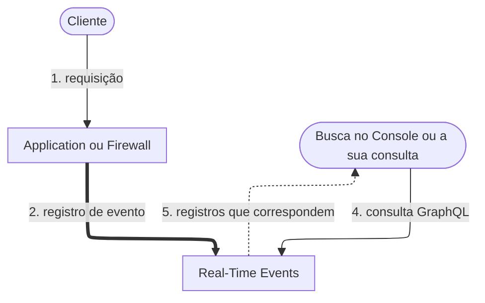

import DocButton from '~/components/webkit/DocButton.vue'
import DocCardGroup from '@aziontech/webkit/doc-card-group'
import DocCard from '@aziontech/webkit/doc-card'

**Real-Time Events** é um recurso da plataforma que serve seus registros de eventos da infraestrutura distribuída da Azion, no [Azion Console](https://console.azion.com/) e pela [API GraphQL](/pt-br/documentacao/devtools/graphql/). Um _registro de evento_, ou _log_, descreve uma requisição ou ação, como endereço de origem, caminho e status, para você consultar o que aconteceu depois. Use Real-Time Events para rastrear uma requisição lenta em uma [Application](/pt-br/documentacao/plataforma/applications/), inspecionar um ataque, depurar uma [Function](/pt-br/documentacao/plataforma/functions/) ou verificar quem alterou a sua conta.

Real-Time Events separa os registros que mantém por tipo de evento:

- [Fontes de dados](/pt-br/documentacao/plataforma/real-time-events/fontes-de-dados/) ajuda a achar o tipo de registro que responde à sua pergunta, como as requisições que suas Applications e Firewalls recebem. Cada fonte de dados também informa o dataset dela na API GraphQL.

<DocButton href="/pt-br/documentacao/plataforma/real-time-events/primeiros-passos/" label="Primeiros passos" size="medium" />
<DocButton href="/pt-br/documentacao/plataforma/real-time-events/referencia/" label="Referência de Real-Time Events" kind="outlined" size="medium" />

---

## Caminho da requisição

Real-Time Events não registra nada por conta própria: um registro só existe depois que um recurso da plataforma trata uma requisição ou uma ação.

O diagrama acompanha uma requisição até uma busca ler o registro dela. As setas contínuas levam uma requisição, a seta grossa leva o registro de evento e as setas pontilhadas levam a resposta. Cada rótulo começa com o número da etapa correspondente na lista.

1. Um cliente envia uma requisição, e o recurso da plataforma que a trata, como uma Application ou um Firewall, a serve.
2. Esse recurso da plataforma escreve um registro de evento para a requisição, com um valor para cada campo da fonte de dados dele. Uma requisição que também executa uma Function deixa um registro na fonte de dados de Functions também, e outros eventos, como uma consulta DNS ou uma alteração na sua conta, vão para fontes de dados próprias.
3. Real-Time Events mantém o registro até o fim do período de retenção dele e depois o remove, mesmo que nenhuma busca o tenha lido. O registro fica disponível para busca alguns segundos depois da requisição, então uma busca feita na mesma hora pode não encontrá-lo.
4. Uma busca no Azion Console e uma consulta que você escreve enviam, cada uma, uma consulta GraphQL para a mesma API. A consulta informa uma fonte de dados, um período e os filtros que a restringem.
5. A API responde com os registros que correspondem, e cada registro traz somente os campos que a consulta seleciona.

---

## Próximos passos

<DocCardGroup cols={2}>
  <DocCard title="Primeiros passos" href="/pt-br/documentacao/plataforma/real-time-events/primeiros-passos/" label="Consulte as requisições dos últimos minutos e leia um registro no Console ou com uma consulta." />
  <DocCard title="Como funciona" href="/pt-br/documentacao/plataforma/real-time-events/como-funciona/" label="Acompanhe um registro desde a requisição que o escreve até a consulta que o lê." />
  <DocCard title="Guias e tutoriais" href="/pt-br/documentacao/plataforma/real-time-events/guias/" label="Filtre uma busca, investigue uma requisição com a API GraphQL ou exporte os registros para CSV." />
  <DocCard title="Boas práticas" href="/pt-br/documentacao/plataforma/real-time-events/boas-praticas/" label="Filtre antes de ampliar um período, escolha a fonte de dados e envie os registros para fora antes do fim da retenção." />
  <DocCard title="Limites" href="/pt-br/documentacao/plataforma/real-time-events/limites/" label="Consulte o que Real-Time Events cobre, por quanto tempo mantém os registros e os limites dele." />
  <DocCard title="Solução de problemas" href="/pt-br/documentacao/plataforma/real-time-events/solucao-de-problemas/" label="Descubra por que uma busca não retorna nenhum registro ou por que uma consulta é recusada." />
  <DocCard title="Glossário" href="/pt-br/documentacao/plataforma/real-time-events/glossario/" label="Consulte uma palavra que as páginas de Real-Time Events usam com um sentido específico." />
</DocCardGroup>
