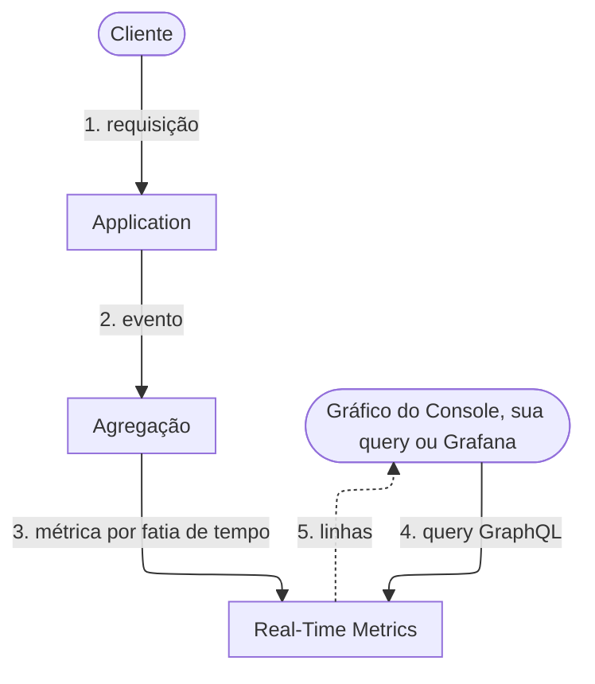

import DocButton from '~/components/webkit/DocButton.vue'
import DocCardGroup from '@aziontech/webkit/doc-card-group'
import DocCard from '@aziontech/webkit/doc-card'

**Real-Time Metrics** é um recurso da plataforma que mostra o tráfego dos seus recursos como métricas agregadas, no [Azion Console](https://console.azion.com/) e pela [API GraphQL](/pt-br/documentacao/devtools/graphql/). Uma métrica conta ou soma muitas requisições em uma fatia de tempo, então um gráfico de métricas mostra a tendência, não cada requisição. Use Real-Time Metrics para medir requisições e dados transferidos, ver a banda que o cache economiza, acompanhar status codes e ameaças ou comparar dois períodos.

Real-Time Metrics reúne os gráficos e os controles dele nestas páginas:

- [Dashboards de Build](/pt-br/documentacao/plataforma/real-time-metrics/dashboards-build/) mostram as requisições, os dados, a economia de cache, os status codes e os tempos de requisição das suas Applications, com as invocações de Functions, Tiered Cache e Image Processor. Cada gráfico informa o campo que retorna o valor dele pela API.
- [Dashboards de Secure](/pt-br/documentacao/plataforma/real-time-metrics/dashboards-secure/) contam as ameaças que o WAF identifica, as consultas que o Edge DNS responde e as requisições que o Bot Manager classifica. Eles também mostram quais endereços IP enviam as ameaças.
- [Dashboards de Observe](/pt-br/documentacao/plataforma/real-time-metrics/dashboards-observe/) mostram em gráficos os dados que o Data Stream envia aos seus endpoints e as requisições por trás desses dados.
- [Filtros e intervalo de tempo](/pt-br/documentacao/plataforma/real-time-metrics/filtros-e-intervalo-de-tempo/) define o período e os filtros que todos os gráficos de um dashboard seguem. O menu de um gráfico também copia a query que o gráfico envia ou exporta os pontos dele como um arquivo CSV.

<DocButton href="/pt-br/documentacao/plataforma/real-time-metrics/primeiros-passos/" label="Primeiros passos" size="medium" />
<DocButton href="/pt-br/documentacao/plataforma/real-time-metrics/referencia/" label="Referência de Real-Time Metrics" kind="outlined" size="medium" />

---

## Caminho da requisição

Real-Time Metrics não tem nada para ativar e não cria nenhuma entidade na sua conta: ele está ativo em todas as contas. Os recursos da plataforma que servem o seu tráfego registram cada requisição, e Real-Time Metrics serve os totais do que eles registraram, então um gráfico tem dados somente depois que o tráfego chega.

O diagrama acompanha uma requisição até ela fazer parte de um ponto em um gráfico. As setas contínuas levam uma requisição ou um registro, e as setas pontilhadas levam a resposta. Cada rótulo começa com o número da etapa correspondente na lista.

1. Um cliente envia uma requisição, e o recurso da plataforma que a trata, como uma Application ou o WAF, registra a requisição como um evento.
2. A Azion soma os eventos de cada fatia de tempo em métricas, como uma contagem de requisições ou uma soma de bytes. Isso leva minutos, então os pontos mais recentes de um gráfico ainda podem subir.
3. Real-Time Metrics mantém as métricas em datasets, um dataset para cada tipo de tráfego.
4. Um gráfico do Console, uma query que você escreve e um dashboard do Grafana enviam, cada um, uma query GraphQL para a mesma API. Para consultar a API pelo Grafana, consulte [Instale o plugin da Azion para Grafana](/pt-br/documentacao/guias/plataforma/observabilidade/integrar-grafana/).
5. A API responde com as linhas do dataset, e um gráfico plota um ponto por linha. Como os três leem as mesmas linhas, um gráfico e a sua própria query retornam os mesmos números para o mesmo intervalo e os mesmos filtros.

---

## Próximos passos

<DocCardGroup cols={2}>
  <DocCard title="Primeiros passos" href="/pt-br/documentacao/plataforma/real-time-metrics/primeiros-passos/" label="Leia as requisições e os dados transferidos das suas Applications no Console ou com uma query." />
  <DocCard title="Como funciona" href="/pt-br/documentacao/plataforma/real-time-metrics/como-funciona/" label="Acompanhe uma requisição até ela virar um ponto em um gráfico e veja o que define o tamanho de cada ponto." />
  <DocCard title="Guias e tutoriais" href="/pt-br/documentacao/plataforma/real-time-metrics/guias/" label="Faça uma tarefa específica, de uma divisão por status code a um dashboard do Grafana." />
  <DocCard title="Boas práticas" href="/pt-br/documentacao/plataforma/real-time-metrics/boas-praticas/" label="Escolha o intervalo, o escopo e a fonte em que confiar para cada número." />
  <DocCard title="Limites" href="/pt-br/documentacao/plataforma/real-time-metrics/limites/" label="Consulte o que Real-Time Metrics cobre, por quanto tempo mantém os dados e os limites dele." />
  <DocCard title="Solução de problemas" href="/pt-br/documentacao/plataforma/real-time-metrics/solucao-de-problemas/" label="Descubra por que um gráfico está vazio, um último ponto cai ou os totais diferem dos de Billing." />
  <DocCard title="Glossário" href="/pt-br/documentacao/plataforma/real-time-metrics/glossario/" label="Consulte uma palavra que as páginas de Real-Time Metrics usam com um sentido específico." />
</DocCardGroup>
