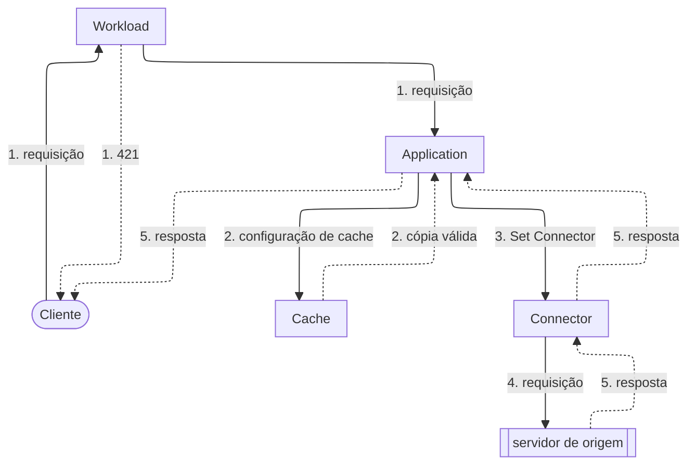

import DocButton from '~/components/webkit/DocButton.vue'
import DocCardGroup from '@aziontech/webkit/doc-card-group'
import DocCard from '@aziontech/webkit/doc-card'
import VersionRollingOut from '~/includes/snippets/versionRollingOut/pt/snippet.mdx'

<VersionRollingOut>[Origins](/pt-br/documentacao/plataforma/connectors/origins/)</VersionRollingOut>

**Connectors** é um recurso da plataforma que encaminha requisições das suas [Applications](/pt-br/documentacao/plataforma/applications/) às origens que guardam o seu conteúdo, na infraestrutura distribuída da Azion. Um Connector é o upstream de um proxy reverso: onde o seu conteúdo está e como cada requisição chega até ele. Ele também pode balancear requisições com [Load Balancer](/pt-br/documentacao/plataforma/connectors/load-balancer/), restringir a sua origem à Azion com [Origin Shield](/pt-br/documentacao/plataforma/connectors/origin-shield/) e receber transmissões ao vivo com [Live Ingest](/pt-br/documentacao/plataforma/connectors/live-ingest/). Use Connectors para alcançar servidores cloud ou on-premise, servir um bucket do [Object Storage](/pt-br/documentacao/plataforma/object-storage/) ou enviar o hostname e o caminho que a origem espera.

Cada Connector pode usar estes recursos aninhados:

- [Load Balancer](/pt-br/documentacao/plataforma/connectors/load-balancer/) é indicado quando o seu conteúdo precisa continuar disponível enquanto um servidor de origem falha, ou quando nenhum servidor deve receber todas as requisições. Ele atua em um Connector do tipo `http`.
- [Origin Shield](/pt-br/documentacao/plataforma/connectors/origin-shield/) serve para uma origem que deve responder somente às requisições que passam pela Azion, como um servidor atrás do seu próprio firewall ou um bucket privado compatível com S3. Ele também atua em um Connector do tipo `http`.
- [Live Ingest](/pt-br/documentacao/plataforma/connectors/live-ingest/) permite que uma Application entregue um evento ao vivo, como uma partida de e-sports ou uma aula, aos espectadores enquanto ele acontece. Ele funciona por meio de um Connector do tipo `live_ingest`, que define a região que recebe a sua transmissão.

<DocButton href="/pt-br/documentacao/plataforma/connectors/primeiros-passos/" label="Primeiros passos" size="medium" />
<DocButton href="/pt-br/documentacao/plataforma/connectors/referencia/" label="Referência de Connectors" kind="secondary" size="medium" />

---

## Caminho da requisição

Criar um Connector não envia tráfego a ele: ele recebe requisições somente da regra de uma Application que o define com o behavior _Set Connector_. A regra define o Connector pelo ID, então várias Applications podem compartilhar um Connector, e cada mudança nele chega a todas as regras que o definem.

O diagrama acompanha uma requisição que chega à sua origem. As setas contínuas levam a requisição, e as setas pontilhadas levam a resposta. Cada rótulo começa com o número da etapa correspondente abaixo.

1. Um cliente requisita um domínio de um [Workload](/pt-br/documentacao/plataforma/workloads/), e a Application que o deployment desse Workload define recebe a requisição. Em HTTPS, o [SNI Check](/pt-br/documentacao/plataforma/connectors/sni-check/) pode responder `421 Misdirected Request` antes que qualquer Application seja executada.
2. As regras da Request Phase da Application são executadas em ordem. Quando uma regra aplica uma configuração de cache e o Cache guarda uma cópia válida da resposta da origem, essa cópia responde ao cliente.
3. Caso contrário, a requisição vai para o Connector que uma regra com _Set Connector_ define. Quando várias regras correspondentes carregam o behavior, somente a última é executada: uma regra posterior pode enviar `/images/` a um Connector do tipo `storage`.
4. O Connector abre uma conexão com o endereço dele e envia a requisição com o header `Host`, o prefixo de caminho e o protocolo configurados nele.
5. A origem responde ao Connector, a Application executa as regras da Response Phase na resposta, e a resposta chega ao cliente.

---

## Próximos passos

<DocCardGroup cols={2}>
  <DocCard title="Primeiros passos" href="/pt-br/documentacao/plataforma/connectors/primeiros-passos/" label="Crie um Connector, envie um caminho a ele com uma regra e confira a resposta." />
  <DocCard title="Como funciona" href="/pt-br/documentacao/plataforma/connectors/como-funciona/" label="Acompanhe uma requisição da regra, pelo Connector, até a sua origem, com os timeouts." />
  <DocCard title="Configurações de Connector" href="/pt-br/documentacao/plataforma/connectors/configuracoes/" label="Consulte um campo, o padrão dele, os valores que ele aceita ou um código de erro." />
  <DocCard title="Guias e tutoriais" href="/pt-br/documentacao/plataforma/connectors/guias/" label="Execute uma tarefa específica, de uma origem em bucket ao header Host." />
  <DocCard title="Boas práticas" href="/pt-br/documentacao/plataforma/connectors/boas-praticas/" label="Planeje uma mudança considerando a propagação ou configure uma origem da forma recomendada." />
  <DocCard title="Limites" href="/pt-br/documentacao/plataforma/connectors/limites/" label="Consulte onde um Connector para, um limite e o que acontece quando ele é ultrapassado." />
  <DocCard title="Solução de problemas" href="/pt-br/documentacao/plataforma/connectors/solucao-de-problemas/" label="Descubra por que uma requisição falha entre a regra e a sua origem." />
  <DocCard title="Glossário" href="/pt-br/documentacao/plataforma/connectors/glossario/" label="Consulte uma palavra que as páginas de Connectors usam com um significado específico." />
</DocCardGroup>
