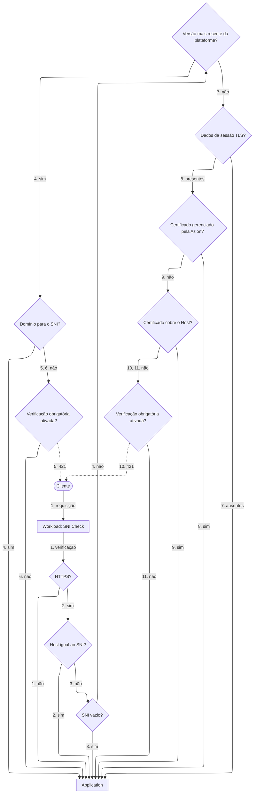

import FrameBox from '@aziontech/webkit/frame-box'
import ItemList from '@aziontech/webkit/item-list'
import DocItem from '@aziontech/webkit/doc-item'

Um cliente HTTPS informa duas vezes o host que deseja. No handshake TLS, ele envia o hostname como Server Name Indication (SNI), antes que o servidor envie o certificado dele. O servidor usa esse nome para escolher um certificado, então um endereço IP pode servir muitos hostnames, cada um com o próprio certificado.

Cada requisição na conexão informa um host de novo, no header `Host` dela. Quando o certificado não cobre esse host, a requisição é misdirected: ela seria servida sob um certificado que nunca foi emitido para o host dela. Um servidor pode recusar essa requisição com `421 Misdirected Request`.

**SNI Check** é uma feature da Azion Platform que toma essa decisão para cada requisição HTTPS a um [Workload](/pt-br/documentacao/plataforma/workloads/). Ele atua antes que qualquer [Application](/pt-br/documentacao/plataforma/applications/) ou Connector seja executado, então uma requisição recusada nunca chega à sua origem. Para saber onde ele atua sobre uma requisição, consulte o [caminho da requisição de Connectors](/pt-br/documentacao/plataforma/connectors/#caminho-da-requisicao).

As seções tratam da ordem das verificações, de como um certificado cobre um host e da verificação obrigatória.

---

## Ordem das verificações

SNI Check executa as verificações dele em uma ordem fixa, e a primeira verificação que resolve a requisição decide o resultado. A maioria dos resultados deixa a requisição seguir para a Application que o deployment do Workload define, e dois terminam em um `421`.

As setas contínuas levam a requisição, e as setas pontilhadas levam a resposta. Cada rótulo começa com o número da etapa correspondente na lista depois do diagrama.

1. O cliente envia uma requisição a um domínio do Workload. Uma requisição HTTP simples não passa pelo SNI Check e segue para a Application.
2. Em HTTPS, SNI Check compara o header `Host` com o valor do SNI, `ssl_server_name`, sem distinguir maiúsculas de minúsculas. Quando os dois correspondem, a requisição segue.
3. Quando o cliente não enviou um valor de SNI, e `ssl_server_name` está vazio, a requisição segue.
4. Quando o Workload está na versão mais recente da plataforma e tem um domínio para o valor do SNI, a requisição segue.
5. Quando o Workload está na versão mais recente da plataforma, nenhum domínio corresponde e a verificação obrigatória está ativada, a Azion responde `421 Misdirected Request`.
6. Com a verificação obrigatória desativada, essa requisição segue.
7. Caso contrário, quando os dados da sessão TLS estão indisponíveis, a requisição segue.
8. Quando o certificado é um certificado gerenciado pela Azion, a requisição segue.
9. Quando `X509_check_host` confirma que o certificado cobre o header `Host`, a requisição segue.
10. Quando nenhuma dessas verificações deixa a requisição passar e a verificação obrigatória está ativada, a Azion responde `421 Misdirected Request`.
11. Com a verificação obrigatória desativada, a requisição segue.

---

## Cobertura de um host por um certificado

Um Workload serve HTTPS com um certificado do [Certificate Manager](/pt-br/documentacao/plataforma/certificate-manager/certificados/). Um certificado cobre os hostnames do Common Name (CN) e dos Subject Alternative Names (SANs) dele.

`X509_check_host`, uma função do [OpenSSL](https://www.openssl.org/docs/man3.0/man3/X509_check_host.html), toma a decisão da etapa 9. Ela verifica se o header `Host` está dentro do CN ou dos SANs do certificado. Por exemplo, um certificado para `example.com` não cobre uma requisição para `api.other-domain.com`, então essa requisição recebe `421 Misdirected Request` quando a verificação obrigatória está ativada.

Duas verificações deixam uma requisição passar antes que a etapa 9 teste o certificado dela. Um certificado gerenciado pela Azion passa na etapa 8. Uma requisição sem dados da sessão TLS passa na etapa 7, porque SNI Check falha de forma aberta: uma condição transitória da infraestrutura nunca bloqueia tráfego legítimo. O custo é que essa requisição não é verificada.

---

## Verificação obrigatória

A verificação obrigatória do SNI Check decide se uma verificação que falha recusa a requisição. Com ela desativada, as etapas 6 e 11 deixam a requisição seguir, então SNI Check não recusa nada. A verificação obrigatória não tem configuração no Azion Console nem na API. Para ativá-la ou desativá-la nos seus Workloads, entre em contato com o [Suporte da Azion](/pt-br/documentacao/suporte/).

A verificação obrigatória protege contra SNI spoofing, um ataque que altera o valor do SNI para que uma conexão TLS seja executada sob um certificado que não cobre o host de destino. Com a verificação obrigatória ativada, uma requisição que falha nas verificações é recusada em vez de ser servida sob um certificado que não cobre o host dela.

A mesma verificação também recusa clientes legítimos que reutilizam uma conexão para vários hostnames, por connection pooling ou multiplexação do HTTP/2. Para encontrar essas requisições e corrigir o certificado ou o cliente, consulte [Uma requisição recebe 421 Misdirected Request](/pt-br/documentacao/plataforma/connectors/solucao-de-problemas/#uma-requisicao-recebe-421-misdirected-request).

---

## Recursos relacionados

<FrameBox>
<ItemList>
  <DocItem title="Certificados" href="/pt-br/documentacao/plataforma/certificate-manager/certificados/">Os certificados que um Workload usa e os nomes de cada um que a etapa 9 testa.</DocItem>
  <DocItem title="Solucione problemas de Connectors" href="/pt-br/documentacao/plataforma/connectors/solucao-de-problemas/">As correções para uma resposta 421 e para os outros erros entre uma regra e a sua origem.</DocItem>
  <DocItem title="Real-Time Events" href="/pt-br/documentacao/plataforma/real-time-events/">Os logs que mostram o host e o valor do SNI de cada requisição.</DocItem>
  <DocItem title="Connectors" href="/pt-br/documentacao/plataforma/connectors/">Para onde uma requisição vai depois que o SNI Check a deixa passar, da regra até a sua origem.</DocItem>
</ItemList>
</FrameBox>
