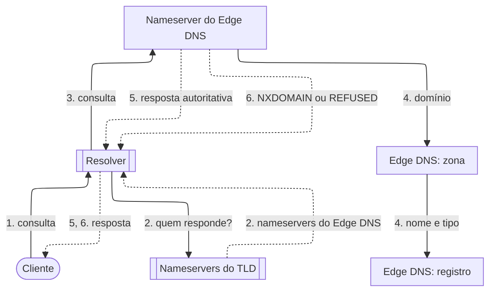

import DocButton from '~/components/webkit/DocButton.vue'
import DocCardGroup from '@aziontech/webkit/doc-card-group'
import DocCard from '@aziontech/webkit/doc-card'

**Edge DNS** é um recurso da plataforma que hospeda os registros DNS dos seus domínios e responde às consultas, na infraestrutura distribuída da Azion. Um serviço de [authoritative DNS](https://www.azion.com/pt-br/learning/dns/o-que-e-dns-autoritativo/) guarda os registros de um domínio, como o endereço do site, e dá a resposta final a cada consulta. Use Edge DNS para apontar domínios para seus servidores ou um [Workload](/pt-br/documentacao/plataforma/workloads/), criar registros para seus serviços de e-mail ou comprovar a posse de domínios.

Edge DNS trabalha com estas entidades e configurações:

- [Zonas e registros](/pt-br/documentacao/plataforma/edge-dns/zonas-e-registros/) guardam o que Edge DNS responde: uma zona para cada domínio que você hospeda, com os registros dos nomes desse domínio. Um domínio pode estar em apenas uma zona entre todas as contas da Azion.
- [Tipos de registro](/pt-br/documentacao/plataforma/edge-dns/tipos-de-registro/) definem o que um registro responde, como um endereço, outro hostname, um servidor de e-mail ou um valor de texto. Por exemplo, um registro ANAME aponta o apex, o próprio domínio da zona, para um Workload, onde um registro CNAME é recusado.
- [DNSSEC](/pt-br/documentacao/plataforma/edge-dns/dnssec/) permite que uma zona assine as respostas, para que um resolver que valida assinaturas perceba uma resposta alterada no caminho. Os resolvers validam as assinaturas depois que o seu registrador publica o registro delegation signer (DS) que a Azion gera para a zona.

<DocButton href="/pt-br/documentacao/plataforma/edge-dns/primeiros-passos/" label="Primeiros passos" size="medium" />
<DocButton href="/pt-br/documentacao/plataforma/edge-dns/referencia/" label="Referência de Edge DNS" kind="outlined" size="medium" />

---

## Caminho da consulta

Criar uma zona não envia consultas a ela: elas chegam só depois que o registrador delega o domínio ao Edge DNS. Antes disso, você pode montar a zona e conferir as respostas dela consultando diretamente um nameserver do Edge DNS. O guia [Consulte uma zona com o dig](/pt-br/documentacao/guias/seguranca-de-aplicacoes/dns/executar-o-comando-dig/) mostra como.

O diagrama segue uma consulta por `www.example.com`. As setas contínuas levam a consulta, e as setas pontilhadas levam a resposta. Cada rótulo começa com o número do passo correspondente.

1. Um cliente pergunta ao próprio resolver, não ao Edge DNS, por `www.example.com`.
2. O resolver pergunta aos nameservers do domínio de topo (TLD), aqui `.com`, quais nameservers respondem por `example.com`. Eles retornam os três nameservers que o registrador definiu: `ns1.aziondns.net`, `ns2.aziondns.com` e `ns3.aziondns.org`.
3. O resolver envia a consulta a um dos três nameservers do Edge DNS.
4. O nameserver seleciona a zona cujo domínio corresponde à consulta e, depois, o registro cujo nome e tipo correspondem a ela.
5. O nameserver retorna os valores do registro como uma resposta autoritativa. O resolver guarda essa resposta pelo time to live (TTL) dela e a repassa ao cliente.
6. Quando nenhum registro corresponde ao nome, o nameserver responde `NXDOMAIN`. Quando a zona está inativa, ou nenhuma zona contém o domínio, ele responde `REFUSED`.

---

## Próximos passos

<DocCardGroup cols={2}>
  <DocCard title="Primeiros passos" href="/pt-br/documentacao/plataforma/edge-dns/primeiros-passos/" label="Crie uma zona e o primeiro registro dela no Azion Console, na Azion CLI ou na API." />
  <DocCard title="Como funciona" href="/pt-br/documentacao/plataforma/edge-dns/como-funciona/" label="Veja por que uma alteração leva minutos para responder e como funcionam os registros com política weighted, o ANAME e o DNSSEC." />
  <DocCard title="Guias e tutoriais" href="/pt-br/documentacao/plataforma/edge-dns/guias/" label="Conclua uma tarefa, como adicionar registros MX, TXT ou CAA." />
  <DocCard title="Migre nameservers para a Azion" href="/pt-br/documentacao/guias/plataforma/migracao/migrar-ns-para-a-azion/" label="Mova o DNS de um domínio de outro provedor para o Edge DNS." />
  <DocCard title="Boas práticas" href="/pt-br/documentacao/plataforma/edge-dns/boas-praticas/" label="Planeje TTLs e alterações para que registros novos e alterados respondam quando você espera." />
  <DocCard title="Limites" href="/pt-br/documentacao/plataforma/edge-dns/limites/" label="Consulte até onde vai o Edge DNS, cada limite e o que acontece além dele." />
  <DocCard title="Solução de problemas" href="/pt-br/documentacao/plataforma/edge-dns/solucao-de-problemas/" label="Descubra por que um nome não responde ou ainda responde um valor antigo." />
  <DocCard title="Glossário" href="/pt-br/documentacao/plataforma/edge-dns/glossario/" label="Consulte uma palavra que a documentação de Edge DNS usa com um sentido específico." />
</DocCardGroup>
