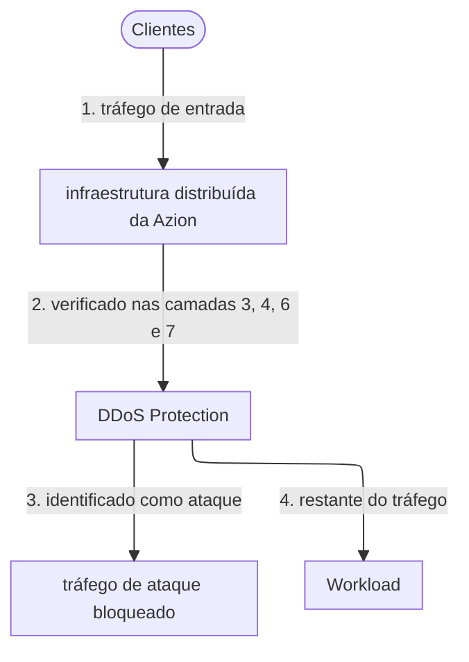

import FrameBox from '@aziontech/webkit/frame-box'
import ItemList from '@aziontech/webkit/item-list'
import DocItem from '@aziontech/webkit/doc-item'

Um ataque de negação de serviço (DoS) inunda um serviço com tráfego até que as requisições legítimas não consigam passar. Um ataque distribuído de negação de serviço (DDoS) envia esse tráfego de muitas máquinas ao mesmo tempo. O tráfego de ataque raramente parece diferente do tráfego real quando visto um pacote por vez. O que o denuncia é o padrão: um fluxo que cresce muito além da sua forma normal, pacotes que violam um protocolo ou conexões abertas e nunca concluídas. Por isso, uma defesa observa cada fluxo continuamente, reconhece esses padrões e descarta o tráfego correspondente antes que o serviço precise tratá-lo.

Na Azion, essa defesa é [DDoS Protection](/pt-br/documentacao/plataforma/workloads/#ddos-protection). DDoS Protection é uma feature da Azion Platform que mitiga ataques de negação de serviço em todo Workload. Ela está sempre ativa e não precisa de ativação nem de configuração. Para saber onde ela age sobre uma requisição, antes do Firewall que o deployment de um Workload pode definir, consulte [Como Workloads funciona](/pt-br/documentacao/plataforma/workloads/como-funciona/#ddos-protection). As seções abaixo cobrem a detecção, a mitigação, os tipos de ataque e as técnicas envolvidas, o Security Response Team e onde os registros de ataques aparecem.

---

## Detecção

DDoS Protection detecta um ataque inspecionando continuamente o fluxo de rede do tráfego de entrada, haja ou não um ataque em andamento. A detecção é executada na infraestrutura distribuída da Azion, então ela vê o tráfego de um Workload antes que esse tráfego alcance o Workload.

Duas famílias de algoritmos fazem a inspeção. Os algoritmos de análise de tráfego e de assinaturas reconhecem o tráfego de ataques conhecidos e o bloqueiam. Os algoritmos de Deep Packet Inspection (DPI) e de inteligência artificial (IA) procuram, em vez disso, um comportamento anormal do tráfego. Essa abordagem reduz os falsos positivos: um tráfego incomum, mas legítimo, tem menos chance de ser bloqueado.

A detecção também acompanha cada camada de aplicação dos recursos que a Azion entrega por meio do [Firewall](/pt-br/documentacao/plataforma/firewall/) e do [WAF](/pt-br/documentacao/plataforma/firewall/waf/). Os algoritmos são construídos para a mitigação automatizada, então um ataque detectado é mitigado sem que ninguém precise agir sobre um alerta. DDoS Protection detecta e mitiga ataques em menos de 3 segundos, em média. Esse número é uma média entre ataques, não um teto para cada um deles.

---

## Mitigação

DDoS Protection mitiga ataques em quatro camadas do modelo Open Systems Interconnection (OSI): a camada de rede (3), a camada de transporte (4), a camada de apresentação (6) e a camada de aplicação (7).

Este diagrama acompanha o tráfego de entrada pela mitigação. Cada rótulo começa com o número do passo a que pertence.

1. O tráfego de um Workload chega à infraestrutura distribuída da Azion.
2. DDoS Protection verifica o tráfego nas camadas de rede, de transporte, de apresentação e de aplicação.
3. O tráfego identificado como ataque é bloqueado. A Azion realiza a mitigação.
4. O restante continua até o Workload.

DDoS Protection mitiga o tráfego de ataque no data center da infraestrutura distribuída da Azion que o tráfego alcança, antes que ele chegue ao Workload. A Azion participa da iniciativa Mutually Agreed Norms for Routing Security (MANRS) da Internet Society. Ela aplica filtros AS-path (autonomous system path) rigorosos e verifica tanto os anúncios de rede de clientes quanto os internos, o que impede o IP spoofing.

A mesma proteção alcança mais do que HTTP. DDoS Protection também protege o seu serviço de Domain Name System (DNS). Para saber como a Azion serve DNS, consulte [Edge DNS](/pt-br/documentacao/plataforma/edge-dns/).

Como a mitigação não precisa de configuração, um Workload está protegido desde o momento em que existe, e você não tem nada para ajustar. O custo é que a defesa automática é a mesma para todo Workload. Para uma detecção e uma mitigação direcionadas a um ataque específico, você escreve regras personalizadas no [Firewall](/pt-br/documentacao/plataforma/firewall/) que o deployment do Workload define. Para ataques de camada 7, [WAF](/pt-br/documentacao/plataforma/firewall/waf/) nesse Firewall reforça ainda mais a proteção.

---

## Tipos de ataque

Os ataques DDoS se dividem em duas classes:

- **Ataques baseados em volume**, também chamados de ataques de inundação (flood attacks), criam grandes quantidades de tráfego para sobrecarregar um sistema. Eles usam amplificação ou requisições de malwares e worms, e uma botnet pode coordená-los.
- **Ataques de protocolo**, também chamados de ataques de exaustão de estado, exploram vulnerabilidades em recursos de rede. Eles sobrecarregam o processamento de serviços e infraestruturas críticos, como segurança e balanceamento de carga.

Os ataques que a Azion mitiga incluem os seguintes. A lista não é exaustiva:

- Bogons, IP bogons, ICMP flood, IGMP flood, malformed ICMP flood (também chamado de ping of death), IP fragmentation, Nuke, Smurf, Spoofing, Teardrop
- TCP SYN flood, TCP SYN-ACK flood, TCP ACK flood, TCP ACK-PSH flood, TCP FIN flood, TCP RESET flood, TCP out-of-state flood, TCP fragmentation, TCP invalid, UDP flood, connection flood attacks, CLDAP amplification, NTP amplification, SSDP amplification
- HTTP floods, incluindo requisições de URL HTTP `POST` e `GET` bem formadas; HTTP slow reads; Slowloris; low and slow attacks; DNS flood, incluindo consultas DNS bem formadas; brute force attacks; OWASP Top 10
- Botnet attacks; mixed floods, como TCP mais UDP e ICMP mais UDP; reflected ICMP e UDP; zero-day attacks

As técnicas de detecção e mitigação que a Azion emprega incluem as seguintes, agrupadas pelo alvo sobre o qual agem:

| Grupo | Técnicas |
| --- | --- |
| Listas e reputação | Allowlists, blocklists e greylists; bloqueio, redirecionamento ou descarte de requisições por reputação e por network lists; listas de botnets, provedores de nuvem, malware e proxies; reputação dinâmica de IP, fingerprints e endereço IP mais user agent |
| Atributos da requisição | Bloqueio, redirecionamento ou descarte de requisições por cabeçalhos HTTP e geolocalização; redirecionamento HTTP; manipulação de cookies (cookie tampering); tokens de segurança, como JWT; session timeout |
| Identificação e pontuação | Fingerprinting; bloqueio baseado em assinatura e em fingerprint; análise de padrões e detecção de anomalias; bloqueio baseado em pontuação |
| Bots e força bruta | Técnicas de mitigação e gerenciamento de bots; técnicas de desafio-resposta; CAPTCHA e reCAPTCHA para identificar usuários humanos; técnicas que impedem ataques de força bruta |
| Taxa de requisições | Rate limiting simples, que é local, e rate limiting avançado, que é global e contextual |
| Pacotes e origem | Descarte de pacotes malformados; restrição do acesso à origem apenas a endereços IP da Azion |
| Resposta a incidentes | Regras de prontidão (standby rules), usadas em resposta a incidentes à medida que ocorrem |

---

## Security Response Team

A Azion prioriza o desenvolvimento de algoritmos que detectam e bloqueiam ataques automaticamente. Uma vez identificada uma ameaça, o Azion [Security Response Team (SRT)](/pt-br/documentacao/servicos/security-response-team/) a acompanha do início ao fim. O SRT pode aplicar regras personalizadas em um Firewall para mitigar ataques sofisticados nas camadas de rede, transporte, apresentação e aplicação.

Você pode acionar o SRT durante um ataque, depois dele ou antes dele, para criar regras personalizadas com antecedência. Durante ou depois de um ataque, o SRT ajuda a acompanhar o incidente, encontrar a causa raiz e implementar soluções com a sua equipe. Em seguida, ele dá acesso a análises e investigações pós-evento.

O SRT é um contrato à parte: um pacote mensal de horas. Para acioná-lo, entre em contato com a [equipe de vendas da Azion](https://www.azion.com/pt-br/contato/). Para saber como a mitigação de DDoS Protection é cobrada, consulte [Preços](/pt-br/documentacao/fundamentos/precos/#ddos-protection).

---

## Visibilidade de ataques

DDoS Protection mitiga ataques sem nenhuma ação da sua parte, então os registros de um ataque são a forma de saber que ele aconteceu.

[Azion Console](https://console.azion.com/) e [Azion API](https://api.azion.com/) mostram o volume de ataques contra as suas aplicações. Para registros de ataques e monitoramento, use [Real-Time Events](/pt-br/documentacao/plataforma/real-time-events/) ou [Real-Time Metrics](/pt-br/documentacao/plataforma/real-time-metrics/). Para manter os registros nos seus próprios sistemas, os connectors de [Data Stream](/pt-br/documentacao/plataforma/data-stream/) enviam eventos a serviços de Security Information and Event Management (SIEM) e de big data.

---

## Recursos relacionados

<FrameBox>
<ItemList>
  <DocItem title="Como Workloads funciona" href="/pt-br/documentacao/plataforma/workloads/como-funciona/#ddos-protection">Onde DDoS Protection age sobre uma requisição, antes do Firewall que o deployment de um Workload define.</DocItem>
  <DocItem title="Preços" href="/pt-br/documentacao/fundamentos/precos/#ddos-protection">Como a mitigação de DDoS Protection é cobrada, incluindo o que não é medido.</DocItem>
  <DocItem title="Firewall" href="/pt-br/documentacao/plataforma/firewall/">Escreva regras personalizadas para um ataque direcionado, com WAF, Network Shield e Bot Manager no mesmo Firewall.</DocItem>
  <DocItem title="Real-Time Events" href="/pt-br/documentacao/plataforma/real-time-events/">Revise os registros de ataques e outros eventos dos seus Workloads.</DocItem>
</ItemList>
</FrameBox>
