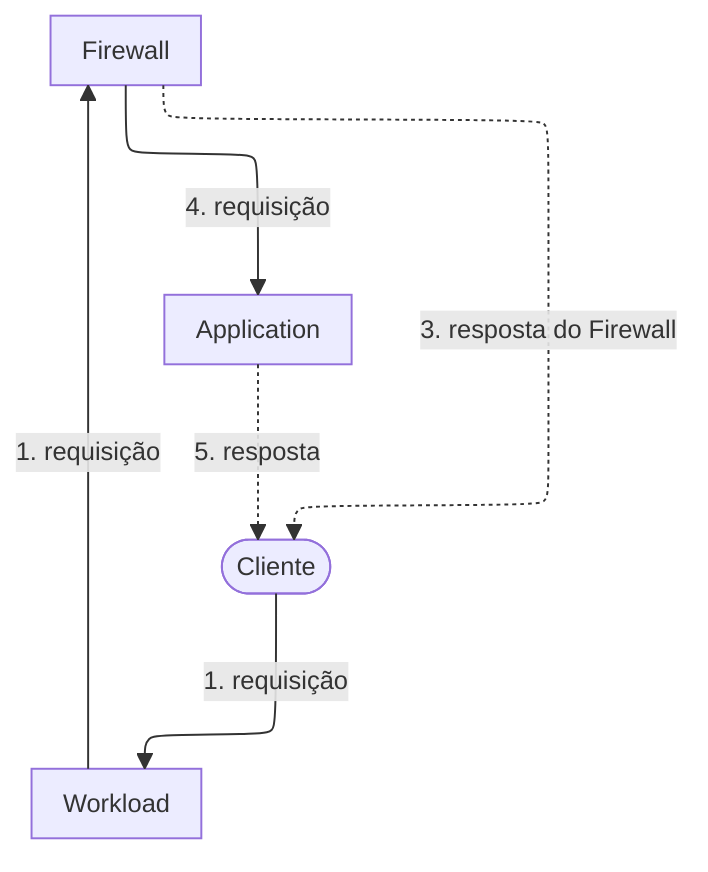

import DocButton from '~/components/webkit/DocButton.vue'
import DocCardGroup from '@aziontech/webkit/doc-card-group'
import DocCard from '@aziontech/webkit/doc-card'

**Firewall** é um recurso da plataforma que inspeciona as requisições aos seus [Workloads](/pt-br/documentacao/plataforma/workloads/) antes que a sua [Application](/pt-br/documentacao/plataforma/applications/) as receba, na infraestrutura distribuída da Azion. Um firewall web é um ponto de controle na frente de uma aplicação: ele compara cada requisição com regras e interrompe as que elas capturam. Um Firewall pode avaliar requisições pela origem com [Network Shield](/pt-br/documentacao/plataforma/firewall/network-shield/), detectar ataques com [Web Application Firewall (WAF)](/pt-br/documentacao/plataforma/firewall/waf/) e detectar automação com [Bot Manager](/pt-br/documentacao/plataforma/firewall/bot-manager/). Use Firewall para negar um caminho ou hostname, limitar a taxa de requisições por cliente, enviar uma resposta personalizada ou executar a sua própria [Function](/pt-br/documentacao/plataforma/functions/).

Firewall oferece estes recursos aninhados e features:

- [Network Shield](/pt-br/documentacao/plataforma/firewall/network-shield/) permite que uma regra decida pela origem de uma requisição: uma lista de endereços IP e faixas, Autonomous System Numbers (ASNs) ou países. Use-o para bloquear redes abusivas conhecidas, permitir apenas as suas próprias redes ou bloquear nós de saída do Tor.
- [WAF](/pt-br/documentacao/plataforma/firewall/waf/) é indicado quando a sua Application recebe dados que um atacante pode explorar, como um formulário ou o corpo de uma API. Uma regra o aplica aos caminhos que você escolhe, onde ele pode registrar ameaças antes de bloqueá-las.
- [Bot Manager](/pt-br/documentacao/plataforma/firewall/bot-manager/) é indicado quando automação, como credential stuffing ou scraping, chega a uma Application que também atende pessoas. Ele é executado como uma Function no Firewall, então uma regra decide quais requisições ele verifica.
- [Functions no Firewall](/pt-br/documentacao/plataforma/firewall/functions/) permite que uma regra execute o seu próprio JavaScript em uma requisição, para negá-la, descartá-la, respondê-la ou adicionar headers. Use quando a sua lógica de proteção precisa de mais do que os critérios e os comportamentos de uma regra.

<DocButton href="/pt-br/documentacao/plataforma/firewall/primeiros-passos/" label="Primeiros passos" size="medium" />
<DocButton href="/pt-br/documentacao/plataforma/firewall/referencia/" label="Referência de Firewall" kind="outlined" size="medium" />

---

## Caminho da requisição

Criar um Firewall não protege nada: um Firewall inspeciona apenas as requisições de um Workload cujo deployment o define. Um Firewall não tem domínio próprio, então vários Workloads podem compartilhar um, e cada mudança nas suas regras chega a todos eles.

O diagrama acompanha uma requisição pelo Firewall. As setas contínuas levam a requisição, e as setas pontilhadas levam a resposta. Cada rótulo começa com o número da etapa correspondente abaixo.

1. Um cliente requisita um domínio de um [Workload](/pt-br/documentacao/plataforma/workloads/), e o deployment do Workload define o Firewall e a Application que o atendem. O Firewall recebe a requisição primeiro.
2. O Firewall executa as suas regras em ordem. Cada regra compara os seus critérios com a requisição, e uma regra cujos critérios não correspondem não aplica nada.
3. Uma regra cujos critérios correspondem aplica os seus comportamentos. Um comportamento que interrompe a requisição, como _Deny (403 Forbidden)_, responde ao cliente ou fecha a conexão, e nenhuma regra seguinte é executada. _Set WAF_ e _Run Function_ entregam a requisição ao WAF ou a uma [Function Instance](/pt-br/documentacao/plataforma/firewall/functions-instances/), e qualquer um deles também pode interrompê-la.
4. Uma requisição que nenhuma regra interrompe chega à Application, que nunca recebe uma requisição que uma regra interrompeu.
5. A Application processa a requisição, e a resposta dela chega ao cliente.

---

## Próximos passos

<DocCardGroup cols={2}>
  <DocCard title="Primeiros passos" href="/pt-br/documentacao/plataforma/firewall/primeiros-passos/" label="Crie um Firewall, negue um caminho com uma regra e confira a resposta." />
  <DocCard title="Como funciona" href="/pt-br/documentacao/plataforma/firewall/como-funciona/" label="Acompanhe uma requisição pelas regras e veja quanto tempo uma mudança leva para valer." />
  <DocCard title="Rules Engine para Firewall" href="/pt-br/documentacao/plataforma/firewall/rules-engine/" label="Consulte um critério, um operador, um comportamento ou um código de erro." />
  <DocCard title="Guias e tutoriais" href="/pt-br/documentacao/plataforma/firewall/guias/" label="Faça uma tarefa específica, de um bloqueio por país a uma exceção do WAF." />
  <DocCard title="Boas práticas" href="/pt-br/documentacao/plataforma/firewall/boas-praticas/" label="Planeje a ordem das suas regras e decida quando Workloads compartilham um Firewall." />
  <DocCard title="Limites" href="/pt-br/documentacao/plataforma/firewall/limites/" label="Consulte onde um Firewall termina, um limite e o que acontece além dele." />
  <DocCard title="Solução de problemas" href="/pt-br/documentacao/plataforma/firewall/solucao-de-problemas/" label="Descubra por que uma regra não age ou recusa uma requisição que não deveria." />
  <DocCard title="Glossário" href="/pt-br/documentacao/plataforma/firewall/glossario/" label="Consulte uma palavra que as páginas de Firewall usam com um sentido específico." />
</DocCardGroup>
