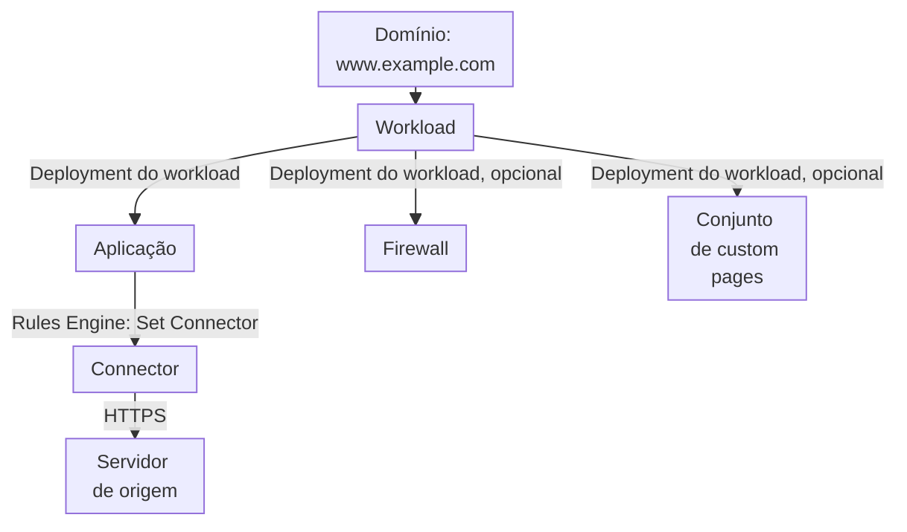
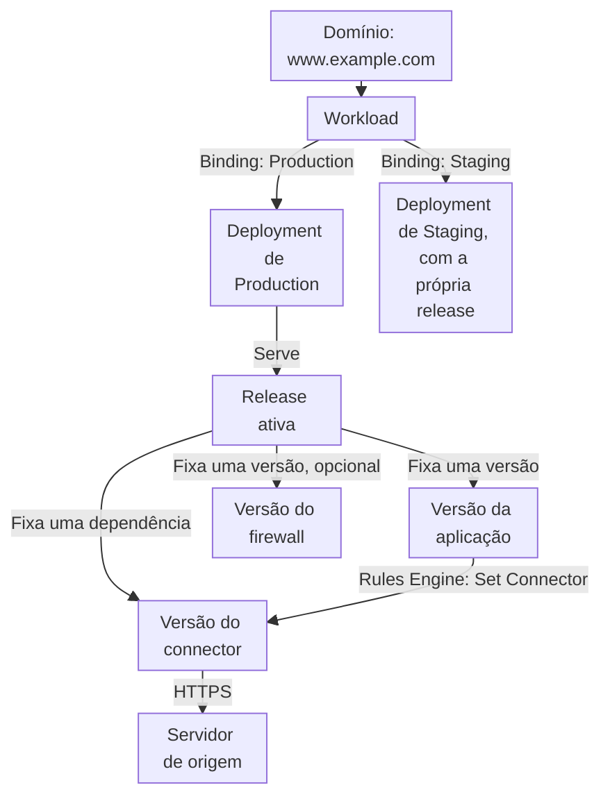
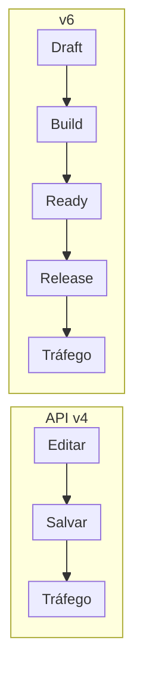
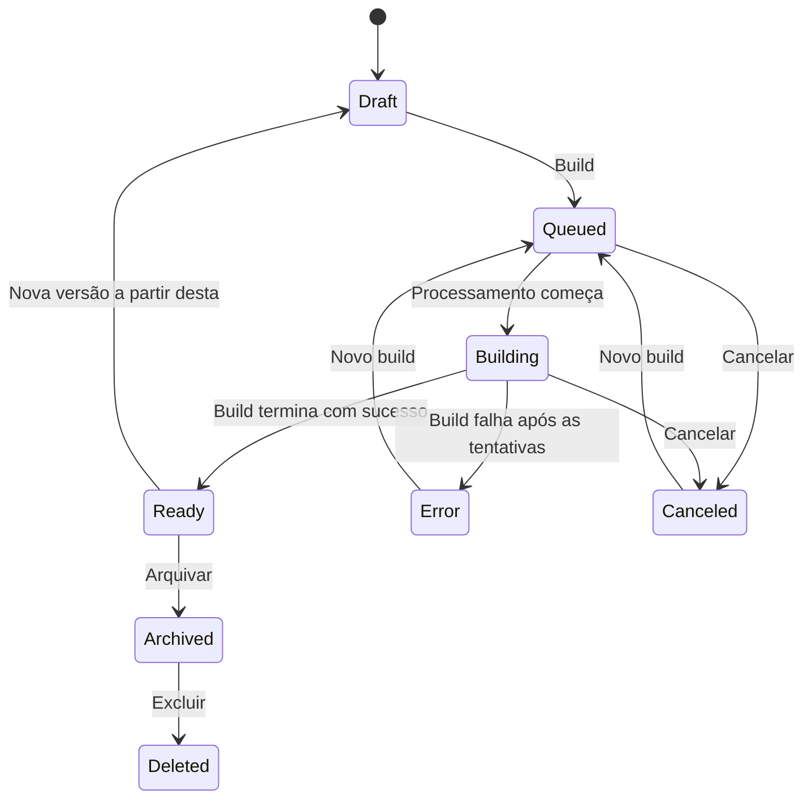
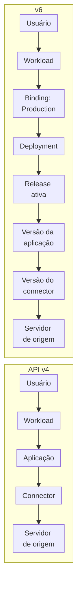

import DocSteps from '@aziontech/webkit/doc-steps'
import DocStep from '@aziontech/webkit/doc-step'
import FrameBox from '@aziontech/webkit/frame-box'
import ItemList from '@aziontech/webkit/item-list'
import DocItem from '@aziontech/webkit/doc-item'
import Tabs from '~/components/webkit/Tabs.vue'
import Tag from '~/components/webkit/Tag.vue'

<Tag severity="info">Preview</Tag>

Na API v4, uma alteração salva em uma aplicação, em um firewall ou em um connector chega ao tráfego assim que se propaga. Na v6, salvar cria uma versão do recurso, e o tráfego só muda quando uma release coloca essa versão em um deployment. A configuração e o momento em que ela entra no ar viram dois passos separados.

As seções abaixo cobrem as mudanças no modelo de configuração, como os recursos se ligam, como funciona um deploy, os estados de uma versão, um exemplo de proxy nos dois modelos e o que revisar antes da migração.

:::note
As mudanças desta página valem para uma conta só depois que a Azion a move para a v6. Até lá, a conta segue o modelo da API v4 que [Workloads](/pt-br/documentacao/plataforma/workloads/) descreve.
:::

---

## Visão geral da migração

A v6 mantém os recursos da API v4 e adiciona a eles um ciclo de vida de versões. Applications, Firewall, Custom Pages, Connectors, Functions, WAF e Network Lists mantêm os nomes e as configurações. O que muda é como uma alteração chega ao tráfego.

**Pontos principais da migração**:

- Salvar grava uma versão em **draft**. Um draft nunca atende tráfego.
- Um **build** valida o draft e o transforma em uma versão **ready**, que ninguém pode editar.
- Uma **release** fixa uma versão ready de cada recurso e a serve por meio de um **deployment**.
- Um **environment**, como Production ou Staging, dá a cada estágio o próprio deployment e as próprias versões.
- Um workload deixa de nomear uma aplicação. Ele liga cada environment a um deployment, e a release ativa desse deployment nomeia as versões.
- Uma release anterior pode voltar a atender o tráfego, então um rollback não depende de desfazer a configuração à mão.

---

## O que muda

| Tema | API v4 | v6 |
| --- | --- | --- |
| Unidade de mudança | A configuração do recurso, editada no lugar. | Uma versão do recurso, identificada por um hash e imutável depois do build. |
| O que salvar faz | Propaga a alteração para o tráfego. | Grava um draft. O tráfego não muda. |
| Como uma alteração chega ao tráfego | De forma implícita, com o save. | De forma explícita, com um build e uma release em um deployment. |
| Estágios | Um workload roda na Production Network ou na Staging Network, escolhida na criação. As duas leem a mesma configuração da aplicação. | Environments, como Production e Staging. Cada um serve as versões que a própria release fixa. |
| Do domínio até a aplicação | O deployment do workload nomeia a aplicação, o firewall e o conjunto de custom pages. | O workload liga um environment a um deployment. A release ativa nomeia as versões. |
| Connectors, Functions, WAF, Network Lists | Referenciados pelo recurso. Uma edição afeta na hora todo recurso que os usa. | Fixados por versão dentro de cada release. |
| Rollback | Editar a configuração de novo. | Fazer rollback ou redeploy de uma release anterior. |
| Liberação gradual | Não existe. Toda alteração chega a todo o tráfego de uma vez. | Gradual rollout por porcentagem, skew protection e uma URL por release. |
| Histórico | O estado atual, com o último editor e a última alteração. | Cada versão registra o autor, a data, a interface que fez o build e um comentário. |
| Variables | Valem para a conta inteira. | Têm escopo: um environment, um deployment, uma aplicação ou um firewall. |
| Domínio gratuito | `azion.app` | `azion.run` |

As configurações dentro de um recurso continuam no mesmo lugar. Rules Engine e as configurações de cache ficam na aplicação e pertencem à mesma versão dela. Mudar o nome ou a descrição de um recurso não cria versão.

---

## Vínculos entre recursos

Na API v4, o deployment de um workload aponta direto para os recursos:

Na v6, três objetos ficam entre o workload e os recursos: o environment, o deployment e a release.

1. O domínio chega ao workload, como na API v4.
2. O workload tem um binding por environment. Um binding nomeia o environment, o deployment, os domínios e o certificado.
3. O deployment serve a release ativa dele.
4. A release fixa uma versão da aplicação e, se houver, do firewall e do conjunto de custom pages.
5. A release também fixa as versões das dependências que detecta, como o connector que o Rules Engine da aplicação usa.
6. O connector chega ao servidor de origem.

Como cada environment tem o próprio deployment, a mesma aplicação pode rodar uma versão em Production e outra em Staging.

### Objetos que a v6 adiciona

| Objeto | O que guarda |
| --- | --- |
| Environment | Um estágio de publicação, como Production ou Staging. Define a política de versão, as variáveis, o log verbosity, a robots policy, o branch tracking do Git e uma IP allowlist. |
| Binding | O vínculo entre um workload e um environment: o deployment, os domínios e o certificado daquele environment. |
| Deployment | As configurações de publicação: a política de versão, igual à do environment, a binding policy e a estratégia de rollout. Um deployment pode atender mais de um workload. |
| Release | O conjunto de versões que um deployment serve: uma versão de cada recurso, com as dependências. |

A **binding policy** de um deployment decide o que uma release pode mudar. Com **Strict**, o deployment mantém a aplicação, o firewall e o conjunto de custom pages que recebeu primeiro, e uma release muda só as versões deles. Com **Flexible**, uma release pode trocar o próprio recurso.

### Dependências em uma release

Uma release publica aplicações, firewalls e conjuntos de custom pages. Connectors, Functions, WAF e Network Lists também têm versões, mas só chegam ao tráfego dentro da release de um recurso que os usa.

| Recurso publicado | Dependências detectadas na versão | Incluídas à mão |
| --- | --- | --- |
| Aplicação | Functions e os connectors que o Rules Engine seleciona com Set Connector | Connectors |
| Firewall | Functions e os WAF e network lists que as regras usam | Network Lists |
| Conjunto de custom pages | Os connectors das páginas do tipo connector | Connectors |

Um connector ou uma network list que uma function chama em tempo de execução não aparece nas dependências detectadas. Inclua-o na release à mão.

---

## Deploy

Na API v4, não existe passo de deploy. Salvar qualquer recurso propaga a alteração para todo workload que o usa, e a propagação leva vários minutos. Para entender a propagação, consulte [Como Workloads funciona](/pt-br/documentacao/plataforma/workloads/como-funciona/).

Na v6, uma alteração chega ao tráfego por estas etapas:

<DocSteps>
  <DocStep title="Edite um draft">

  Toda alteração começa em um draft. Você pode salvar um draft várias vezes, em várias configurações do recurso, sem efeito no tráfego.

  </DocStep>
  <DocStep title="Faça o build da versão">

  O build valida a configuração e gera a versão. Ele roda em segundo plano e pode ser cancelado. Quando falha, nada chega ao tráfego.

  </DocStep>
  <DocStep title="Use a versão ready">

  Uma versão ready é imutável. A mesma versão pode entrar nas releases de vários deployments e environments.

  </DocStep>
  <DocStep title="Crie uma release">

  Escolha os deployments de destino e a versão de cada recurso. Uma versão pode seguir a última versão ready ou ficar fixada. As dependências detectadas entram sozinhas na release.

  </DocStep>
  <DocStep title="Atenda o tráfego">

  Cada deployment recebe a própria release, que faz o build em segundo plano. A política de versão do deployment decide o que acontece com a release anterior.

  </DocStep>
</DocSteps>

:::tip
Antes de a release entrar no ar, o Azion Console mostra quantos workloads, domínios e environments ela alcança. Um deployment pode atender mais de um workload.
:::

### Onde um deploy começa

| Ponto de partida | Com o que a release começa |
| --- | --- |
| Uma versão de um recurso | Aquele recurso e aquela versão. Você escolhe os deployments que a recebem. |
| Um deployment | As versões da release ativa dele. |
| Um workload | Os deployments de todos os environments que o workload liga. |

### Políticas de versão

| Política | Comportamento |
| --- | --- |
| Single | Uma release atende o tráfego por deployment, com o papel de tráfego **Current**. Uma release nova a substitui. Depois do primeiro deploy, o deployment mantém a aplicação, e as releases seguintes mudam só a versão dela. |
| Versioned | Cada release ganha uma URL própria, e várias releases atendem o tráfego ao mesmo tempo, com o papel de tráfego **Live**. Use para revisar uma release antes de enviar usuários a ela. O número de URLs ativas é limitado. |

Em um environment Versioned, a Azion adiciona um curinga `*-` ao domínio Azion de um workload. Cada release responde no próprio hostname.

### Estratégias de rollout

- **Gradual rollout** envia uma porcentagem do tráfego para a release candidata. Um cookie mantém cada usuário na mesma versão durante o rollout.
- **Skew protection** mantém um usuário na mesma release por um período, uma hora por padrão, em até dez releases. HTML e assets de releases diferentes não se misturam.
- **Rollback** e **Redeploy** agem sobre o histórico de releases de um deployment. Como as versões são imutáveis, uma release anterior traz de volta exatamente a configuração que servia.

Workloads e deployments também têm versões, mas você não faz o build delas. Salvar um workload faz o build da versão sozinho. Salvar um deployment registra uma versão em um histórico somente leitura.

---

## Estados de uma versão

Toda versão de uma aplicação, de um firewall, de um conjunto de custom pages, de um connector, de uma function, de um WAF ou de uma network list passa pelos mesmos estados. As ações que o Azion Console oferece dependem do estado.

| Estado | Significado | Editável | Atende tráfego | Ações |
| --- | --- | --- | --- | --- |
| `draft` | Uma versão em edição. Ainda não tem build. | Sim | Não | Salvar, build, nova versão, excluir |
| `queued` | O build aguarda processamento. O draft fica congelado. | Não | Não | Cancelar |
| `building` | O build valida a configuração e gera a versão. Só termina depois que as versões das quais depende estão prontas. | Não | Não | Cancelar |
| `ready` | A versão é imutável e pode entrar em uma release. | Não | Dentro de uma release ativa | Deploy, promote, nova versão, arquivar, excluir |
| `canceled` | O build foi cancelado. A versão se comporta como um draft. | Sim | Não | Salvar, build |
| `error` | O build falhou depois das tentativas. Nada chegou ao tráfego. | Sim | Não | Salvar, build |
| `archived` | A versão saiu da infraestrutura. Arquivar exige um motivo e uma versão fora de toda release ativa. | Não | Não | Nova versão, excluir |
| `deleted` | A versão deixa de aparecer. | Não | Não | Nenhuma |

Uma release tem estados próprios: `queued`, `building`, `ready`, `error` e `canceled`. Uma release que atende tráfego também tem um papel de tráfego, **Current** na política Single e **Live** na política Versioned.

- Uma versão é identificada por um hash, como `01JCA4M8`, e não tem número sequencial.
- Uma versão ready não pode passar por um novo build.
- Um recurso guarda até 20 drafts por padrão.
- Arquivar pede um motivo: `SUPERSEDED`, `DEPRECATED_BY_DESIGN`, `SECURITY_ISSUE`, `BUGGY_OR_UNSTABLE`, `COMPLIANCE_RETENTION` ou `USER_REQUEST`.

---

## Exemplo: proxy para uma origem

A configuração mais comum coloca um domínio na Azion na frente de um servidor de origem, com cache e um firewall opcional. A mesma configuração leva quatro passos na API v4 e seis na v6.

<Tabs client:visible>
<Fragment slot="tab.v4">API v4</Fragment>
<Fragment slot="tab.v6">v6</Fragment>

<Fragment slot="panel.v4">

<DocSteps>
  <DocStep title="Crie o connector">

  Crie um connector HTTP com o endereço da origem, `origin.example.com`, em HTTPS na porta `443`.

  </DocStep>
  <DocStep title="Crie a aplicação">

  No Rules Engine, configure a regra padrão com o behavior **Set Connector** e o connector. Ajuste as configurações de cache se precisar.

  </DocStep>
  <DocStep title="Crie o firewall">

  Este passo é opcional. Crie um firewall com WAF e network lists para inspecionar as requisições antes da aplicação.

  </DocStep>
  <DocStep title="Crie o workload">

  Adicione o domínio, como `meu-site.azion.app`, e o certificado. No deployment do workload, selecione a aplicação e o firewall. Depois de salvar, o domínio responde assim que a alteração se propaga.

  </DocStep>
</DocSteps>

</Fragment>

<Fragment slot="panel.v6">

<DocSteps>
  <DocStep title="Crie o connector">

  Crie um connector HTTP para `origin.example.com`. Ele começa como draft. Faça o build até ele ficar ready.

  </DocStep>
  <DocStep title="Crie a aplicação">

  No Rules Engine, configure a regra padrão com o behavior **Set Connector** e o connector. Salve o draft e faça o build. A aplicação só fica ready depois que o connector dela está ready.

  </DocStep>
  <DocStep title="Crie o firewall">

  Este passo é opcional. Crie um firewall com WAF e network lists e faça o build até ele ficar ready.

  </DocStep>
  <DocStep title="Crie o deployment">

  O environment Production já existe na conta. Crie um deployment com a mesma política de versão do environment, **Single**.

  </DocStep>
  <DocStep title="Crie a release">

  Selecione o deployment e a versão ready da aplicação, mais o firewall se você criou um. O connector entra como dependência. Revise o impacto e selecione **Deploy release**.

  </DocStep>
  <DocStep title="Crie o workload">

  Adicione o domínio, como `meu-site.azion.run`, e o certificado. Ligue o environment Production ao deployment. O domínio responde com a release ativa.

  </DocStep>
</DocSteps>

No Azion Console, criar uma aplicação com um workload novo executa o build da aplicação e os três últimos passos por você.

</Fragment>
</Tabs>

Nos dois modelos, a requisição chega à origem pelo connector. Na v6, o caminho também passa pelo binding, pelo deployment e pela release ativa:

### Mudar uma configuração de cache depois do primeiro deploy

A diferença aparece em toda alteração seguinte. Um novo TTL de cache para a aplicação segue estes caminhos:

| Modelo | Caminho até o tráfego |
| --- | --- |
| API v4 | Edite a aplicação e salve. A alteração chega a todo workload que usa a aplicação. |
| v6 | Crie uma versão a partir da ready, edite o draft e faça o build. Publique uma release em Staging e depois em Production. Para desfazer, faça rollback para a release anterior. |

---

## Antes da migração

- **Automações que editam recursos**: um script ou um pipeline que salva uma aplicação e espera mudar o tráfego também precisa fazer o build da versão e criar uma release.
- **Automações que leem o deployment de um workload**: na v6, o workload não nomeia uma aplicação. Leia a release ativa do deployment que cada binding nomeia.
- **Workloads na Staging Network**: um workload v6 não tem o controle Infrastructure. Teste em um environment, como Staging, com o próprio deployment e a própria release.
- **Rótulos de versão**: refira-se a uma versão pelo hash. Uma versão não tem número.
- **Dependências**: connectors, functions, WAF e network lists não têm deploy próprio. Planeje as alterações deles junto com a release do recurso que os usa.

:::caution
Na v6, o Azion Console não oferece o Azion Marketplace, os templates nem o import do GitHub do botão **Create**.
:::

---

## Recursos relacionados

<FrameBox>
<ItemList>
  <DocItem title="Workloads" href="/pt-br/documentacao/plataforma/workloads/">O ponto de entrada que guarda os domínios, o certificado e os bindings.</DocItem>
  <DocItem title="Applications" href="/pt-br/documentacao/plataforma/applications/">O recurso ao qual pertencem o Rules Engine e as configurações de cache.</DocItem>
  <DocItem title="Connectors" href="/pt-br/documentacao/plataforma/connectors/">Como uma aplicação chega ao servidor de origem.</DocItem>
  <DocItem title="Firewall" href="/pt-br/documentacao/plataforma/firewall/">As regras que inspecionam uma requisição antes da aplicação.</DocItem>
  <DocItem title="Migração para API v4" href="/pt-br/documentacao/fundamentos/api-v4-migration/">A migração anterior, de Domains para Workloads e Connectors.</DocItem>
</ItemList>
</FrameBox>
