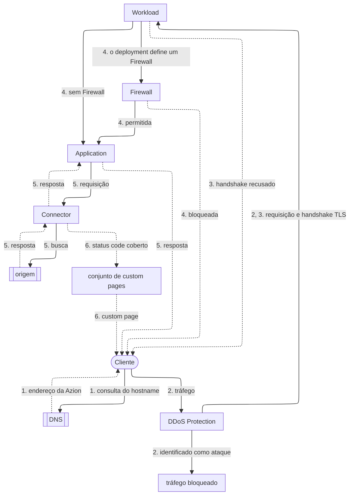

import DocButton from '~/components/webkit/DocButton.vue'
import DocCardGroup from '@aziontech/webkit/doc-card-group'
import DocCard from '@aziontech/webkit/doc-card'

**Workloads** é um recurso da plataforma que recebe, como ponto de entrada, as requisições feitas aos seus domínios, na infraestrutura distribuída da Azion. Um ponto de entrada é a configuração que responde aos hostnames de um site, guarda o certificado de cada um e termina as conexões HTTPS. Use Workloads para colocar uma [Application](/pt-br/documentacao/plataforma/applications/) no seu próprio domínio, servir esse domínio por HTTPS ou testar uma configuração em staging antes da produção.

Cada Workload tem estas features:

- [DDoS Protection](/pt-br/documentacao/plataforma/workloads/ddos-protection/ddos-mitigation/) mitiga inundações de tráfego de ataque antes que elas cheguem aos seus Workloads e às Applications por trás deles. Para uma defesa voltada a um ataque específico, você adiciona regras personalizadas a um Firewall.
- [TLS mútuo (mTLS)](/pt-br/documentacao/plataforma/workloads/mtls/) permite que um Workload recuse, no modo `enforce`, todo cliente sem um certificado de uma autoridade certificadora em que você confia. É indicado para uma API chamada por sistemas de parceiros, como uma que precisa atender aos requisitos do Open Banking.

<DocButton href="/pt-br/documentacao/plataforma/workloads/primeiros-passos/" label="Primeiros passos" size="medium" />
<DocButton href="/pt-br/documentacao/plataforma/workloads/referencia/" label="Referência de Workloads" kind="secondary" size="medium" />

---

## Caminho da requisição

Criar um Workload não serve nenhuma requisição: uma requisição chega a uma Application somente depois que o deployment desse Workload define essa Application. Um deployment é a parte de um Workload que define a Application e, opcionalmente, um [Firewall](/pt-br/documentacao/plataforma/firewall/) e um conjunto de custom pages. Até o deployment se propagar, o workload domain, o hostname que a Azion gera para o Workload, responde `404` com a página de erro HTML da Azion.

As setas contínuas levam a requisição, e as setas pontilhadas levam o que volta ao cliente. Cada rótulo começa com o número do passo a que pertence.

1. O cliente consulta o hostname, e o DNS retorna um endereço da infraestrutura distribuída da Azion. Um domínio personalizado, um domínio seu listado no Workload, chega a esse endereço por um registro CNAME que aponta para o workload domain.
2. No data center que o cliente alcança, DDoS Protection inspeciona o tráfego antes que o Workload o veja, e a Azion mitiga o tráfego que identifica como ataque. O Workload que lista o hostname recebe o restante.
3. Em uma conexão HTTPS, o Workload conclui o handshake Transport Layer Security (TLS) com o certificado, a versão mínima de TLS e o conjunto de cifras dele. O certificado é o da própria Azion ou um que você vincula do [Certificate Manager](/pt-br/documentacao/plataforma/certificate-manager/). Com mTLS ativado, o Workload também verifica o certificado de cliente nesse handshake e pode recusá-lo.
4. Quando o deployment define um Firewall, as regras desse Firewall avaliam a requisição antes da Application e podem bloquear essa requisição. Sem Firewall, a requisição segue direto para a Application.
5. A Application que o deployment define executa as regras dela sobre a requisição. Quando uma regra define um [Connector](/pt-br/documentacao/plataforma/connectors/), esse Connector encaminha a requisição à sua origem. A resposta volta pela Application até o cliente.
6. Quando o Connector responde com um status code de erro que o conjunto de custom pages do deployment cobre, o cliente recebe a custom page de [Custom Pages](/pt-br/documentacao/plataforma/custom-pages/) no lugar dessa resposta.

Todo hostname de um Workload chega à Application, ao Firewall e ao conjunto de custom pages que o deployment desse Workload define. Para cada passo do caminho e a contrapartida dele, consulte [Como Workloads funciona](/pt-br/documentacao/plataforma/workloads/como-funciona/).

---

## Próximos passos

<DocCardGroup cols={2}>
  <DocCard title="Primeiros passos" href="/pt-br/documentacao/plataforma/workloads/primeiros-passos/" label="Crie um Workload, defina uma Application no deployment dele e envie a sua primeira requisição." />
  <DocCard title="Como funciona" href="/pt-br/documentacao/plataforma/workloads/como-funciona/" label="Acompanhe uma requisição do DNS pelo TLS e pelo deployment até a sua Application." />
  <DocCard title="Configurações de Workload" href="/pt-br/documentacao/plataforma/workloads/configuracoes/" label="Consulte um campo, o padrão dele ou os valores que ele aceita." />
  <DocCard title="Guias e tutoriais" href="/pt-br/documentacao/plataforma/workloads/guias/" label="Conclua uma tarefa específica, como adicionar um domínio personalizado ou solicitar um certificado Let's Encrypt." />
  <DocCard title="Limites" href="/pt-br/documentacao/plataforma/workloads/limites/" label="Consulte onde um Workload termina e o valor de cada limite." />
  <DocCard title="Boas práticas" href="/pt-br/documentacao/plataforma/workloads/boas-praticas/" label="Teste em staging, feche o workload domain e mantenha o mTLS estrito em produção." />
  <DocCard title="Solução de problemas" href="/pt-br/documentacao/plataforma/workloads/solucao-de-problemas/" label="Encontre a causa quando um domínio responde 404, uma configuração é recusada ou um handshake falha." />
  <DocCard title="Glossário" href="/pt-br/documentacao/plataforma/workloads/glossario/" label="Consulte um termo que as páginas de Workloads usam, como workload domain ou deployment." />
</DocCardGroup>
