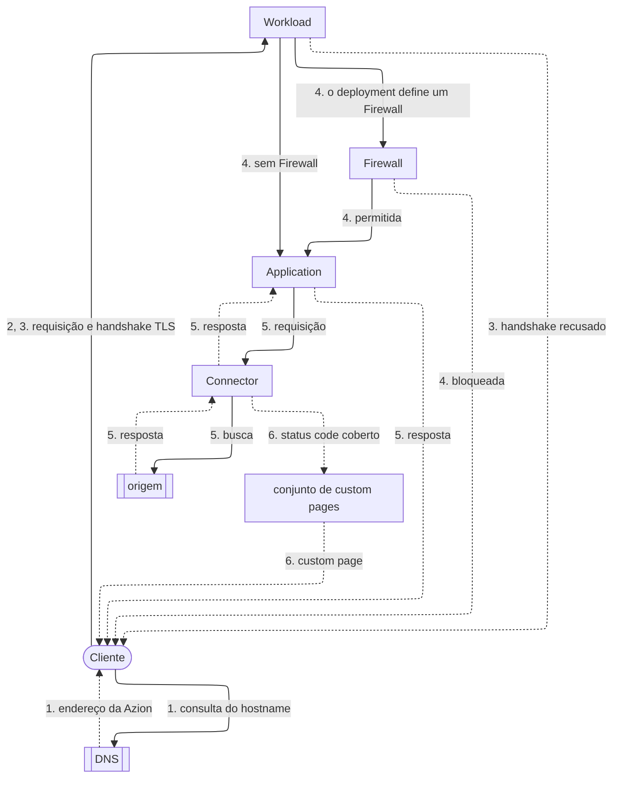

import DocButton from '~/components/webkit/DocButton.vue'
import DocCardGroup from '@aziontech/webkit/doc-card-group'
import DocCard from '@aziontech/webkit/doc-card'
import VersionRollingOut from '~/includes/snippets/versionRollingOut/pt/snippet.mdx'

<VersionRollingOut>[Domains](/pt-br/documentacao/plataforma/workloads/domains/)</VersionRollingOut>

**Workloads** é um recurso da plataforma que recebe, como ponto de entrada, as requisições feitas aos seus domínios, na infraestrutura distribuída da Azion. O ponto de entrada de um site é a configuração que responde aos hostnames dele, como `www.example.com`. Uma consulta de Domain Name System (DNS) envia o cliente até o ponto de entrada, que faz a terminação da conexão Transport Layer Security (TLS): ele decifra o tráfego dessa conexão. Nessa conexão criptografada, o ponto de entrada prova com um certificado que detém o hostname e, quando o ponto de entrada exige TLS mútuo (mTLS), o cliente também prova a identidade dele.

Um Workload guarda:

- um workload domain que a Azion gera;
- os domínios que você adiciona;
- as configurações de TLS e mTLS;
- as portas e as versões HTTP que aceita;
- a infraestrutura em que roda.

Um deployment é a parte de um Workload que define a [Application](/pt-br/documentacao/plataforma/applications/) que responde às requisições dele e, opcionalmente, um [Firewall](/pt-br/documentacao/plataforma/firewall/) que inspeciona as requisições primeiro e um conjunto de custom pages que substitui as respostas de erro. Depois de receber uma requisição, o Workload a encaminha para a Application que o deployment desse Workload define. Essa Application executa as suas regras nessa requisição. Use Workloads para colocar uma Application no seu próprio domínio, servi-la por HTTPS com o seu certificado ou com um que a Azion solicita para você, exigir certificados de cliente ou testar uma configuração em staging antes da produção.

<DocButton href="/pt-br/documentacao/plataforma/workloads/primeiros-passos/" label="Primeiros passos" size="medium" />
<DocButton href="/pt-br/documentacao/plataforma/workloads/configuracoes/" label="Configurações de Workload" kind="secondary" size="medium" />

---

## Caminho da requisição

Criar um Workload não serve nenhuma requisição: antes, esse Workload precisa de um deployment que defina uma Application. Até o deployment se propagar, o workload domain responde `404` com a página de erro HTML da Azion.

As setas contínuas levam a requisição, e as setas pontilhadas levam o que volta ao cliente. Cada rótulo começa com o número do passo a que pertence.



1. O cliente consulta o hostname, e o DNS retorna um endereço da infraestrutura distribuída da Azion. Um domínio personalizado, um domínio seu listado no Workload, chega a esse endereço por um registro CNAME que aponta para o workload domain.
2. O Workload que lista o hostname recebe a requisição.
3. Em uma conexão HTTPS, o Workload conclui o handshake TLS com o certificado, a versão mínima de TLS e o conjunto de cifras dele. Com mTLS ativado, ele também verifica o certificado de cliente. No modo `enforce`, um cliente sem certificado, ou com um certificado assinado por uma autoridade em que você não confia, não conclui o handshake.
4. Quando o deployment define um Firewall, as regras desse Firewall avaliam a requisição antes da Application e podem bloquear essa requisição. Sem Firewall, a requisição segue direto para a Application.
5. A Application que o deployment define executa as regras dela sobre a requisição. Quando uma regra define um [Connector](/pt-br/documentacao/plataforma/connectors/), esse Connector encaminha a requisição à sua origem. A resposta volta pela Application até o cliente.
6. Quando o Connector responde com um status code de erro que o conjunto de custom pages do deployment cobre, o cliente recebe a custom page no lugar dessa resposta.

Um Workload guarda no máximo um deployment, então todo hostname do Workload chega à mesma Application. Quando o deployment define um Firewall ou um conjunto de custom pages, o mesmo vale para ele. Para cada passo do caminho e a contrapartida dele, consulte [Como Workloads funciona](/pt-br/documentacao/plataforma/workloads/como-funciona/). Para um domínio que responde `404` ou um handshake que falha, consulte [Solucione problemas de Workloads](/pt-br/documentacao/plataforma/workloads/solucao-de-problemas/).

---

## Estrutura do Workload

A API e [Azion CLI](/pt-br/documentacao/devtools/cli/) representam um Workload como um objeto JSON. `azion describe workload --workload-id <workload-id> --format json` mostra um Workload novo, criado com nome e todos os padrões, como a API o armazena:

```json
{
 "active": true,
 "created_at": "2026-01-01T12:00:00.000000Z",
 "domains": [],
 "id": <workload-id>,
 "infrastructure": 1,
 "last_editor": "<your-email>",
 "last_modified": "2026-01-01T12:00:00.000000Z",
 "mtls": {
  "config": {
   "certificate": null,
   "verification": null
  },
  "enabled": false
 },
 "name": "my-workload",
 "product_version": "1.0",
 "protocols": {
  "http": {
   "http_ports": [
    80
   ],
   "https_ports": [
    443
   ],
   "quic_ports": [
    443
   ],
   "versions": [
    "http1",
    "http2",
    "http3"
   ]
  }
 },
 "tls": {
  "certificate": null,
  "ciphers": 7,
  "minimum_version": "tls_1_3"
 },
 "workload_domain": "<id>.map.azionedge.net",
 "workload_domain_allow_access": true
}
```

- `workload_domain` é o hostname somente leitura que a Azion gera na criação. `domains` guarda os hostnames que você adiciona: os seus próprios domínios e um hostname `azion.app` opcional. `workload_domain_allow_access` decide se os clientes ainda alcançam o workload domain.
- `infrastructure` é `1` para produção e `2` para staging, e define o sufixo do workload domain.
- `protocols.http` lista as versões HTTP e as portas que o Workload aceita. `tls` define o certificado, junto com o conjunto de cifras e a versão mínima de TLS. Com `tls.certificate` em `null`, o Workload apresenta o certificado SAN da Azion: o certificado da própria Azion, com os hostnames dele listados como Subject Alternative Names (SAN).
- `mtls` vem desativado em um Workload novo. Ativado, ele define um certificado de CA confiável e um modo de verificação. Um certificado de CA confiável é o certificado de uma autoridade certificadora (CA) em que você confia para assinar certificados de cliente. O Workload verifica cada certificado de cliente com ele.

Esse objeto não guarda nenhuma Application. O deployment do Workload não faz parte desse objeto: ele define a Application e também pode definir um Firewall e um conjunto de custom pages. Por causa dessa divisão, os hostnames e os certificados mudam sem nenhuma mudança no código da sua aplicação.

---

## Recursos

Certificate Manager age sobre um Workload depois que você vincula um certificado a esse Workload. Custom Pages age sobre um Workload depois que o deployment desse Workload define um conjunto de custom pages. DDoS Protection age sobre todo Workload a partir do momento em que ele existe.

### Certificate Manager

Certificate Manager é um recurso da plataforma que armazena os certificados que um Workload usa para TLS. Ele armazena certificados de servidor, enviados com a chave privada deles, e certificados de CA confiável, que verificam certificados de cliente para mTLS. Ele também solicita certificados Let's Encrypt para os domínios do Workload e os renova para você, armazena listas de revogação de certificados (CRLs) e cria solicitações de assinatura de certificado (CSRs). Recorra a ele quando um domínio seu precisa servir HTTPS, porque o certificado SAN da Azion cobre somente o workload domain e o hostname `azion.app`.

Para os tipos de certificado, os campos e os status deles, consulte [Certificados](/pt-br/documentacao/plataforma/workloads/certificate-manager/certificados/). Para saber como a Azion solicita e renova um certificado Let's Encrypt, consulte [Emissão e renovação](/pt-br/documentacao/plataforma/workloads/certificate-manager/emissao-e-renovacao/). Para vincular o seu primeiro certificado a um Workload, consulte [Primeiros passos com Certificate Manager](/pt-br/documentacao/plataforma/workloads/certificate-manager/primeiros-passos/).

### Custom Pages

Custom Pages é um recurso da plataforma que substitui por uma página sua a resposta de erro retornada por um Connector, uma página por status code de erro. Por exemplo, quando um Connector retorna `404` para um path que não existe, o cliente recebe a sua própria página na URL que pediu, sem redirecionamento. Um conjunto de custom pages é uma lista nomeada dessas páginas. A Azion busca o conteúdo de cada página em um Connector e mantém esse conteúdo em cache pelo tempo que a página define. Uma página também pode responder com um status code que você define. Use Custom Pages quando os visitantes precisam ver a sua própria página em vez da página de erro da origem.

Para os campos de um conjunto e das páginas dele, e os status codes que uma página pode substituir, consulte [Configurações de custom page](/pt-br/documentacao/plataforma/workloads/custom-pages/configuracoes/). Para substituir o seu primeiro `404`, consulte [Primeiros passos com Custom Pages](/pt-br/documentacao/plataforma/workloads/custom-pages/primeiros-passos/). Para uma conta que ainda roda a API v3, consulte [Error Responses](/pt-br/documentacao/plataforma/workloads/custom-pages/error-responses/).

### DDoS Protection

DDoS Protection é uma feature da Azion Platform que mitiga ataques de negação de serviço em todo Workload. Ela está sempre ativa e não precisa de ativação nem de configuração.

Um ataque de negação de serviço (DoS) inunda um serviço com tráfego até que as requisições legítimas não consigam passar. Um ataque distribuído de negação de serviço (DDoS) envia esse tráfego de muitas máquinas ao mesmo tempo. DDoS Protection mitiga esses ataques nas camadas de rede, de transporte, de apresentação e de aplicação. Para detecção e mitigação voltadas a um ataque específico, você escreve regras personalizadas no Firewall que o deployment define.

Para os tipos de ataque e as técnicas de mitigação, consulte [Mitigação de ataques](/pt-br/documentacao/plataforma/workloads/ddos-protection/ddos-mitigation/). Para saber como a mitigação de DDoS Protection é cobrada, consulte [Preços](/pt-br/documentacao/fundamentos/precos/#ddos-protection).

---

## Escopo e limites

- **Domínios**: um Workload responde no workload domain dele, `<id>.map.azionedge.net` em produção e `<id>.preview.azionedge.net` em staging, assim que o deployment dele se propaga, antes de você ter qualquer domínio. Você adiciona domínios seus, cada um como um hostname completo, sem wildcard, e aponta cada um para o workload domain com um registro CNAME. Um Workload de produção também pode responder em um hostname `azion.app`, que [Azion Console](https://console.azion.com/) chama de **Azion Custom Domain**, sem custo adicional. Com `workload_domain_allow_access` definido como `false`, o workload domain responde `404`, e o Workload responde somente nos hostnames de `domains`. Esse valor serve a um Workload cujos próprios domínios já atendem o tráfego, e a API o aceita somente enquanto `domains` tem pelo menos um hostname. Para cada regra que um hostname segue, consulte [Configurações de Workload](/pt-br/documentacao/plataforma/workloads/configuracoes/#dominios), e para os registros DNS, consulte [Aponte um domínio para um workload](/pt-br/documentacao/guias/plataforma/migracao/apontar-dominio-para-a-azion/).
- **DNS**: um Workload não guarda registros DNS. A zona de um domínio fica no seu provedor de DNS ou no [Edge DNS](/pt-br/documentacao/plataforma/edge-dns/), e o Workload responde aos hostnames que lista, onde quer que a zona deles esteja hospedada.
- **Infraestrutura**: um Workload roda em uma de duas redes: a rede de produção, para disponibilidade global, ou a rede de staging, para testes com propagação limitada. Você a escolhe ao criar o Workload, no campo `infrastructure` da API: `1` para produção ou `2` para staging. A escolha não muda depois da criação, e um Workload de staging não aceita domínio personalizado. Por exemplo, uma configuração testada em um Workload de staging chega à produção como um segundo Workload, criado na infraestrutura de produção. Para a mesma escolha no Azion Console, consulte [Configurações de Workload](/pt-br/documentacao/plataforma/workloads/configuracoes/#infraestrutura). Para saber como testar uma mudança em staging primeiro, consulte [Boas práticas de Workloads](/pt-br/documentacao/plataforma/workloads/boas-praticas/).
- **Protocolos**: um Workload aceita HTTP/1.1, HTTP/2 e HTTP/3 sobre QUIC, que exige as duas versões anteriores listadas e, em Azion Console, **HTTPS support** ativado. HTTP roda em até quatro portas, entre `80`, `8008`, `8080` e `8880`, com `80` por padrão. HTTPS roda em até 12 portas listadas, com `443` por padrão. Para as portas, consulte [Configurações de Workload](/pt-br/documentacao/plataforma/workloads/configuracoes/#protocolos-e-portas).
- **TLS**: a versão mínima de TLS vai de TLS 1.0 a TLS 1.3, o padrão, e TLS 1.0 e 1.1 estão descontinuados. Oito conjuntos de cifras estão disponíveis, com o conjunto `7` por padrão. O certificado SAN da Azion cobre o workload domain e o hostname `azion.app`, e um domínio seu precisa de um certificado de servidor de [Certificate Manager](/pt-br/documentacao/plataforma/workloads/#certificate-manager). A Azion bloqueia a renegociação TLS e a retomada de sessão TLS (TLS resumption) por padrão. Essas configurações protegem a conexão do cliente até a Azion, enquanto a conexão com a sua origem é configurada no Connector. Para os campos e as cifras de cada conjunto, consulte [Configurações de Workload](/pt-br/documentacao/plataforma/workloads/configuracoes/#tls).
- **mTLS**: com mTLS ativado, um Workload verifica certificados de cliente com um certificado de CA confiável, no modo `enforce` ou `permissive`, somente em conexões HTTPS. Ele também lista até 100 CRLs. Para os dois modos e todos os requisitos, consulte [mTLS](/pt-br/documentacao/plataforma/workloads/mtls/).
- **Deployment**: um Workload guarda no máximo um deployment, e um Workload criado pela API ou por Azion CLI começa sem nenhum. O deployment define a Application que responde e também pode definir um Firewall e um conjunto de custom pages. A referência publicada da API v4 não tem endpoint para o deployment: Azion Console, Azion CLI e [Terraform](/pt-br/documentacao/devtools/terraform/workloads/) o escrevem. Para os campos dele, consulte [Configurações de Workload](/pt-br/documentacao/plataforma/workloads/configuracoes/#deployment).
- **Propagação**: uma mudança salva em um Workload ou no deployment dele leva vários minutos para alcançar toda a infraestrutura distribuída da Azion, sem duração garantida. Enquanto isso, as requisições podem receber a configuração antiga ou a nova. Por exemplo, logo depois que você ativa o mTLS no modo `enforce`, alguns data centers ainda respondem a um cliente sem certificado. Para mais informações, consulte [Propagação](/pt-br/documentacao/plataforma/workloads/como-funciona/#propagacao).
- **Interfaces**: você cria e gerencia Workloads na página **Workloads** do [Azion Console](https://console.azion.com/), pela [Azion API](https://api.azion.com/) em `/v4/workspace/workloads`, com comandos do [Azion CLI](/pt-br/documentacao/devtools/cli/) como `azion create workload` e com os recursos `azion_workload` e `azion_workload_deployment` do [Terraform](/pt-br/documentacao/devtools/terraform/workloads/).
- **API v4**: na API v3, um único objeto Domains cumpria o papel de um Workload, e as Main Settings de uma Application guardavam as configurações de protocolo e de TLS. Na API v4, o Workload e o deployment dele substituem o objeto Domains, e o Workload guarda as configurações de protocolo e de TLS. Para o mapeamento entre os dois modelos, consulte [Migração para API v4](/pt-br/documentacao/fundamentos/api-v4-migration/), e para uma conta que ainda roda a API v3, consulte [Domains](/pt-br/documentacao/plataforma/workloads/domains/).
- **Observabilidade**: a página de erro da Azion carrega um header `x-azion-request-id` que identifica a requisição. [Data Stream](/pt-br/documentacao/plataforma/data-stream/) coleta os logs dos Workloads que você associa a um stream, como mostra [Associe workloads a um stream](/pt-br/documentacao/guias/plataforma/observabilidade/data-stream-associar-workloads/).
- **Limites**: o `name` de um Workload aceita até 100 caracteres, e um Workload lista até 50 domínios por padrão. Para cada limite e a resposta quando ele é ultrapassado, consulte [Limites de Workloads](/pt-br/documentacao/plataforma/workloads/limites/).
- **Cobrança**: cada plano inclui uma quantidade de uso antes que uma tarifa se aplique, e a página [Preços da Azion](https://www.azion.com/pt-br/precos/) a lista por plano. Para as tarifas, consulte [Preços](/pt-br/documentacao/fundamentos/precos/#workloads).
- **Termos**: o [glossário de Workloads](/pt-br/documentacao/plataforma/workloads/glossario/) define as palavras às quais as páginas de Workloads dão um significado específico, como workload domain, deployment, Azion custom domain e certificado de CA confiável.

---

## Próximos passos

<DocCardGroup cols={2}>
  <DocCard title="Primeiros passos" href="/pt-br/documentacao/plataforma/workloads/primeiros-passos/" label="Crie um Workload, defina uma Application no deployment dele e envie a sua primeira requisição." />
  <DocCard title="Como funciona" href="/pt-br/documentacao/plataforma/workloads/como-funciona/" label="Acompanhe uma requisição do DNS pelo TLS e pelo deployment até a sua Application." />
  <DocCard title="Configurações de Workload" href="/pt-br/documentacao/plataforma/workloads/configuracoes/" label="Consulte um campo, o padrão dele ou os valores que ele aceita." />
  <DocCard title="Guias e tutoriais" href="/pt-br/documentacao/plataforma/workloads/guias/" label="Conclua uma tarefa específica, como adicionar um domínio personalizado ou solicitar um certificado Let's Encrypt." />
</DocCardGroup>
