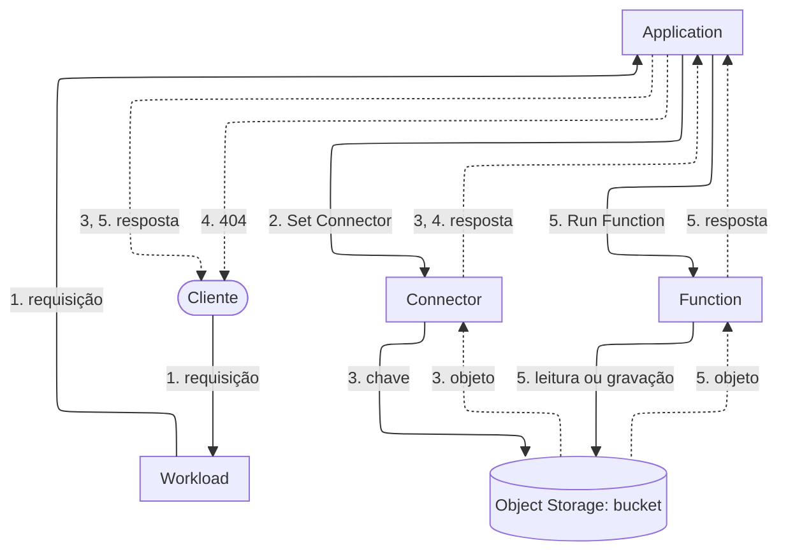

import DocButton from '~/components/webkit/DocButton.vue'
import DocCardGroup from '@aziontech/webkit/doc-card-group'
import DocCard from '@aziontech/webkit/doc-card'

**Object Storage** é um recurso da plataforma que armazena arquivos como objetos em buckets na infraestrutura da Azion e pode servi-los às suas [Applications](/pt-br/documentacao/plataforma/applications/). Um [object store](https://www.azion.com/pt-br/learning/storage-database/o-que-e-object-storage-blob-storage/) é um serviço de armazenamento que guarda cada arquivo inteiro, sob uma chave de sua escolha, em um contêiner plano. Use Object Storage para hospedar um site estático ou uma biblioteca de mídia, manter os uploads dos seus usuários ou receber logs do [Data Stream](/pt-br/documentacao/plataforma/data-stream/).

Object Storage oferece estas entidades e interfaces:

- [Buckets e objetos](/pt-br/documentacao/plataforma/object-storage/buckets-e-objetos/) permitem escolher, para cada bucket, se as suas Applications podem ler os objetos dele, ler e gravá-los, ou nenhum dos dois. Por exemplo, um bucket com os assets de um site fica `read_only`, e um bucket em que uma Function grava uploads precisa de `read_write`.
- [API do runtime](/pt-br/documentacao/devtools/runtime/api-reference/storage/) permite que uma Function leia, grave, liste e exclua os objetos de um bucket durante uma requisição. Uma Function só grava em um bucket que permite às suas Applications ler e gravar os objetos dele.
- [Compatibilidade com S3](/pt-br/documentacao/plataforma/object-storage/compatibilidade-s3/) permite que as suas ferramentas e SDKs S3 gerenciem os seus objetos com as credenciais que você cria. Cada credencial guarda um access key e um secret key e permite só as operações escolhidas, em todos os buckets ou nos indicados.

<DocButton href="/pt-br/documentacao/plataforma/object-storage/primeiros-passos/" label="Primeiros passos" size="medium" />
<DocButton href="/pt-br/documentacao/plataforma/object-storage/referencia/" label="Referência do Object Storage" kind="outlined" size="medium" />

---

## Caminho da requisição

Criar um bucket não publica os objetos dele: uma regra de Application pode servi-los por um [Connector](/pt-br/documentacao/plataforma/connectors/) do tipo `storage` ou por uma [Function](/pt-br/documentacao/plataforma/functions/).

O diagrama segue uma requisição para `https://www.example.com/assets/logo.svg`. As setas contínuas levam a requisição, e as setas pontilhadas levam a resposta. Cada rótulo começa com o número do passo correspondente abaixo.

1. O cliente envia a requisição ao [Workload](/pt-br/documentacao/plataforma/workloads/) que guarda `www.example.com`, e o Workload a passa para a Application que o deployment desse Workload define.
2. Uma regra da Application corresponde à requisição e define um Connector do tipo `storage` com o behavior _Set Connector_.
3. O Connector pede ao bucket o objeto cuja chave é o caminho da requisição, aqui `assets/logo.svg`, precedido do prefixo do Connector quando ele tem um. O bucket devolve o objeto, e a Application o envia ao cliente com o content type guardado com ele.
4. Quando o bucket não guarda nenhum objeto com essa chave, o cliente recebe `404`.
5. No lugar de definir um Connector, uma regra pode executar uma Function. A Function lê ou grava objetos pela API do runtime, dentro do nível de acesso do bucket, e devolve a própria resposta.

---

## Próximos passos

<DocCardGroup cols={2}>
  <DocCard title="Primeiros passos" href="/pt-br/documentacao/plataforma/object-storage/primeiros-passos/" label="Crie um bucket e faça upload do seu primeiro objeto pelo Azion Console, pela Azion CLI ou pela API." />
  <DocCard title="Como funciona" href="/pt-br/documentacao/plataforma/object-storage/como-funciona/" label="Veja como funcionam as chaves, os níveis de acesso, a entrega e a exclusão." />
  <DocCard title="Guias e tutoriais" href="/pt-br/documentacao/plataforma/object-storage/guias/" label="Execute uma tarefa, como servir um site estático a partir de um bucket ou receber uploads de arquivos." />
  <DocCard title="Boas práticas" href="/pt-br/documentacao/plataforma/object-storage/boas-praticas/" label="Defina níveis de acesso, content types e chaves para que os objetos sejam servidos como você espera." />
  <DocCard title="Limites" href="/pt-br/documentacao/plataforma/object-storage/limites/" label="Consulte o escopo do Object Storage, um limite e o que acontece acima dele." />
  <DocCard title="Solução de problemas" href="/pt-br/documentacao/plataforma/object-storage/solucao-de-problemas/" label="Descubra por que um nome de bucket, uma requisição ou um objeto é recusado ou não é servido." />
  <DocCard title="Glossário" href="/pt-br/documentacao/plataforma/object-storage/glossario/" label="Consulte uma palavra que a documentação do Object Storage usa com um sentido específico." />
</DocCardGroup>
