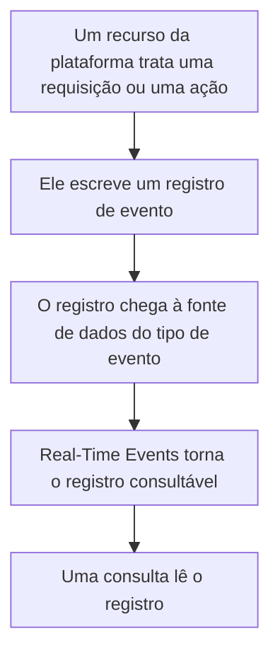
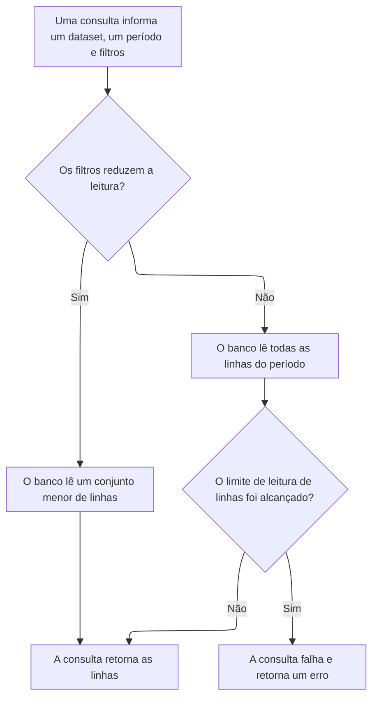

import FrameBox from '@aziontech/webkit/frame-box'
import ItemList from '@aziontech/webkit/item-list'
import DocItem from '@aziontech/webkit/doc-item'

Uma requisição que foi atendida não deixa nada que uma pessoa possa ler, a não ser que quem a atendeu tenha anotado os detalhes. O sistema que processou a requisição registra o que viu. Esse registro guarda o endereço de onde a requisição veio, o caminho que ela pediu, o status com que respondeu e o tempo que levou. Você pode consultar o registro durante um período, e depois ele é removido.

Na Azion, esses registros são registros de eventos, e [Real-Time Events](/pt-br/documentacao/plataforma/real-time-events/) é onde você os consulta. Cada recurso da plataforma escreve os registros dele na fonte de dados do tipo de evento correspondente. Cada fonte de dados carrega o próprio conjunto de campos, porque cada tipo de evento registra uma coisa diferente. Você lê os registros no Azion Console ou com a API GraphQL do Real-Time Events em `https://api.azion.com/v4/events/graphql`.

Esta página acompanha um registro, em vez de listar os campos que ele carrega. As variáveis de cada fonte de dados estão em [Fontes de dados](/pt-br/documentacao/plataforma/real-time-events/fontes-de-dados/), e todos os limites estão em [Limites](/pt-br/documentacao/plataforma/real-time-events/limites/). [Real-Time Metrics](/pt-br/documentacao/plataforma/real-time-metrics/) mostra o mesmo tráfego como métricas agregadas, e [Data Stream](/pt-br/documentacao/plataforma/data-stream/) envia registros para um endpoint seu. As seções a seguir acompanham o caminho de um evento, as fontes de dados e os datasets, como uma consulta é limitada e a retenção.

---

## O caminho que um evento percorre

Um registro de evento existe porque um recurso da plataforma o escreveu, e Real-Time Events não observa nada por conta própria. Uma [Application](/pt-br/documentacao/plataforma/applications/) que não atende nenhuma requisição, uma [Function](/pt-br/documentacao/plataforma/functions/) que nunca é executada e uma conta que ninguém altera não produzem registro nenhum. Um recurso da plataforma escreve um registro para cada evento que trata. O evento é o que ele faz uma vez: uma requisição, uma consulta DNS, uma entrega a um endpoint configurado ou uma ação na conta.

Este diagrama acompanha um único evento, do trabalho que o produz até a consulta que o lê:

1. Um recurso da plataforma trata uma unidade de trabalho: uma requisição, uma consulta DNS, uma entrega ou uma ação na conta.
2. Ele escreve um registro de evento para ela, com um valor para cada campo que a fonte de dados define.
3. O registro é escrito na fonte de dados do tipo de evento. Uma requisição que também executa uma Function deixa mais um registro na fonte de dados de Functions.
4. Real-Time Events torna o registro consultável pouco tempo depois do evento, e não no instante dele.
5. Uma consulta informa uma fonte de dados, um período e os filtros, e lê os registros que correspondem.
6. O registro é removido ao fim do período de retenção, mesmo que ninguém o tenha lido.

Uma variável não é um evento por si só. Um evento produz um registro, e as variáveis são os campos desse registro. Uma requisição que deu match com uma regra do [WAF](/pt-br/documentacao/plataforma/firewall/waf/) e foi atendida pelo cache é, por isso, um registro que carrega os dois fatos. Para abrir um registro e ler todas as variáveis dele, consulte [Ler um registro de evento](/pt-br/documentacao/guias/plataforma/observabilidade/entender-logs/).

O intervalo entre o evento e o registro consultável é a parte desse caminho que exige atenção. Um registro escrito há poucos instantes pode faltar em uma busca feita na mesma hora. Um resultado vazio logo depois de uma requisição costuma significar que a busca rodou cedo demais, então repita a busca antes de concluir qualquer coisa. Para o atraso e os outros limites, consulte [Limites](/pt-br/documentacao/plataforma/real-time-events/limites/).

---

## Fontes de dados e datasets

Uma fonte de dados guarda os registros de um tipo de evento, como as requisições que suas Applications e [Firewalls](/pt-br/documentacao/plataforma/firewall/) recebem. Em uma consulta, ela é o índice de onde os registros são lidos, então toda busca seleciona uma antes de qualquer outra coisa. Real-Time Events expõe oito delas no Azion Console, e cada uma carrega os próprios campos.

A visualização clássica do Azion Console lista um campo no filtro por um rótulo, como _Remote Address_. Estas páginas chamam esse rótulo de variável. A API GraphQL guarda cada fonte de dados como um dataset e nomeia o mesmo campo em camelCase, como `remoteAddress`. Os registros que a visualização clássica mostra, em **Log Body** e **More Details**, também usam esse nome de campo.

Um rótulo de variável não é aceito em uma consulta GraphQL, então copie o nome do campo de um registro. Um payload do [Data Stream](/pt-br/documentacao/plataforma/data-stream/) escreve o mesmo campo em snake_case. A visualização do Azion Console em Preview lista todos os campos pelo nome da API.

[Fontes de dados](/pt-br/documentacao/plataforma/real-time-events/fontes-de-dados/) informa o dataset e as variáveis de cada fonte de dados. Para a lista de campos de cada dataset, consulte [Campos da API GraphQL do Real-Time Events](/pt-br/documentacao/devtools/graphql/campos-gql-real-time-events/). Para obter um token e enviar uma primeira consulta, consulte [Primeiros passos da API GraphQL](/pt-br/documentacao/devtools/graphql/primeiros-passos/).

Separar os registros por tipo de evento mantém cada um legível: uma requisição HTTP e uma consulta DNS quase não têm campos em comum. Um registro único e compartilhado carregaria uma linha quase vazia para cada um. O preço é que uma pergunta sobre dois tipos de evento exige duas consultas, uma por fonte de dados. Você junta os resultados por um valor que os dois registros carregam, como o host.

---

## Como uma consulta é limitada

Uma consulta ao Real-Time Events informa três coisas: a fonte de dados que lê, o período que cobre e os filtros que a restringem. Essas três decidem quantas linhas o banco de dados de logs lê antes de responder, e a leitura é a parte cara do trabalho. O período costuma ser a maior das três. A visualização clássica abre nos últimos 5 minutos, e uma busca ampliada para toda a janela de retenção lê muito mais registros.

Na API GraphQL, as três escolhas ficam escritas. A consulta seleciona um dataset, delimita o período com `tsRange: { begin, end }`, ordena o resultado com `orderBy` e limita as linhas que retorna com `limit`. Uma busca no Azion Console envia o mesmo tipo de consulta, com as escolhas feitas pela interface.

A leitura também é o que uma das duas métricas cobradas conta. Data Scan mede o volume que uma consulta lê, e não o volume que ela retorna. Uma busca ampla que responde com 10 linhas ainda pode ler um volume grande. Storage, a outra métrica, mede o volume de registros mantidos.

O banco de dados de logs limita quantas linhas uma consulta pode ler antes de responder. Este diagrama mostra qual consulta alcança esse limite:

1. Uma consulta com um filtro lê apenas as linhas que podem corresponder a ele, então o período que ela informa custa pouco por si só.
2. Uma consulta sem filtro além do período lê todas as linhas desse período.
3. Uma leitura que fica dentro do limite retorna as linhas normalmente.
4. Uma leitura que alcança o limite encerra a consulta com um erro, em vez de um resultado parcial.

A busca sem filtro sobre um período amplo é o único caso que alcança o limite. Ela falha, em vez de retornar as primeiras linhas que encontrou. Um filtro muda esse resultado mais do que um período mais curto. Um host, um endereço IP, um código de status HTTP ou outro parâmetro da busca reduz a leitura.

A pergunta mais ampla é a que o banco de dados de logs recusa, então faça-a como várias perguntas restritas. Para os limites de linhas, campos, payload e taxa, e para a mensagem que uma consulta recusada retorna, consulte [Limites](/pt-br/documentacao/plataforma/real-time-events/limites/).

---

## Retenção

Retenção é por quanto tempo Real-Time Events mantém um registro de evento consultável. Um registro é mantido por 7 dias, equivalentes a 168 horas, e depois é removido, mesmo que ninguém o tenha lido. A remoção é permanente. A retenção é, portanto, o limite externo de toda consulta: um período que vai além dela não retorna nada para a parte fora da retenção.

Uma fonte de dados é a exceção. [Activity History](/pt-br/documentacao/fundamentos/activity-history/) registra as ações executadas na conta, e não o tráfego que a conta atende. Os registros dela são mantidos por 2 anos, muito mais do que os das outras sete fontes de dados. Eles respondem quem alterou uma configuração muito depois que o tráfego que rodou sob ela foi removido.

Uma retenção de 7 dias basta para investigar um incidente recente, mas Real-Time Events não é um armazenamento de longo prazo. Um registro que você precisa depois da retenção tem de sair antes de ser removido. [Data Stream](/pt-br/documentacao/plataforma/data-stream/) envia os registros de Activity History, Applications, Functions e WAF para um endpoint seu, onde vale a sua própria retenção. Para os dois períodos junto com todos os outros limites, consulte [Limites](/pt-br/documentacao/plataforma/real-time-events/limites/).

---

## Recursos relacionados

<FrameBox>
<ItemList>
  <DocItem title="Fontes de dados" href="/pt-br/documentacao/plataforma/real-time-events/fontes-de-dados/">As oito fontes de dados, as variáveis que cada uma carrega e o dataset que a guarda na API GraphQL.</DocItem>
  <DocItem title="Limites" href="/pt-br/documentacao/plataforma/real-time-events/limites/">Os períodos de retenção, os limites que uma consulta carrega e o que uma consulta que passa de um deles recebe.</DocItem>
  <DocItem title="Primeiros passos com Real-Time Events" href="/pt-br/documentacao/plataforma/real-time-events/primeiros-passos/">Rode uma primeira busca em uma fonte de dados e leia o que ela retorna.</DocItem>
  <DocItem title="Glossário" href="/pt-br/documentacao/plataforma/real-time-events/glossario/">O que registro de evento, fonte de dados, dataset, retenção e Data Scan significam nestas páginas.</DocItem>
</ItemList>
</FrameBox>
