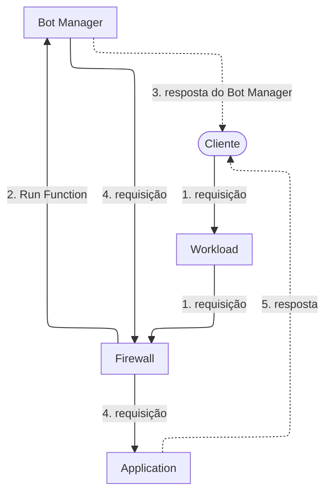

import DocButton from '~/components/webkit/DocButton.vue'
import DocCardGroup from '@aziontech/webkit/doc-card-group'
import DocCard from '@aziontech/webkit/doc-card'

**Bot Manager** é um recurso da plataforma aninhado ao [Firewall](/pt-br/documentacao/plataforma/firewall/) que pontua cada requisição em que uma regra de Firewall o executa, em busca de sinais de automação. O gerenciamento de bots separa clientes automatizados de pessoas: ele pontua o que cada requisição carrega e age quando um score alcança um limite que você define. Use Bot Manager para interromper credential stuffing, scraping e varreduras de vulnerabilidades, ou para enviar clientes suspeitos a um desafio, em uma [Application](/pt-br/documentacao/plataforma/applications/) que pessoas usam.

Para executar Bot Manager no seu Firewall, comece por estas páginas:

- [Bot Manager Lite](/pt-br/documentacao/plataforma/firewall/bot-manager/bot-manager-lite/) lista as regras estáticas com que a edição instalada pelo Azion Marketplace pontua uma requisição e os padrões que ela traz. Comece por esta edição, porque a edição completa está em Preview e a Azion a habilita mediante solicitação.
- [Argumentos](/pt-br/documentacao/plataforma/firewall/bot-manager/argumentos/) lista os valores com que Bot Manager é executado, como o limite, a ação e o modo. Use essa página para escrever cada argumento como Bot Manager o lê, porque um argumento escrito errado é armazenado e ignorado.
- [Logs](/pt-br/documentacao/plataforma/firewall/bot-manager/logs/) lista os campos da linha de report que Bot Manager escreve para uma requisição. Use essa página para ler o score de uma requisição, as regras que corresponderam a ela e a ação executada, e para encontrar onde as linhas aparecem.

<DocButton href="/pt-br/documentacao/plataforma/firewall/bot-manager/primeiros-passos/" label="Primeiros passos" size="medium" />
<DocButton href="/pt-br/documentacao/plataforma/firewall/bot-manager/referencia/" label="Referência do Bot Manager" kind="secondary" size="medium" />

---

## Caminho da requisição

Uma [Function](/pt-br/documentacao/plataforma/functions/) do Bot Manager instalada não protege nenhuma requisição sozinha. A [Function Instance](/pt-br/documentacao/plataforma/firewall/functions-instances/) dela em um Firewall age apenas nas requisições para as quais o comportamento _Run Function_ de uma regra a executa. O Firewall também precisa de Functions ativado. Por isso, os critérios da regra, e não o Firewall, escolhem quais requisições recebem um score.

As setas contínuas do diagrama levam a requisição, e as setas pontilhadas levam o que responde ao cliente. Cada rótulo começa com o número da sua etapa na lista a seguir.

1. Um cliente requisita um domínio de um [Workload](/pt-br/documentacao/plataforma/workloads/), e o Firewall que o deployment do Workload define recebe a requisição primeiro.
2. Uma regra cujos critérios correspondem à requisição executa a Function Instance do Bot Manager. Bot Manager pontua a requisição e compara o score com o limite que a Function Instance carrega.
3. Quando o score é igual ou maior que o limite, a Function Instance aplica a sua ação. A ação pode recusar a requisição, fechá-la sem resposta, redirecioná-la ou responder com uma página sua. Bot Manager também pode responder com uma resposta vazia que define dois cookies de sessão, para pedir que o cliente carregue uma sessão.
4. Uma requisição com score menor que o limite segue pelo Firewall até a Application, assim como uma requisição que nenhuma regra do Bot Manager capturou. Uma ação que permite a requisição, ou que a retém por um atraso aleatório, também a deixa seguir.
5. A Application responde à requisição, e o cliente recebe essa resposta.

---

## Próximos passos

<DocCardGroup cols={2}>
  <DocCard title="Primeiros passos" href="/pt-br/documentacao/plataforma/firewall/bot-manager/primeiros-passos/" label="Execute Bot Manager Lite por uma regra de Firewall e leia o score de uma requisição com formato de bot." />
  <DocCard title="Score de bots" href="/pt-br/documentacao/plataforma/firewall/bot-manager/score-de-bots/" label="Veja como as regras correspondidas somam um score e o que o limite decide." />
  <DocCard title="Guias e tutoriais" href="/pt-br/documentacao/plataforma/firewall/guias/" label="Calibre um limite, execute Bot Manager em caminhos escolhidos ou leia o report log." />
  <DocCard title="Boas práticas" href="/pt-br/documentacao/plataforma/firewall/boas-praticas/#bot-manager" label="Comece no modo de observação e defina um limite a partir do seu próprio tráfego." />
  <DocCard title="Limites" href="/pt-br/documentacao/plataforma/firewall/limites/#bot-manager" label="Consulte os limites de uma Function Instance do Bot Manager e a resposta além de cada um." />
  <DocCard title="Solução de problemas" href="/pt-br/documentacao/plataforma/firewall/solucao-de-problemas/#bot-manager" label="Descubra por que um cliente recebe um 204 vazio ou por que um argumento não tem efeito." />
  <DocCard title="Glossário" href="/pt-br/documentacao/plataforma/firewall/glossario/" label="Consulte um termo do Bot Manager, como fingerprint, limite ou under evaluation." />
</DocCardGroup>
