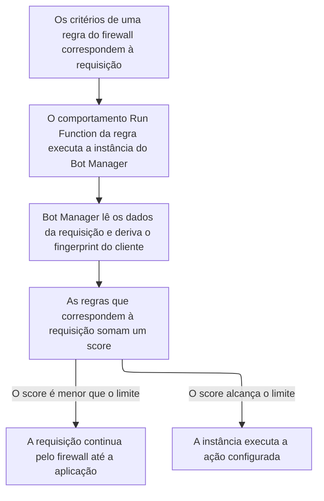

import DocButton from '~/components/webkit/DocButton.vue'
import DocCardGroup from '@aziontech/webkit/doc-card-group'
import DocCard from '@aziontech/webkit/doc-card'

O gerenciamento de bots distingue clientes automatizados de pessoas. Um script e uma pessoa chegam a uma aplicação do mesmo jeito, por HTTP, então a requisição é tudo o que existe para julgar. A verificação pesa o que uma requisição carrega, como os headers, o endereço e a sessão, e cada achado soma pontos a um único score. Quando o score alcança um valor que você define, a requisição recebe uma ação e, abaixo dele, a aplicação recebe a requisição sem alteração.

**Bot Manager** pontua cada requisição que uma regra de [firewall](/pt-br/documentacao/plataforma/firewall/) entrega a ele em busca de sinais de automação. Quando o score alcança o seu limite, ele executa a ação que você configura. Bot Manager roda como uma [instância de função](/pt-br/documentacao/plataforma/firewall/functions-instances/) no firewall, invocada por uma regra com o comportamento _Run Function_, então o firewall precisa de [Functions](/pt-br/documentacao/plataforma/functions/) ativado. Use Bot Manager para recusar, atrasar ou desafiar automação, como credential stuffing, varredura de vulnerabilidades, scraping de estoque ou abuso de checkout, em uma aplicação que também atende pessoas.

<DocButton href="/pt-br/documentacao/plataforma/firewall/bot-manager/primeiros-passos/" label="Primeiros passos" size="medium" />
<DocButton href="/pt-br/documentacao/plataforma/firewall/bot-manager/argumentos/" label="Referência do Bot Manager" kind="secondary" size="medium" />

---

## Estrutura da instância de função

Bot Manager age por meio de uma instância de função, que carrega os argumentos com que a função instalada roda. Esta instância executa [Bot Manager Lite](/pt-br/documentacao/plataforma/firewall/bot-manager/bot-manager-lite/) com o limite e a ação que essa edição traz de fábrica, enviada como corpo de `POST /v4/workspace/firewalls/<firewall-id>/functions`:

```json
{
  "name": "bot-manager-lite",
  "function": <function-id>,
  "active": true,
  "args": {
    "threshold": 30,
    "action": "deny",
    "internal_logs": 2,
    "log_tag": "storefront-bots"
  }
}
```

- `threshold` e `action` decidem o resultado: a função aplica `action` a uma requisição cujo score é igual ou maior que `threshold`. Bot Manager Lite vem com `30` e `deny`, e Bot Manager documenta um limite de `18` como valor de partida.
- `internal_logs` em `2` escreve uma linha de report para toda requisição, mesmo uma que pontua `0`, e `log_tag` nomeia esta instância nessas linhas.
- `function` é o ID da função instalada. Nada valida `args`: uma chave escrita errada é armazenada e ignorada, e a função roda com o seu padrão.
- Uma instância não pontua nada até que uma regra de firewall a execute com um comportamento _Run Function_, `{ "type": "run_function", "attributes": { "value": <instance-id> } }`, que nomeia a instância, nunca a função. [Azion Console](https://console.azion.com) lista as instâncias na aba **Functions Instances** do firewall, e [Azion API](https://api.azion.com/) e [Azion CLI](/pt-br/documentacao/devtools/cli/) carregam os argumentos como `args`.

---

## Caminho da requisição

Uma função Bot Manager instalada não pontua nada sozinha. Cinco objetos colocam uma requisição sob inspeção:

- A função Bot Manager instalada.
- Um firewall com Functions habilitado.
- Uma instância de função nesse firewall, carregando os argumentos.
- Uma regra nesse firewall cujo comportamento _Run Function_ nomeia a instância.
- Um [workload](/pt-br/documentacao/plataforma/workloads/) vinculado ao firewall pelo seu deployment.

Este diagrama acompanha uma requisição, da regra que corresponde a ela até a decisão do Bot Manager:



1. Uma regra no firewall corresponde à requisição, e o comportamento _Run Function_ dela executa uma instância do Bot Manager, com os argumentos que essa instância carrega.
2. Bot Manager lê os dados que a requisição carrega, incluindo os dados de dispositivo, de navegador e de rede, e deriva o fingerprint do cliente por trás dela.
3. Bot Manager pontua a requisição contra as suas regras e compara o score com o limite da instância.
4. Quando o score é igual ou maior que o limite, a instância executa a ação configurada. Caso contrário, a requisição segue até a aplicação.

Para saber como Bot Manager calcula um score e age sobre ele, e como fingerprints, cookies de sessão e modos o moldam, consulte [Score de bots](/pt-br/documentacao/plataforma/firewall/bot-manager/score-de-bots/).

---

## Escopo e limites

- **Firewall**: Bot Manager não tem interruptor em **Modules** nem chave no objeto `modules` do firewall. Ele precisa do interruptor **Functions** do firewall ativado, que um firewall criado pela API, pela CLI ou pela página **Create Firewall** tem. Um firewall criado a partir de um drawer do Console começa com **Functions** desativado.
- **Edições**: Bot Manager Lite é a edição self-service, instalada pelo [Azion Marketplace](/pt-br/documentacao/plataforma/marketplace/), e pontua cada requisição contra 26 regras estáticas. A edição completa, Bot Manager, também executa um score dinâmico, que compara o histórico de comportamento de um fingerprint de dispositivo com o padrão geral de tráfego do host. Ela é um produto em Preview que não vem habilitado na conta por padrão, e a Azion a habilita mediante solicitação. Para saber como solicitá-la, consulte [Diretrizes de suporte](/pt-br/documentacao/suporte/). As duas edições são configuradas pelos argumentos de uma instância, mas as chaves e três dos padrões diferem, conforme [Argumentos](/pt-br/documentacao/plataforma/firewall/bot-manager/argumentos/) lista.
- **Ações**: sete ações respondem a uma requisição cujo score alcança o limite. `allow`, `deny` e `drop` a decidem, `random_delay` e `hold_connection` atrasam a resposta, e `redirect` e `custom_html` substituem a resposta. `deny` responde `403` com a página de erro padrão da Azion. Para saber por que uma primeira instância pontua com `action` definido como `allow`, consulte [Boas práticas de Firewall](/pt-br/documentacao/plataforma/firewall/boas-praticas/#bot-manager).
- **Modos e sessões**: Bot Manager Lite pede que um cliente carregue uma sessão. Com o limite de fábrica, `30`, uma requisição sem os headers de um navegador, como uma enviada pelo `curl`, recebe um `204` sem corpo e com dois cookies de sessão. Um cliente que não guarda cookies, como um monitor ou um consumidor de API, recebe esse `204` indefinidamente. Bot Manager roda no modo `web` por padrão, e o modo `api` dele não define cookie e ignora toda regra que lê o par de sessão.
- **Limites**: o `name` de uma instância aceita até 100 caracteres, e o payload de argumentos dela comporta até 100.000 bytes. Para cada limite, a resposta quando ele é ultrapassado e o que cada plano inclui, consulte [Limites de Firewall](/pt-br/documentacao/plataforma/firewall/limites/#bot-manager) e, para os valores, [Preços](/pt-br/documentacao/fundamentos/precos/#bot-manager).
- **Interfaces**: Bot Manager Lite é instalado pelo Azion Marketplace, no Azion Console. Você cria a instância dele na aba **Functions Instances** do firewall, pela API em `/v4/workspace/firewalls/<firewall-id>/functions` ou com `azion create firewall-instance`. [`azion.config.js`](/pt-br/documentacao/devtools/cli/azion-config-js/#function-instances-do-firewall) (o `functionsInstances` de um firewall) e [Azion Terraform Provider](/pt-br/documentacao/devtools/terraform/security/) (`azion_firewall_functions_instance`) a criam como qualquer instância de função de firewall. O comportamento _Run Function_ pertence a uma regra de firewall, criada com `azion create firewall-rule` ou em `/v4/workspace/firewalls/<firewall-id>/request_rules`.
- **Observabilidade**: uma linha de report chega ao [Real-Time Events](/pt-br/documentacao/plataforma/real-time-events/) no dataset `functionConsoleEvents`, e [Data Stream](/pt-br/documentacao/plataforma/data-stream/) a encaminha a partir da fonte de dados Functions. A aba **Bot Manager** do [Real-Time Metrics](/pt-br/documentacao/plataforma/real-time-metrics/dashboards-secure/#bot-manager) mostra como as requisições foram classificadas e qual ação foi executada. Ela só mostra dados quando a conta tem assinatura do Bot Manager. Azion CLI não imprime nenhuma dessas linhas, então um resultado vazio de `azion logs` não mostra uma função silenciosa. Para cada campo de uma linha de report, consulte [Logs](/pt-br/documentacao/plataforma/firewall/bot-manager/logs/).
- **Produtos vizinhos**: Bot Manager não inspeciona uma requisição em busca de vulnerabilidades de aplicação. Isso cabe ao [WAF](/pt-br/documentacao/plataforma/firewall/waf/), e os dois rodam no mesmo firewall. Para bloquear uma requisição pela origem dela, use [Network Shield](/pt-br/documentacao/plataforma/firewall/network-shield/).
- **Termos**: o [glossário de Firewall](/pt-br/documentacao/plataforma/firewall/glossario/) define as palavras às quais as páginas do Bot Manager dão um significado específico, como fingerprint, limite, regra estática e under evaluation.

---

## Próximos passos

<DocCardGroup cols={2}>
  <DocCard title="Primeiros passos" href="/pt-br/documentacao/plataforma/firewall/bot-manager/primeiros-passos/" label="Pontue a sua primeira requisição e leia o score no report log." />
  <DocCard title="Score de bots" href="/pt-br/documentacao/plataforma/firewall/bot-manager/score-de-bots/" label="Veja como um score se forma e o que o limite decide." />
  <DocCard title="Argumentos" href="/pt-br/documentacao/plataforma/firewall/bot-manager/argumentos/" label="Consulte um argumento, o padrão dele ou os valores que uma ação aceita." />
  <DocCard title="Guias e tutoriais" href="/pt-br/documentacao/plataforma/firewall/guias/" label="Conclua uma tarefa específica, do modo de observação a um limite calibrado." />
  <DocCard title="Limites" href="/pt-br/documentacao/plataforma/firewall/limites/#bot-manager" label="Consulte um limite de uma instância, a resposta quando ele é ultrapassado ou o que um plano inclui." />
  <DocCard title="Solução de problemas" href="/pt-br/documentacao/plataforma/firewall/solucao-de-problemas/#bot-manager" label="Encontre a causa quando um cliente recebe 204 ou um argumento não faz nada." />
</DocCardGroup>
