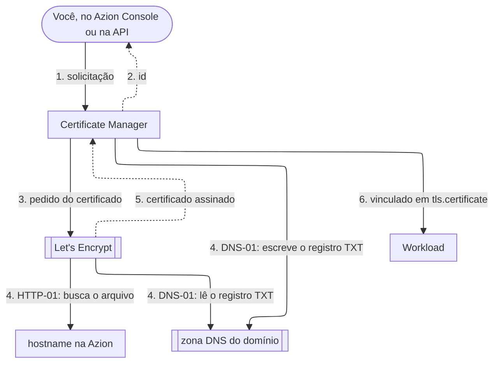
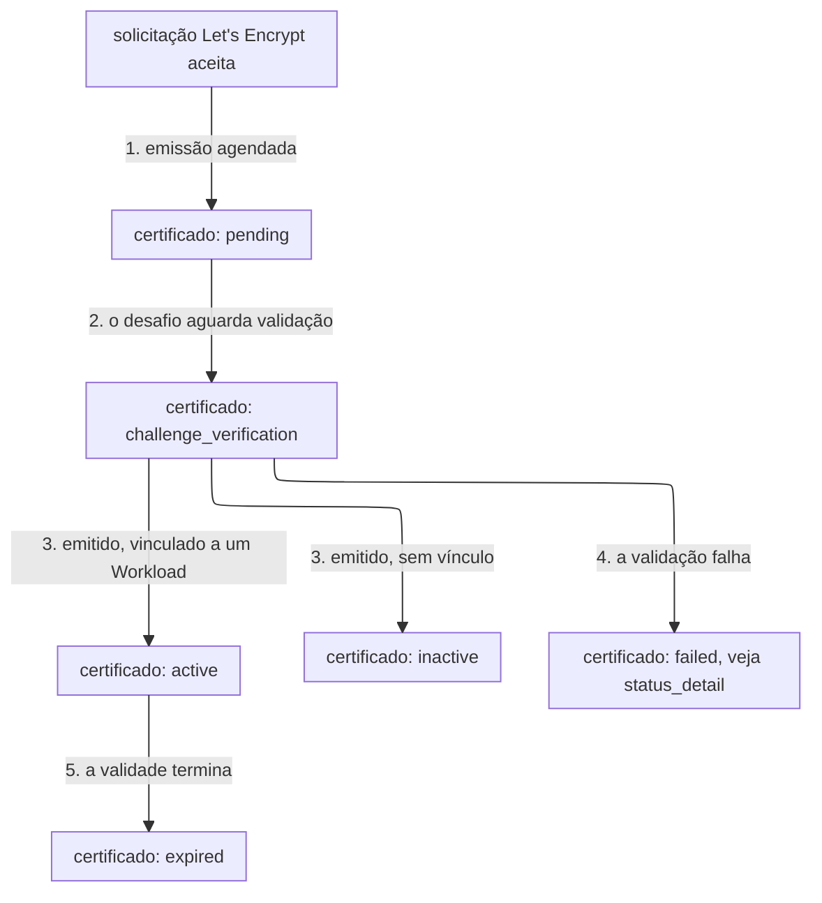

import FrameBox from '@aziontech/webkit/frame-box'
import ItemList from '@aziontech/webkit/item-list'
import DocItem from '@aziontech/webkit/doc-item'

Uma autoridade certificadora (CA) é uma organização que assina certificados. Ela assina um certificado somente depois que o solicitante prova o controle de todos os nomes que ele contém. A prova é um desafio: um valor que a CA verifica nos registros de Domain Name System (DNS) do domínio, ou um arquivo servido no hostname. Let's Encrypt é uma CA que emite certificados válidos por 90 dias, então um certificado só continua útil enquanto alguém o renova.

Para o certificado de servidor de um Workload, a Azion assume esse trabalho: ela solicita o certificado ao Let's Encrypt, conclui o desafio e renova o certificado antes que ele expire. [Certificate Manager](/pt-br/documentacao/plataforma/certificate-manager/) é um recurso da plataforma que armazena os certificados que um Workload usa para Transport Layer Security (TLS). Para saber onde Certificate Manager age sobre uma requisição, consulte [Caminho da requisição](/pt-br/documentacao/plataforma/certificate-manager/#caminho-da-requisicao). Um certificado que você envia, ou que obtém de uma CA por meio de uma solicitação de assinatura de certificado (CSR), é descrito em [Certificados](/pt-br/documentacao/plataforma/certificate-manager/certificados/).

As seções cobrem as solicitações de certificado, a validação de domínio, os certificados wildcard, os status, o tempo de emissão e as novas tentativas, e a renovação.

---

## Solicitações de certificado

Uma solicitação Let's Encrypt pede à Azion que obtenha um certificado para um conjunto de hostnames. No corpo de uma solicitação pela API, o hostname principal vai em `common_name`, e outros hostnames opcionais vão em `alternative_names`, que o certificado lista como Subject Alternative Names (SANs). O corpo também nomeia a autoridade, `lets_encrypt`, e o desafio que prova o controle dos nomes: `http` para HTTP-01 ou `dns` para DNS-01. Uma solicitação pelo formulário do Workload no Azion Console obtém os nomes dos domínios do Workload e o desafio da predefinição que você escolhe.

A Azion gera a chave do certificado. `key_algorithm` tem o padrão `ecc_384` em uma solicitação pela API e `rsa_2048` em uma solicitação pelo formulário do Workload. Para os outros algoritmos, consulte [Campos do certificado](/pt-br/documentacao/plataforma/certificate-manager/certificados/#campos-do-certificado).

Você solicita um certificado no Azion Console ou com `POST /v4/workspace/tls/certificates/request`. [Solicite um certificado Let's Encrypt](/pt-br/documentacao/guias/seguranca-de-aplicacoes/tls-e-certificados/como-gerar-um-certificado-lets-encrypt/) e [Solicite um certificado Let's Encrypt com a API](/pt-br/documentacao/guias/seguranca-de-aplicacoes/tls-e-certificados/como-gerar-um-certificado-lets-encrypt-via-api/) mostram os passos. Para as predefinições do Console que iniciam uma solicitação e o nome que o Console dá ao certificado, consulte [Certificado Let's Encrypt](/pt-br/documentacao/plataforma/certificate-manager/certificados/#certificado-lets-encrypt).

Até que o Let's Encrypt emita o certificado, a entrada dele em Certificate Manager guarda um certificado temporário que a Azion gera. O certificado aparece em Certificate Manager desde a solicitação, e o `id` que a API retorna o identifica quando você verifica o seu status.

Este diagrama acompanha uma solicitação, de você até o Workload que apresenta o certificado. As setas contínuas levam solicitações e verificações, e as setas pontilhadas levam respostas. Cada rótulo começa com o número do passo a que pertence.

1. Você solicita o certificado pelo formulário do Workload ou por Certificate Manager no Azion Console, ou com `POST /v4/workspace/tls/certificates/request`.
2. A API responde com o `id` do certificado, e a Azion agenda a emissão.
3. A Azion solicita o certificado ao Let's Encrypt para todos os nomes da solicitação.
4. O Let's Encrypt valida cada nome por meio do desafio. Com o HTTP-01, ele busca um arquivo no hostname, que a Azion serve. Com o DNS-01, ele lê o registro TXT `_acme-challenge` que a Azion escreve, em uma zona do Edge DNS ou por meio do registro Canonical Name (CNAME) que você adiciona em outro provedor de DNS.
5. O Let's Encrypt emite o certificado, e Certificate Manager o armazena.
6. Um Workload com o certificado vinculado em `tls.certificate` o apresenta no handshake TLS para os domínios personalizados do Workload.

A Azion solicita certificados Let's Encrypt para domínios e subdomínios registrados no DNS. Todo nome da solicitação também precisa pertencer a um domínio para o qual a conta tem permissão. Caso contrário, a solicitação é recusada com `This account cannot use certain common or alternative names because it does not have permission for their domain names.` Um hostname `azion.app` também é recusado, mesmo um que um Workload da conta tenha.

---

## Validação de domínio

O Let's Encrypt valida todos os nomes de uma solicitação antes de emitir o certificado, e o desafio da solicitação decide como. A Azion oferece suporte aos dois desafios, HTTP-01 e DNS-01, para um domínio cujo DNS está hospedado no [Edge DNS](/pt-br/documentacao/plataforma/edge-dns/) ou em outro provedor de DNS.

Com o HTTP-01, o Let's Encrypt valida o hostname por meio de um arquivo servido para ele, e a Azion executa o serviço que responde ao desafio. Nenhum nome precisa de registro TXT nem de outra mudança na zona do domínio, então o HTTP-01 atende bem a uma conta que gerencia muitos domínios e hostnames.

O hostname já precisa apontar para a Azion quando você envia uma solicitação HTTP-01. Todo nome alternativo da solicitação também precisa apontar para a Azion, ou a emissão falha. A Azion agenda a emissão mesmo quando nenhum Workload com o hostname está publicado e ativo.

Com o DNS-01, o Let's Encrypt valida o hostname por meio de um registro TXT no DNS do domínio, sob o nome `_acme-challenge` do hostname. Quem prepara o DNS depende de onde a zona está hospedada:

- Quando a zona está no Edge DNS, a Azion gera o registro TXT e o insere na zona. O desafio é concluído sem nenhuma ação sua.
- Quando outro provedor de DNS hospeda a zona, você adiciona um registro CNAME por hostname nesse provedor. O nome dele é `_acme-challenge.<your-domain>`, e o valor é `<your-domain>.letsencrypt.azion.com`. Por exemplo, `_acme-challenge.www.example.com` aponta para `www.example.com.letsencrypt.azion.com`.

Para os registros passo a passo, consulte [Solicite um certificado Let's Encrypt](/pt-br/documentacao/guias/seguranca-de-aplicacoes/tls-e-certificados/como-gerar-um-certificado-lets-encrypt/). Para adicionar você mesmo um registro TXT `_acme-challenge`, consulte [Adicione o registro TXT do Let's Encrypt](/pt-br/documentacao/guias/seguranca-de-aplicacoes/tls-e-certificados/registro-lets-encrypt/).

Cada desafio atende a uma situação diferente:

| Desafio | Valor de `challenge` | Use quando |
| --- | --- | --- |
| HTTP-01 | `http` | Você não controla os registros DNS do domínio, e o domínio já aponta para a Azion |
| DNS-01 | `dns` | Você controla os registros DNS, precisa de um nome wildcard ou não acessa o servidor web |

Os dois desafios trocam uma dependência do tráfego por uma dependência do DNS. Por exemplo, durante uma migração para a Azion, uma solicitação DNS-01 pode obter o certificado para `www.example.com` enquanto o hostname ainda aponta para o provedor anterior. Uma solicitação HTTP-01 só consegue obtê-lo depois que o hostname aponta para a Azion.

---

## Certificados wildcard

Um nome wildcard, como `*.example.com`, permite que um único certificado cubra subdomínios que você não lista um a um. Um certificado wildcard passa pelo desafio DNS-01, e a Azion o solicita e o renova automaticamente.

A emissão automática precisa que a zona do domínio esteja configurada e ativa no Edge DNS, o que dá à Azion controle sobre o registro TXT `_acme-challenge` de que a validação precisa. Quando a zona não está ativa no Edge DNS, a Azion não consegue automatizar a validação, e você a conclui manualmente.

Um certificado pode levar um nome wildcard sozinho ou ao lado de nomes específicos. Um subdomínio que o wildcard já cobre não precisa de uma entrada própria: com `*.example.com` no certificado, `blog.example.com` não precisa ser listado.

Um Workload, por outro lado, lista cada hostname por completo. Os domínios dele recusam uma entrada wildcard com `The domain does not conform to the format defined in RFC 1035.` O formulário do Workload solicita um certificado para os domínios do Workload, então não consegue solicitar um nome wildcard. Para solicitar um com o desafio DNS-01, consulte [Solicite um certificado Let's Encrypt com a API](/pt-br/documentacao/guias/seguranca-de-aplicacoes/tls-e-certificados/como-gerar-um-certificado-lets-encrypt-via-api/).

Um certificado wildcard no lugar de um certificado por subdomínio significa menos certificados distintos para emitir. Isso reduz a chance de atingir os limites de emissão do serviço Let's Encrypt, que [Limites do Certificate Manager](/pt-br/documentacao/plataforma/certificate-manager/limites/) indica. O custo é a dependência do Edge DNS que a emissão automática traz. Para saber quando um certificado compartilhado por muitos subdomínios é um risco, consulte [Boas práticas do Certificate Manager](/pt-br/documentacao/plataforma/certificate-manager/boas-praticas/).

---

## Status

Um certificado Let's Encrypt informa em que ponto está a sua emissão no campo somente leitura `status`. Os valores acompanham o certificado desde a solicitação até o seu uso em um Workload.

Este diagrama acompanha um certificado, da solicitação aceita até os estados em que ele pode terminar. Cada rótulo começa com o número do passo a que pertence.

1. A API aceita a solicitação, e a Azion agenda a emissão. Um certificado está em `pending` enquanto a Azion processa a sua emissão ou renovação.
2. `challenge_verification` significa que o desafio DNS-01 ou HTTP-01 está aguardando validação.
3. Depois de emitido, o certificado aparece como `active` enquanto está vinculado a um Workload em `tls.certificate`, e como `inactive` enquanto não está vinculado a nenhum.
4. Quando a validação falha, o certificado aparece como `failed` e mantém esse status entre as novas tentativas da emissão. O campo `status_detail` traz o motivo, como `An error has occurred while issuing the requested certificate. Please verify the following domains CNAME: www.example.com`.
5. Depois que a data de `validity` passa, o certificado aparece como `expired` e não protege mais o tráfego.

Você pode vincular um certificado a um Workload antes que o Let's Encrypt o emita, mas o HTTPS nos domínios do Workload pode não funcionar até que o certificado seja validado. No Azion Console, o campo **Digital Certificate** do Workload então avisa "This certificate is pending validation and HTTPS may not work until it’s validated". Para um certificado com falha, ele avisa "This digital certificate failed and HTTPS cannot be used until the issue is resolved".

Para a tabela completa de status, com os certificados enviados e os ícones da lista do Azion Console, consulte [Status](/pt-br/documentacao/plataforma/certificate-manager/certificados/#status).

---

## Tempo de emissão e novas tentativas

A Azion faz a primeira tentativa de obter um certificado Let's Encrypt em até 5 minutos depois que você salva as configurações do certificado. Quando uma tentativa falha, a Azion tenta de novo em um cronograma que espaça mais as tentativas quanto mais a falha dura. O cronograma aumenta a chance de sucesso enquanto se mantém dentro dos limites do serviço Let's Encrypt.

As 5 primeiras novas tentativas ocorrem em intervalos crescentes de cerca de 5 a 30 minutos e resolvem a maioria das falhas causadas pela propagação de DNS ou por um serviço temporariamente indisponível.

A Azion registra por que uma tentativa falhou em `status_detail`, que a API retorna com o certificado e Azion Console mostra ao lado do ícone de erro do certificado. Por exemplo, um CNAME `_acme-challenge` digitado errado no seu provedor de DNS faz as primeiras tentativas falharem, e `status_detail` nomeia o hostname cujo CNAME você deve verificar. Depois que você corrige o registro, uma tentativa posterior do cronograma pode obter o certificado. Para sintomas e as suas correções, consulte [Solucione problemas do Certificate Manager](/pt-br/documentacao/plataforma/certificate-manager/solucao-de-problemas/).

---

## Renovação

A Azion renova automaticamente um certificado Let's Encrypt antes que termine a sua validade de 90 dias. A renovação começa 30 dias antes da expiração, quando o certificado se torna elegível para renovação. A Azion monitora os certificados que solicitou, conclui o desafio de novo conforme a renovação se aproxima e atualiza o certificado. O campo `renewed_at` registra quando a Azion o renovou pela última vez.

A renovação não precisa de janela de manutenção, e o certificado mantém as suas cotas, o seu faturamento e as suas permissões. Certificados wildcard são renovados da mesma forma.

A renovação depende de a validação passar de novo, então a Azion renova um certificado somente enquanto as configurações de validação dele continuam válidas e atualizadas. Por exemplo, um certificado DNS-01 de uma zona em outro provedor deixa de ser renovado depois que o seu registro `_acme-challenge` é excluído. Um certificado HTTP-01 precisa que os seus hostnames continuem apontando para a Azion.

A Azion para de renovar um certificado nestes casos:

- Você vincula, no lugar dele no Workload, um certificado que enviou.
- Você altera os domínios para os quais o certificado foi solicitado. A Azion cria outro certificado a partir do conjunto alterado, e o antigo não é renovado.
- Você exclui o certificado, ou o domínio para o qual ele foi solicitado é removido da Azion. Cada um desses dois eventos também desativa um certificado gerenciado.

Um certificado desvinculado do seu Workload continua em Certificate Manager, e você pode vinculá-lo de novo enquanto ele permanece válido.

A renovação automática elimina a data de expiração como tarefa, ao custo de uma dependência. O caminho de validação que obteve o certificado precisa continuar funcionando enquanto um Workload o usar.

A Azion não renova um certificado que você envia. Para substituir um antes que expire, consulte [Boas práticas do Certificate Manager](/pt-br/documentacao/plataforma/certificate-manager/boas-praticas/).

---

## Recursos relacionados

<FrameBox>
<ItemList>
  <DocItem title="Certificados" href="/pt-br/documentacao/plataforma/certificate-manager/certificados/">Todos os campos de uma solicitação Let's Encrypt, a tabela completa de status e os algoritmos de chave que a Azion gera.</DocItem>
  <DocItem title="Solicite um certificado Let's Encrypt" href="/pt-br/documentacao/guias/seguranca-de-aplicacoes/tls-e-certificados/como-gerar-um-certificado-lets-encrypt/">Os passos para solicitar um certificado Let's Encrypt e preparar os registros DNS de que o seu desafio precisa.</DocItem>
  <DocItem title="Adicione o registro TXT do Let's Encrypt" href="/pt-br/documentacao/guias/seguranca-de-aplicacoes/tls-e-certificados/registro-lets-encrypt/">Os passos para adicionar o registro TXT que um desafio DNS-01 verifica.</DocItem>
  <DocItem title="Solucione problemas do Certificate Manager" href="/pt-br/documentacao/plataforma/certificate-manager/solucao-de-problemas/">Sintomas de um certificado que não é emitido ou renovado, com as suas causas e correções.</DocItem>
</ItemList>
</FrameBox>
