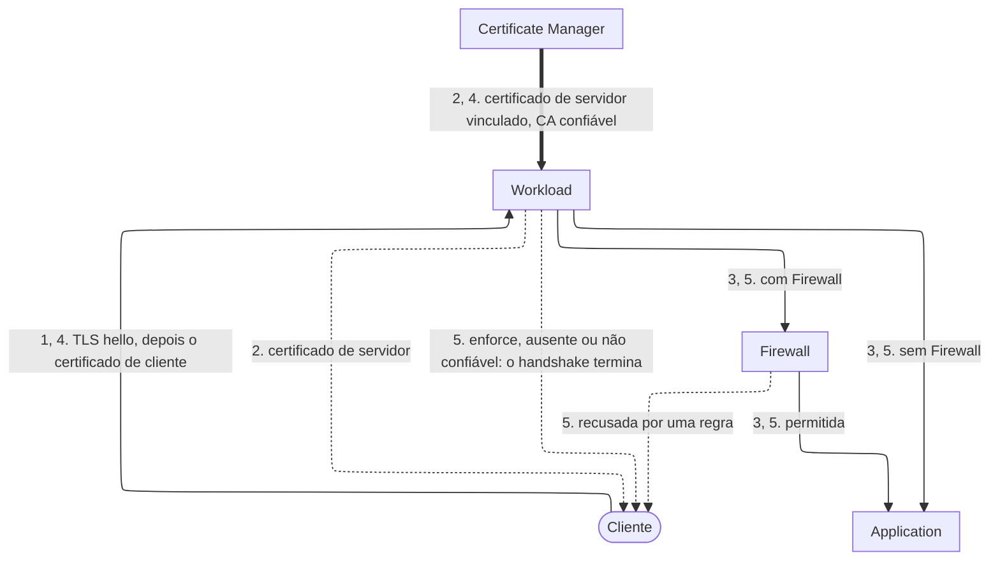

import DocButton from '~/components/webkit/DocButton.vue'
import DocCardGroup from '@aziontech/webkit/doc-card-group'
import DocCard from '@aziontech/webkit/doc-card'

**Certificate Manager** é um recurso da plataforma que armazena os certificados de Transport Layer Security (TLS) que um [Workload](/pt-br/documentacao/plataforma/workloads/) usa na infraestrutura distribuída da Azion. Um certificado é um documento assinado que prova que um servidor detém um hostname ou lhe permite verificar certificados de cliente no [TLS mútuo (mTLS)](/pt-br/documentacao/plataforma/workloads/mtls/). Use Certificate Manager para servir HTTPS nos seus domínios ou aceitar certificados de cliente da sua autoridade certificadora (CA).

Certificate Manager guarda certificados que você obtém e certificados que a Azion obtém para você:

- [Certificados](/pt-br/documentacao/plataforma/certificate-manager/certificados/) permitem trazer um certificado emitido por uma CA, com a chave privada, ou pedir um via solicitação de assinatura de certificado (CSR). Certificate Manager também guarda listas de revogação de certificados (CRLs), para que um Workload recuse certificados de cliente revogados por uma CA.
- [Emissão e renovação](/pt-br/documentacao/plataforma/certificate-manager/emissao-e-renovacao/) permite que a Azion solicite ao Let's Encrypt um certificado de servidor para os domínios de um Workload e o renove antes do vencimento. Todo nome no certificado precisa pertencer a um domínio que a sua conta tem permissão para usar.

<DocButton href="/pt-br/documentacao/plataforma/certificate-manager/primeiros-passos/" label="Primeiros passos" size="medium" />
<DocButton href="/pt-br/documentacao/plataforma/certificate-manager/referencia/" label="Referência do Certificate Manager" kind="outlined" size="medium" />

## Caminho da requisição

Armazenar um certificado no Certificate Manager não protege nenhum hostname: um Workload usa um certificado somente depois que esse certificado é vinculado a esse Workload. Certificate Manager então age durante o handshake TLS.

Este diagrama acompanha um handshake, do hello do cliente até a requisição que continua, com os certificados que Certificate Manager fornece. As setas contínuas levam o handshake e a requisição, e as setas pontilhadas levam o que volta ao cliente. A seta grossa leva os certificados que você vinculou antes da requisição. Cada rótulo começa com o número do passo a que pertence.

1. O cliente abre uma conexão TLS com um dos hostnames do Workload e nomeia esse hostname por Server Name Indication (SNI).
2. O Workload apresenta o certificado de servidor dele. Para o [workload domain](/pt-br/documentacao/plataforma/workloads/como-funciona/#workload-domain-e-dominios-personalizados), ou com `tls.certificate` definido como `null`, esse é o certificado SAN da Azion. Para um domínio personalizado com um certificado de servidor vinculado, é esse certificado.
3. Com o mTLS desativado, o handshake se completa, e a requisição continua até a [Application](/pt-br/documentacao/plataforma/applications/), pelo [Firewall](/pt-br/documentacao/plataforma/firewall/) quando o deployment define um Firewall.
4. Com o mTLS ativado, o Workload solicita um certificado de cliente e o verifica contra o certificado de CA confiável em `mtls.config.certificate`.
5. No modo `enforce`, um cliente sem certificado, ou com um certificado que outra autoridade assinou, não consegue completar o handshake. No modo `permissive`, o handshake se completa. Quando o deployment define um Firewall, uma regra que testa a variável Client Certificate Validation pode recusar a requisição.

---

## Próximos passos

<DocCardGroup cols={2}>
  <DocCard title="Primeiros passos" href="/pt-br/documentacao/plataforma/certificate-manager/primeiros-passos/" label="Envie o seu primeiro certificado e vincule-o a um Workload." />
  <DocCard title="Como funciona" href="/pt-br/documentacao/plataforma/certificate-manager/como-funciona/" label="Entenda o que vincular um certificado muda e quanto isso custa." />
  <DocCard title="Guias e tutoriais" href="/pt-br/documentacao/plataforma/certificate-manager/guias/" label="Conclua uma tarefa específica com certificados." />
  <DocCard title="Limites" href="/pt-br/documentacao/plataforma/certificate-manager/limites/" label="Consulte onde Certificate Manager para e o valor de cada limite." />
  <DocCard title="Boas práticas" href="/pt-br/documentacao/plataforma/certificate-manager/boas-praticas/" label="Substitua certificados antes que expirem e escolha o tipo certo." />
  <DocCard title="Solução de problemas" href="/pt-br/documentacao/plataforma/certificate-manager/solucao-de-problemas/" label="Encontre a causa quando um certificado fica pendente ou é recusado." />
  <DocCard title="Glossário" href="/pt-br/documentacao/plataforma/certificate-manager/glossario/" label="Consulte um termo que as páginas do Certificate Manager usam." />
</DocCardGroup>
