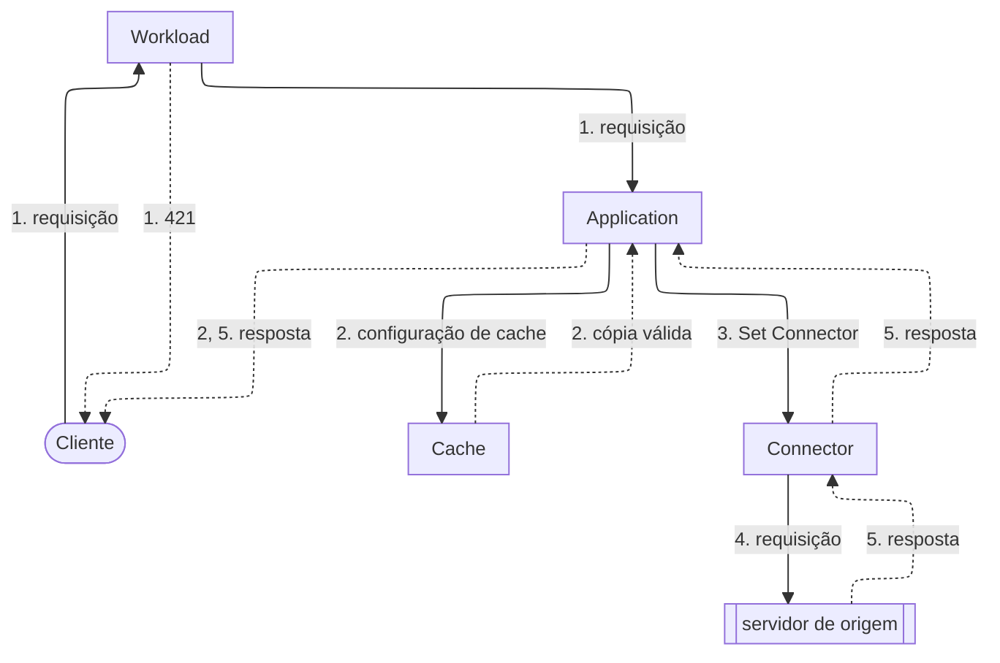

import FrameBox from '@aziontech/webkit/frame-box'
import ItemList from '@aziontech/webkit/item-list'
import DocItem from '@aziontech/webkit/doc-item'

Um proxy reverso é um servidor que responde a um cliente em nome de um servidor que você opera. Quando não consegue responder com o que já guarda, ele abre a sua própria conexão com esse servidor e encaminha a requisição. No caminho, ele decide como endereçar o servidor: qual hostname enviar no header `Host`, qual caminho pedir e qual protocolo e porta usar. O servidor responde ao proxy, e o proxy responde ao cliente.

Na Azion, o proxy é uma Application de [Applications](/pt-br/documentacao/plataforma/applications/), o recurso da plataforma que processa as requisições recebidas pelos seus Workloads. [Connectors](/pt-br/documentacao/plataforma/connectors/) é o recurso da plataforma que encaminha requisições das suas Applications às origens que guardam o seu conteúdo. Um Connector é o upstream desse proxy: onde o seu conteúdo está e como cada requisição chega até ele. Uma regra da Application define o Connector, e o Connector molda cada requisição que envia à origem.

Três recursos da plataforma aninhados estendem Connectors. [Load Balancer](/pt-br/documentacao/plataforma/connectors/load-balancer/) balanceia as requisições entre os endereços de um Connector do tipo `http`, e [Origin Shield](/pt-br/documentacao/plataforma/connectors/origin-shield/) permite que a sua origem aceite somente as requisições que um Connector envia. [Live Ingest](/pt-br/documentacao/plataforma/connectors/live-ingest/) recebe uma transmissão ao vivo, e um Connector do tipo `live_ingest` define a região em que o Live Ingest a recebe.

Esta página cobre os mecanismos, não os campos: cada campo está em [Configurações de Connector](/pt-br/documentacao/plataforma/connectors/configuracoes/), e cada limite está em [Limites de Connectors](/pt-br/documentacao/plataforma/connectors/limites/). As seções seguem uma requisição: o caminho da requisição, os tipos de Connector, como o Connector endereça a origem, os headers de endereço do cliente, a reutilização de conexões e os timeouts, e a propagação. Load Balancer, Origin Shield e Live Ingest fecham a página, nessa ordem.

---

## Caminho da requisição

Criar um Connector não envia tráfego a ele: somente uma regra de Application com o behavior _Set Connector_ envia requisições a ele. Até que uma regra defina um Connector, a Application não tem origem. A própria Application recebe apenas as requisições de um [Workload](/pt-br/documentacao/plataforma/workloads/) quando o deployment desse Workload define essa Application.

O diagrama acompanha uma requisição, do cliente até a origem. As setas contínuas levam a requisição, e as setas pontilhadas levam a resposta. Cada rótulo começa com o número da sua etapa.



1. Um cliente requisita um domínio de um Workload, e a Application que o deployment desse Workload define recebe a requisição. Quando a verificação obrigatória do SNI Check está ativada, uma requisição HTTPS pode receber `421 Misdirected Request` antes que qualquer Application seja executada.
2. A Application executa as suas regras da Request Phase em ordem. Quando uma regra aplica uma configuração de cache e o Cache guarda uma cópia válida da resposta da origem, essa cópia responde ao cliente, e a requisição nunca alcança o Connector.
3. Caso contrário, a requisição vai para o Connector que uma regra correspondente com _Set Connector_ define. Quando várias regras correspondentes carregam o behavior, apenas a última é executada.
4. O Connector abre uma conexão com a origem e envia a requisição, moldada pelas configurações do Connector.
5. A origem responde ao Connector. A Application executa as suas regras da Response Phase sobre a resposta, e o cliente a recebe.

Uma regra guarda o ID do Connector em `attributes.value`, e o Connector guarda o endereço. Mover a origem, portanto, significa editar um Connector, e toda regra que define esse Connector acompanha a mudança sem nenhuma alteração. Por exemplo, quando você altera o `host` e o `path_prefix` do Connector, a mesma regra envia requisições à origem com os novos valores. O preço é uma dependência entre as duas entidades: a API recusa excluir um Connector que uma regra ainda define, com `28000`.

Na API v3, as origins de uma Application cumpriam esse papel. Para esse modelo, consulte [Origins](/pt-br/documentacao/plataforma/connectors/origins/). Para escrever a regra que define um Connector, consulte [Rules Engine para Applications](/pt-br/documentacao/plataforma/applications/rules-engine/). Para saber quando o SNI Check responde `421`, consulte [SNI Check](/pt-br/documentacao/plataforma/connectors/sni-check/).

---

## Tipos de Connector

Um Connector tem um de três tipos, e o tipo decide o que o Connector alcança e quais configurações carrega. Na API, eles são `http`, `storage` e `live_ingest`, e Azion Console os rotula como _HTTP_, _Object Storage_ e _Live Ingest_.

Um Connector do tipo `http` alcança servidores que você opera, por hostname ou por endereço IP. Ele guarda um endereço, ou vários quando Load Balancer está ativado. É o único tipo com opções de conexão, então o header `Host`, o prefixo de caminho, o protocolo e os headers de endereço do cliente se aplicam somente a ele. Use-o para qualquer origem que responda HTTP: um servidor em nuvem, um servidor no seu data center ou um endpoint de armazenamento compatível com S3.

Um Connector do tipo `storage` lê objetos de um bucket de [Object Storage](/pt-br/documentacao/plataforma/object-storage/) na sua conta. Ele não guarda endereços nem opções de conexão, porque a origem é o próprio armazenamento da Azion, e não há servidor para você operar. Um prefixo restringe o Connector aos objetos sob ele, como `images/`.

Um Connector do tipo `live_ingest` define a região em que o Live Ingest recebe a sua transmissão. Ele não guarda endereços nem opções de conexão. A seção Live Ingest desta página descreve como a transmissão chega aos espectadores.

Por exemplo, uma Application pode enviar as requisições de `/images/` a um Connector do tipo `storage` e todos os outros caminhos a um Connector do tipo `http`. Cada regra corresponde aos seus próprios caminhos, e cada uma define o seu próprio Connector. Para os campos de cada tipo, consulte [Configurações de Connector](/pt-br/documentacao/plataforma/connectors/configuracoes/#geral).

---

## Como o Connector endereça a origem

Um Connector do tipo `http` decide quatro coisas sobre cada requisição que encaminha. Elas são o header `Host`, o caminho, o protocolo e a porta, e como o Connector resolve e segue o endereço da origem. Elas moldam a requisição que a origem recebe, não a URL que o cliente pediu.

### Header Host

O header `Host` diz a um servidor para qual site é uma requisição. Um servidor pode hospedar vários sites, chamados virtual hosts, e lê `Host` para escolher o site e localizar o conteúdo dele. A opção de conexão `host` decide o valor que o Connector envia.

Por padrão, `host` é `${host}`, que envia o host que o cliente pediu. Por exemplo, um cliente que pede `www.example.com` faz o Connector enviar `Host: www.example.com`. Isso atende uma origem que serve vários virtual hosts e espera cada requisição sob o seu nome público.

Um valor literal é enviado como está, em toda requisição. Defina um quando a origem responde a um virtual host sob um nome diferente do que o cliente usou, como `origin.example.com`. Uma origem que roteia requisições por nome pode não responder ao host do cliente, então ela precisa do seu próprio nome aqui.

### Prefixo de caminho

A opção de conexão `path_prefix` vai na frente do caminho que o cliente pediu. Com `/anything`, uma requisição de `/get` chega à origem como `/anything/get`. O prefixo nunca aparece na URL do cliente: o cliente pede `/get` e recebe a resposta de `/anything/get`.

Use um prefixo quando o conteúdo fica sob um diretório da origem. Uma origem também pode precisar de um segmento de caminho, como o nome do bucket em um endpoint compatível com S3. O padrão é nenhum prefixo, e o caminho chega à origem sem alteração.

### Protocolo e portas

A conexão do Connector até a origem tem o seu próprio protocolo, independente do que o cliente usou para alcançar a Azion. A opção de conexão `transport_policy` o decide, **Transport Protocol Policy** no Azion Console. Com `preserve`, o padrão, o Connector mantém o scheme que o cliente usou, então uma requisição HTTPS chega à origem por HTTPS. Com `force_https` ou `force_http`, o Connector usa esse protocolo em toda requisição, qualquer que seja o protocolo do cliente.

Forçar HTTPS protege o trecho entre a Azion e a origem, e custa um handshake TLS com a origem a cada nova conexão. Forçar HTTP poupa o handshake, e envia a requisição à origem sem criptografia.

Cada endereço carrega as suas próprias portas, `http_port` e `https_port`, com os padrões `80` e `443`. O próprio endereço nunca carrega uma porta nem um protocolo. Para saber como executar uma origem em outras portas, consulte [Configure portas HTTP e HTTPS](/pt-br/documentacao/guias/desenvolvimento-de-aplicacoes/primeiros-passos/configurar-portas/).

### Resolução DNS e redirecionamentos

Um endereço pode ser um hostname, e o Connector o resolve antes de se conectar. A opção de conexão `dns_resolution`, **DNS Resolution Policy** no Azion Console, decide quais endereços o Connector usa. `both`, o padrão, permite IPv4 e IPv6. `force_ipv4` mantém a conexão em IPv4 mesmo quando o hostname também resolve para IPv6, e `force_ipv6` a mantém em IPv6.

Uma origem pode responder com um redirecionamento HTTP em vez do conteúdo. Para redirecionamentos, o Connector tem a opção de conexão `following_redirect`, **Following Redirect** no Azion Console, que vem desativada por padrão.

Para cada uma dessas configurações e o seu padrão, consulte [Configurações de Connector](/pt-br/documentacao/plataforma/connectors/configuracoes/#opcoes-de-conexao).

---

## Headers de endereço do cliente

A origem recebe a requisição por uma conexão que o Connector abre, então ela vê o endereço da Azion, não o do cliente. Para repassar o endereço do cliente, o Connector adiciona dois headers a toda requisição de um Connector do tipo `http`.

Por padrão, a origem recebe o endereço IP do cliente em `X-Real-IP` e a porta do cliente em `X-Real-PORT`. As opções de conexão `real_ip_header` e `real_port_header` os renomeiam. Por exemplo, com `real_ip_header` definido como `X-Client-Real-IP`, a origem recebe `X-Client-Real-IP` com o endereço do cliente, e nenhum `X-Real-IP`.

Uma origem que registra, aplica rate limit ou autoriza pelo endereço do cliente o lê desse header. Algumas origens descartam `X-Real-IP` por conta própria, antes que o seu código o veja. Renomear o header contorna esse tipo de origem.

Como alternativa, uma regra pode adicionar o IP do cliente a um header de sua escolha. Para essa abordagem, consulte [Envie o IP do cliente para a origem em um header](/pt-br/documentacao/suporte/ip-original-header/).

---

## Reutilização de conexões e timeouts

A conexão da Azion até a origem segue padrões da plataforma que decidem quanto tempo a Azion espera e por quanto tempo mantém aberta uma conexão ociosa. Alguns vêm das configurações globais da Azion e outros do sistema operacional. Um Connector sem Load Balancer não expõe nenhum deles como configuração.

Esta tabela lista os padrões da conexão com a origem:

| Comportamento da conexão | Padrão |
| --- | --- |
| Complete TCP Connection | 60 segundos |
| TCP ACK Timeout | Cerca de 15 a 30 minutos |
| TCP Keep-Alive Interval | Desativado |
| Proxy Idle Timeout | 75 segundos |
| Proxy Read Timeout | 120 segundos |
| Proxy Write Timeout | 120 segundos |
| HTTP/2 Pings to Origin | Desativado |
| HTTP/2 Connection Idle | 75 segundos |

Com Load Balancer no Connector, a configuração dele traz os timeouts e as novas tentativas. O `connection_timeout` limita a espera por uma conexão com a origem, e o `read_write_timeout` limita a espera por dados em uma conexão aberta. O `max_retries` conta as novas tentativas em uma falha de conexão. No Azion Console, eles são **Connection Timeout**, **Read/Write Timeout** e **Max Retries**.

Na API, `max_retries` tem o padrão `0`, então uma requisição não é tentada de novo a menos que você aumente esse valor. Para esses campos, consulte [Configurações de Connector](/pt-br/documentacao/plataforma/connectors/configuracoes/#load-balancer).

Quando uma origem HTTPS recusa o handshake TLS, o cliente recebe `502` com a página intitulada `Azion - Default error page`, não uma página da origem:

```text
HTTP/2 502 
server: nginx
…
content-type: text/html
x-azion-request-id: <request-id>
…
    <title>Azion - Default error page</title>
```

---

## Propagação

Uma mudança em um Connector não precisa de um novo deployment e, ainda assim, leva tempo para alcançar o tráfego. A infraestrutura distribuída da Azion a recebe ao longo de vários minutos, e cada data center a aplica no seu próprio momento. O tempo é best-effort, sem duração garantida.

Enquanto uma mudança se espalha, uma requisição pode encontrar as configurações antigas ou as novas, dependendo do data center que responde. Por exemplo, logo depois que você altera o `host` do Connector, algumas requisições chegam à origem com o novo header `Host` e outras com o anterior. O mesmo vale para uma nova regra que define um Connector.

Uma requisição enviada logo depois de uma mudança mostra apenas o que um data center guarda. Para confirmar uma mudança, envie a requisição várias vezes, até que toda resposta a reflita. Planeje cada mudança para que as duas versões das configurações funcionem enquanto ela se espalha. Por exemplo, mantenha a origem antiga respondendo até que todo data center envie requisições à nova.

---

## Load Balancer

Um único servidor é um ponto único de falha, e ele carrega toda a carga. Distribuir as requisições entre vários servidores que guardam o mesmo conteúdo mantém o site respondendo quando um deles falha, e divide a carga entre eles. Um balanceador escolhe, para cada requisição, qual servidor a recebe.

Com [Load Balancer](/pt-br/documentacao/plataforma/connectors/load-balancer/) ativado, um Connector do tipo `http` guarda vários endereços em vez de um, e Load Balancer balanceia as requisições entre eles. O método de balanceamento é o método que Load Balancer usa para escolher o endereço de cada requisição, e o peso e a função do servidor de cada endereço moldam essa escolha. As regras continuam decidindo quais requisições alcançam o Connector, então qualquer critério de [Rules Engine para Applications](/pt-br/documentacao/plataforma/applications/rules-engine/), como o caminho, decide quais requisições são balanceadas.

Para saber onde Load Balancer age sobre uma requisição, consulte a [visão geral do Load Balancer](/pt-br/documentacao/plataforma/connectors/load-balancer/#caminho-da-requisicao) e, para saber como cada método escolhe um endereço, [Métodos de balanceamento](/pt-br/documentacao/plataforma/connectors/load-balancer/metodos-de-balanceamento/).

---

## Origin Shield

Uma origem na internet pública responde a qualquer um que encontre o seu endereço. Um cliente pode, então, contornar o proxy e todas as proteções à frente dele.

Duas defesas fecham esse caminho. A origem aceita conexões apenas dos endereços do proxy. A origem também exige que cada requisição carregue uma assinatura feita com um segredo que só o proxy guarda.

[Origin Shield](/pt-br/documentacao/plataforma/connectors/origin-shield/) permite que a sua origem aceite somente as requisições que um Connector do tipo `http` envia, com uma das defesas ou com as duas. Origin IP ACL, uma Feature de Origin Shield, dá à sua conta a lista `Azion Origin Shield` em [Network Lists](/pt-br/documentacao/plataforma/firewall/network-shield/network-lists/): os prefixos que a infraestrutura da Azion usa para se conectar às origens. O firewall da sua origem permite esses prefixos e recusa qualquer outra fonte. O código de autenticação de mensagem baseado em hash (HMAC), uma Feature de Origin Shield, assina cada requisição com credenciais AWS Signature Version 4, para que uma origem compatível com S3 a autentique.

Para saber onde Origin Shield age sobre uma requisição, consulte a [visão geral do Origin Shield](/pt-br/documentacao/plataforma/connectors/origin-shield/#caminho-da-requisicao) e, para saber como Origin IP ACL e HMAC protegem a origem, [Origin IP ACL e HMAC](/pt-br/documentacao/plataforma/connectors/origin-shield/origin-ip-acl-e-hmac/).

---

## Live Ingest

Uma transmissão ao vivo começa em um encoder, que a envia a um ponto de ingestão à medida que ela é produzida. Os espectadores não se conectam ao encoder. Eles buscam a transmissão por HTTP em servidores que a receberam.

Na Azion, o encoder envia a transmissão a [Live Ingest](/pt-br/documentacao/plataforma/connectors/live-ingest/), na região que um Connector do tipo `live_ingest` define. A Application a entrega: o behavior _Set Connector_ de uma regra define esse Connector, e o Connector encaminha as requisições dos espectadores ao Live Ingest.

Para saber onde Live Ingest age sobre a requisição de um espectador, consulte a [visão geral do Live Ingest](/pt-br/documentacao/plataforma/connectors/live-ingest/#caminho-da-requisicao) e, para saber como ele recebe uma transmissão e a entrega, [Ingestão e entrega](/pt-br/documentacao/plataforma/connectors/live-ingest/ingestao-e-entrega/).

---

## Recursos relacionados

<FrameBox>
<ItemList>
  <DocItem title="Configurações de Connector" href="/pt-br/documentacao/plataforma/connectors/configuracoes/">Cada campo de um Connector por tipo, com o padrão e os valores permitidos por trás dos mecanismos desta página.</DocItem>
  <DocItem title="Primeiros passos com Connectors" href="/pt-br/documentacao/plataforma/connectors/primeiros-passos/">Crie um Connector, defina-o com uma regra e envie a sua primeira requisição por ele até a sua origem.</DocItem>
  <DocItem title="Solucione problemas de Connectors" href="/pt-br/documentacao/plataforma/connectors/solucao-de-problemas/">Sintomas ao longo do caminho da regra até a origem, com as suas causas e correções.</DocItem>
  <DocItem title="Como Applications funciona" href="/pt-br/documentacao/plataforma/applications/como-funciona/">As regras, o cache e as fases que uma Application executa antes e depois que uma requisição alcança um Connector.</DocItem>
</ItemList>
</FrameBox>
