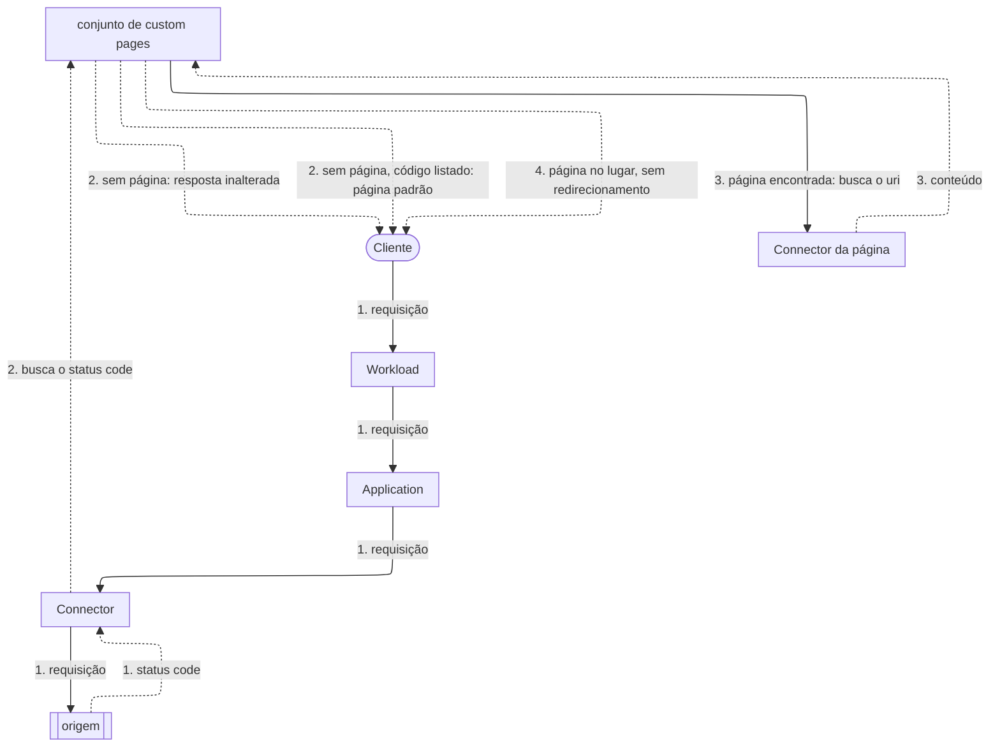

import DocButton from '~/components/webkit/DocButton.vue'
import DocCardGroup from '@aziontech/webkit/doc-card-group'
import DocCard from '@aziontech/webkit/doc-card'
import VersionRollingOut from '~/includes/snippets/versionRollingOut/pt/snippet.mdx'

<VersionRollingOut>[Error Responses](/pt-br/documentacao/plataforma/custom-pages/error-responses/)</VersionRollingOut>

**Custom Pages** é um recurso da plataforma que substitui a resposta de erro de um [Connector](/pt-br/documentacao/plataforma/connectors/) por uma página sua, na infraestrutura distribuída da Azion. Uma página de erro personalizada é o documento que um site serve no lugar do erro padrão do servidor para um status code, como `404`. Use Custom Pages para exibir sua página para um recurso ausente ou uma origem sem resposta, com tempo de cache e status code próprios. Use também [Configurações de custom page](/pt-br/documentacao/plataforma/custom-pages/configuracoes/) para consultar os campos de um conjunto, das páginas dele e os status codes que uma página substitui.

<DocButton href="/pt-br/documentacao/plataforma/custom-pages/primeiros-passos/" label="Primeiros passos" size="medium" />
<DocButton href="/pt-br/documentacao/plataforma/custom-pages/referencia/" label="Referência do Custom Pages" kind="secondary" size="medium" />

## Caminho da requisição

Criar um conjunto de custom pages não altera respostas: um [Workload](/pt-br/documentacao/plataforma/workloads/) só usa o conjunto depois que o deployment desse Workload define esse conjunto.

Este diagrama acompanha uma resposta, do status code do Connector até o que o cliente recebe. As setas contínuas levam as requisições, e as setas pontilhadas levam as respostas. Cada rótulo começa com o número do passo a que pertence.

1. O Workload encaminha a requisição para a [Application](/pt-br/documentacao/plataforma/applications/) que o deployment dele define. A Application envia a requisição à origem por um Connector, e o Connector responde com um status code.
2. A Azion procura uma página com esse status code no conjunto de custom pages que o deployment define. Quando o conjunto não tem página para o status code, o cliente recebe a resposta do Connector sem alteração, exceto nos status codes `400`, `401`, `403`, `406`, `500`, `502`, `503` e `504`, que recebem a página de erro padrão da Azion.
3. Quando uma página corresponde, a Azion busca o conteúdo dela no Connector da página, no `uri` da página. O `ttl` da página define o tempo de cache dela.
4. O cliente recebe esse conteúdo no lugar da resposta, sem redirecionamento e sem header `Location`. O status é o `custom_status_code` da página, quando definido.

---

## Próximos passos

<DocCardGroup cols={2}>
  <DocCard title="Primeiros passos" href="/pt-br/documentacao/plataforma/custom-pages/primeiros-passos/" label="Substitua o 404 da sua origem por uma página sua." />
  <DocCard title="Como funciona" href="/pt-br/documentacao/plataforma/custom-pages/como-funciona/" label="Entenda quais respostas um conjunto de custom pages substitui." />
  <DocCard title="Guias e tutoriais" href="/pt-br/documentacao/plataforma/custom-pages/guias/" label="Conclua uma tarefa específica com páginas de erro." />
  <DocCard title="Limites" href="/pt-br/documentacao/plataforma/custom-pages/limites/" label="Consulte onde Custom Pages para e o valor de cada limite." />
  <DocCard title="Solução de problemas" href="/pt-br/documentacao/plataforma/custom-pages/solucao-de-problemas/" label="Encontre a causa quando um conjunto é recusado ou uma página de erro não aparece." />
  <DocCard title="Glossário" href="/pt-br/documentacao/plataforma/custom-pages/glossario/" label="Consulte um termo que as páginas do Custom Pages usam." />
</DocCardGroup>
