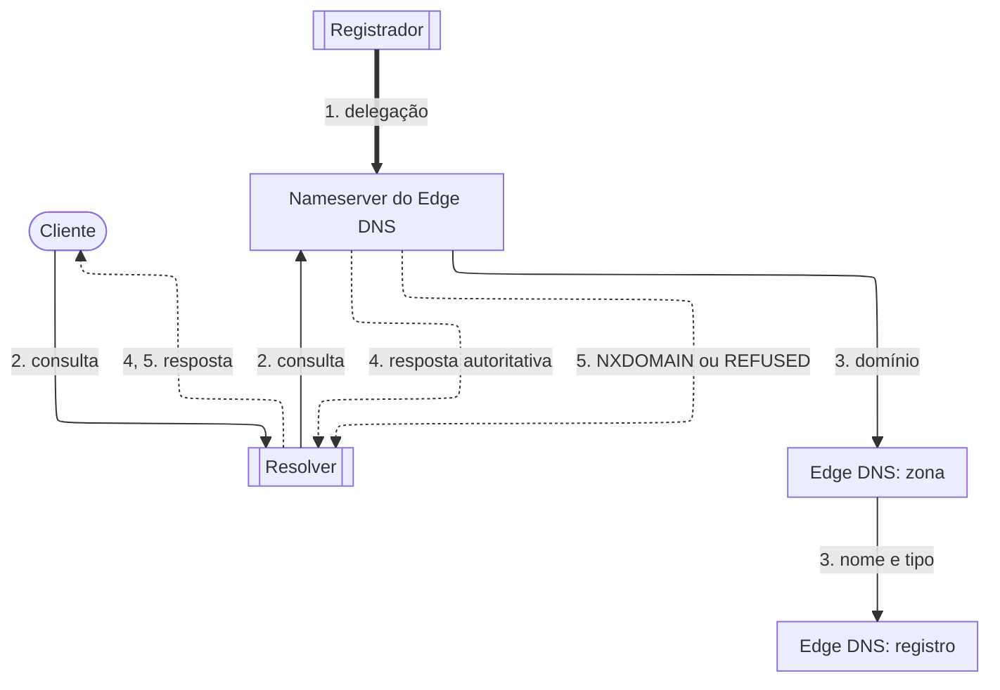
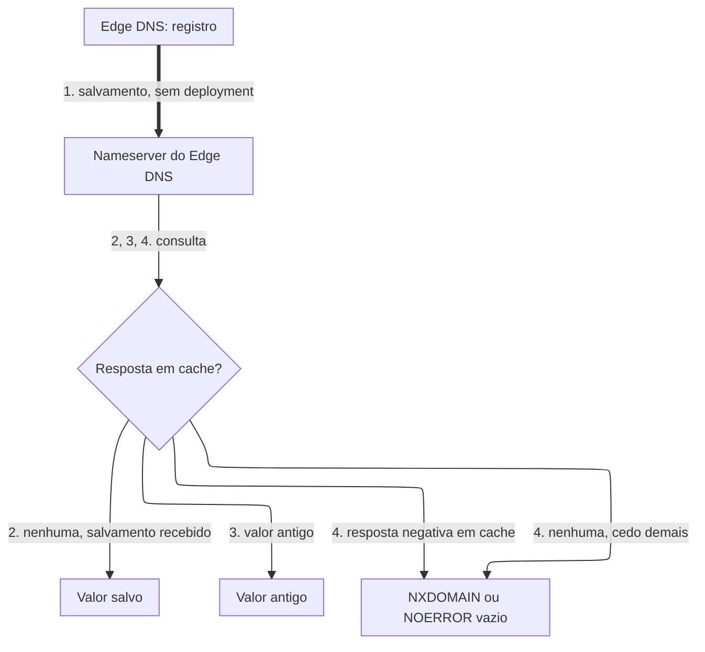
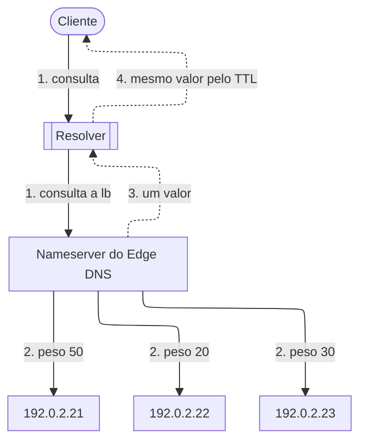
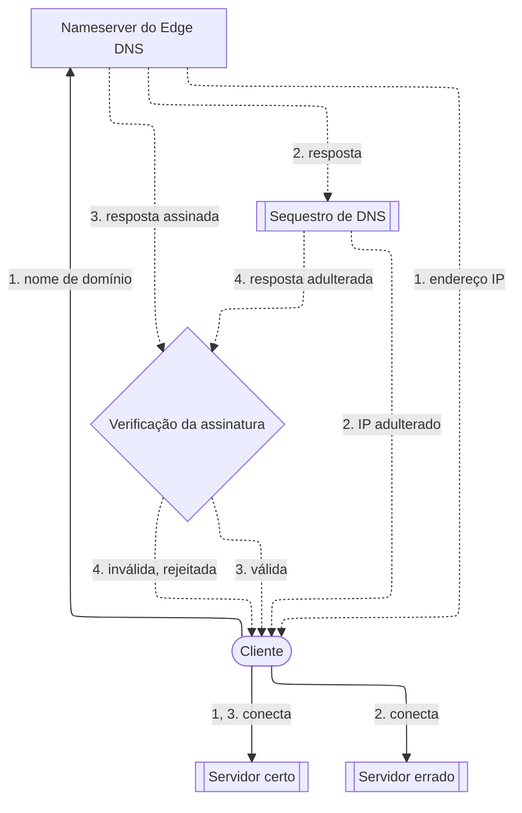

import FrameBox from '@aziontech/webkit/frame-box'
import ItemList from '@aziontech/webkit/item-list'
import DocItem from '@aziontech/webkit/doc-item'

O [DNS](https://www.azion.com/pt-br/learning/dns/o-que-e-dns/) responde a consultas pelos registros de nomes de domínio, como o endereço IP de um site, por meio de uma hierarquia de servidores. Um nameserver autoritativo guarda os registros de um domínio e responde às perguntas sobre eles. Um resolver é um servidor DNS que consulta nomes para os clientes. Ele segue a delegação do domínio até esses nameservers, pergunta a um deles e guarda a resposta em cache pelo time to live (TTL) dela.

[Edge DNS](/pt-br/documentacao/plataforma/edge-dns/) é um recurso da plataforma que hospeda os registros DNS dos seus domínios e responde às consultas. Uma zona guarda os registros dos nomes de um domínio, e cada domínio tem uma zona. Três nameservers na infraestrutura distribuída da Azion, `ns1.aziondns.net`, `ns2.aziondns.com` e `ns3.aziondns.org`, respondem por todas as zonas. Um domínio passa a ser servido pelo Edge DNS quando o registrador do domínio o delega a esses nameservers.

Os campos de uma zona e de um registro estão em [Zonas e registros](/pt-br/documentacao/plataforma/edge-dns/zonas-e-registros/). Para criar sua primeira zona, consulte [Primeiros passos com Edge DNS](/pt-br/documentacao/plataforma/edge-dns/primeiros-passos/).

As seções seguem uma consulta até a resposta: o caminho da resolução, cache e propagação, políticas de registro, ANAME no apex e DNSSEC.

---

## O caminho da resolução

Edge DNS é um serviço de authoritative DNS, não um resolver. Os nameservers da Azion respondem pelas zonas que hospedam e não fazem recursão. Por isso, seus usuários continuam consultando os próprios resolvers, que chegam à Azion pela delegação.

O diagrama segue uma consulta por `www.example.com` de um cliente até o registro que a responde. As setas contínuas levam a consulta, as setas pontilhadas levam a resposta e a seta grossa leva a delegação, que vem antes de qualquer consulta. Cada rótulo começa com o número do passo correspondente.

1. No registrador do domínio, você delega o domínio aos três nameservers do Edge DNS. Até o registrador publicar essa delegação, os resolvers públicos não chegam à Azion. Um domínio sem delegação a nenhum nameserver recebe `NXDOMAIN`, com o registro start of authority (SOA) do registry pai, e não o da Azion.
2. Um cliente pede um nome ao próprio resolver, como `www.example.com`. O resolver segue a delegação e pergunta a um dos três nameservers.
3. O nameserver encontra a zona pelo domínio e, em seguida, o registro pelo nome e pelo tipo. Os nomes de registro são relativos à zona: `www` responde por `www.example.com`, e `@` pelo próprio `example.com`.
4. O nameserver retorna os valores do registro como uma resposta autoritativa, com um TTL que faz a contagem regressiva a partir do TTL do registro. O resolver mantém a resposta em cache por esse TTL e a repassa ao cliente.
5. Um nome sem registro na zona recebe a resposta `NXDOMAIN`, a menos que um [registro wildcard](/pt-br/documentacao/plataforma/edge-dns/tipos-de-registro/#wildcards) corresponda a ele. Um nome que tem o próprio registro sempre prevalece sobre um wildcard. Quando a zona está inativa, ou nenhuma zona contém o domínio, o nameserver responde `REFUSED`. Uma zona inativa mantém os registros dela.

A delegação é a única etapa desse caminho fora da Azion. Você pode criar uma zona e os registros dela antes da alteração no registrador e consultar `ns1.aziondns.net` diretamente para ver o que ele responde. Espere cerca de um minuto depois de cada salvamento antes dessa primeira consulta, como explica [Cache e propagação](#cache-e-propagacao). Para os nameservers e os valores do SOA, consulte [Zonas e registros](/pt-br/documentacao/plataforma/edge-dns/zonas-e-registros/#nameservers-e-soa).

---

## Cache e propagação

Uma zona ou um registro salvo não precisa de nenhuma etapa de deployment. A Azion o armazena assim que a API, a Azion CLI ou o Azion Console aceita o salvamento.

Os nameservers da Azion, porém, respondem a partir de um [cache](https://www.azion.com/pt-br/learning/dns/como-funciona-o-cache-de-dns/) que faz a contagem regressiva do TTL de cada resposta. O que um nameserver responde depois de um salvamento depende de o salvamento já chegar a ele. A resposta depende também do que o cache do nameserver já guarda para o nome.

O diagrama segue uma consulta a um nameserver depois que você salva um registro. A seta grossa leva o salvamento. Cada rótulo começa com o número do passo correspondente.

1. Você salva um registro no Azion Console, na Azion CLI ou na API, e os nameservers o servem sem nenhuma outra ação. Um nome novo chega a todos os nameservers em cerca de um minuto depois do salvamento, e uma zona nova também.
2. Quando o nameserver não guarda nenhuma resposta para o nome e o salvamento já chegou a ele, ele responde com o valor salvo.
3. Quando o nameserver guarda uma resposta com o valor antigo, ele serve essa resposta até a atualização dela. A atualização acontece depois do TTL do registro ou de cerca de 5 minutos, o que for menor. Até lá, o TTL que ele serve faz a contagem regressiva a partir da resposta em cache. Uma alteração de TTL ou de peso e uma zona desativada chegam às respostas da mesma forma. Já uma zona reativada volta a responder em menos de um minuto.
4. Quando um nameserver recebeu uma consulta antes de o salvamento chegar a ele, esse nameserver deu uma resposta negativa. Essa resposta é `NXDOMAIN` para um nome novo, e `NOERROR` vazio para um tipo novo em um nome existente. O nameserver guarda essa resposta por 1 hora, o mínimo do SOA, de 3.600 segundos, sem a atualização de 5 minutos. Mesmo uma consulta enviada alguns segundos depois do salvamento pode chegar cedo assim.

Depois dos nameservers da Azion, cada resolver mantém a própria cópia de uma resposta pelo TTL que ela trazia. Ele mantém uma resposta negativa por até o mínimo do SOA. Por isso, todos os seus usuários só veem uma alteração depois que os nameservers da Azion a servem e a cópia de cada resolver expira. Consultar `ns1.aziondns.net` diretamente ignora o cache do seu resolver, não o da Azion.

O cache é o que torna as respostas rápidas, e o custo dele é a espera depois de uma alteração. Um TTL longo permite que os resolvers perguntem com menos frequência, e um TTL curto permite que uma alteração chegue a eles mais cedo.

Reduzir o TTL antes de uma alteração planejada encurta a espera nos resolvers. Quando o TTL fica abaixo de 5 minutos, encurta também a espera nos nameservers da Azion. Esperar cerca de um minuto depois de salvar evita a resposta negativa em cache, para um nome novo ou um tipo novo. As duas práticas estão em [Boas práticas para Edge DNS](/pt-br/documentacao/plataforma/edge-dns/boas-praticas/).

---

## Políticas de registro

A política de um registro decide como os valores dele se tornam uma resposta. Todo registro tem uma: *Simple*, o padrão, ou *Weighted*, definida em **Policy Type** no Console e em `policy` na API.

Um registro *Simple* responde a uma consulta com todos os valores que guarda. Um nome e um tipo comportam um único registro *Simple*, então várias respostas para um nome ficam nos valores desse registro. A política *Weighted* permite que vários registros compartilhem um nome e um tipo, cada um com o próprio peso, de 0 a 255. Cada resposta traz o valor de um registro, escolhido na proporção do peso do registro sobre a soma dos pesos.

O diagrama segue uma consulta por `lb.example.com`. Nesse nome, três registros A com a política *Weighted* têm os pesos 50, 20 e 30 e um TTL de 20 segundos. As setas contínuas levam a consulta, e as setas pontilhadas levam a resposta. Cada rótulo começa com o número do passo correspondente.

1. O resolver de um cliente pergunta a um nameserver por `lb.example.com`.
2. O nameserver escolhe um dos três registros. Os pesos somam 100, então a chance de cada registro é de 50, 20 ou 30 por cento.
3. A resposta traz apenas o valor do registro escolhido. O nameserver retorna esse valor pelo TTL do registro ou por cerca de 5 minutos, o que for menor. Depois, ele escolhe de novo e reinicia o TTL.
4. O resolver mantém essa única resposta pelo TTL que recebeu, então os clientes dele recebem o mesmo endereço até lá.

Um registro *Weighted* não divide o tráfego de cada cliente. As parcelas se equilibram ao longo de muitos resolvers e de muitas escolhas, não consulta a consulta. Um TTL curto, como os 20 segundos do exemplo, permite que os resolvers escolham de novo mais cedo, mas eles também perguntam com mais frequência. Cada consulta conta para o seu uso de Edge DNS, como mostra [Preços](/pt-br/documentacao/fundamentos/precos/#edge-dns).

Um registro com peso `0` permanece na zona e nunca é respondido, o que o tira do rodízio sem excluí-lo. Para os tipos de registro que aceitam a política *Weighted*, consulte [Tipos de registro](/pt-br/documentacao/plataforma/edge-dns/tipos-de-registro/).

---

## ANAME no apex

O apex de um domínio, como `example.com`, já guarda registros que a Azion escreve: o SOA da zona e o conjunto NS dela. Um CNAME bloqueia todos os outros tipos no nome dele, então um CNAME não pode ficar no apex. A API recusa um CNAME com o nome `@` com `19005`. Apontar o apex para outro hostname exige outro tipo de registro.

Um registro ANAME aponta um nome para um hostname da Azion e é respondido como um registro A. Edge DNS consulta o destino e responde à consulta com endereços. Por isso, o apex pode apontar para um [Workload](/pt-br/documentacao/plataforma/workloads/) e manter os registros SOA, NS, MX e TXT dele.

Um destino de ANAME é um nome sob `azioncdn.net`, `azionedge.net` ou `azionedge.com`, como `<your-workload>.map.azionedge.net`, e o TTL do registro é `20`. Um ANAME não se limita ao apex: qualquer nome da zona aceita um. Para as regras dele, consulte [Tipos de registro](/pt-br/documentacao/plataforma/edge-dns/tipos-de-registro/#aname).

Um CNAME em outro nome segue a mesma ideia dentro da zona. Quando um CNAME aponta para um nome da mesma zona, Edge DNS retorna o CNAME e os registros do destino em uma única resposta. Assim, o resolver não precisa de uma segunda consulta.

---

## DNSSEC

Uma resposta DNS viaja do nameserver até o cliente por resolvers e redes que o cliente não controla. Nada em uma resposta comum prova que ela veio do nameserver autoritativo sem alterações. O [DNSSEC](https://www.azion.com/pt-br/learning/dns/o-que-e-dnssec/) acrescenta assinaturas digitais às respostas, que o destinatário verifica.

O diagrama segue uma consulta e a resposta dela, com e sem assinatura. As setas contínuas levam a consulta e a conexão, e as setas pontilhadas levam a resposta. Cada rótulo começa com o número do passo correspondente.

1. Em uma consulta normal, o cliente envia o nome de domínio, e o nameserver retorna o endereço IP. Depois, o cliente se conecta ao servidor nesse endereço.
2. Em um sequestro, um intermediário altera o endereço IP na resposta no caminho até o cliente. O cliente se conecta a outro destino, que pode servir a uma fraude.
3. Com DNSSEC, o nameserver assina a resposta. O destinatário verifica a assinatura: uma resposta inalterada passa, e o cliente chega ao servidor certo.
4. Uma resposta adulterada deixa de corresponder à assinatura dela. Ela falha na verificação e é rejeitada.

DNSSEC é uma feature do Edge DNS: quando você a ativa em uma zona, Edge DNS assina essa zona. A Azion gera duas chaves para a zona: uma chave de assinatura de chaves (KSK) e uma chave de assinatura de zona (ZSK). As duas usam o algoritmo 13, `ECDSAP256SHA256`. Os nameservers da Azion publicam as chaves públicas como dois registros `DNSKEY`: as flags `257` marcam a KSK, e as flags `256`, a ZSK.

Cada resposta assinada traz um registro `RRSIG`, a assinatura dos registros dessa resposta. A própria Azion escreve esses registros, e você não adiciona nenhum registro DNSSEC nem chave à zona. Na API, a configuração de DNSSEC da zona traz apenas `enabled`, `status` e `delegation_signer`, que guarda os valores do registro delegation signer (DS).

As assinaturas não provam nada até que um resolver confie nas chaves. Essa confiança vem da zona pai, por meio do registro DS. O registro DS guarda um hash, o digest, da KSK da zona, e o seu registrador o publica para o domínio.

Um resolver que valida usa o registro DS para verificar os registros `DNSKEY`, e as chaves para verificar o `RRSIG` de cada resposta. Uma assinatura verificada mostra que um registro, como um registro A, AAAA, CNAME ou PTR, veio do nameserver autoritativo com o conteúdo preservado. Para os quatro valores do registro DS, consulte [DNSSEC](/pt-br/documentacao/plataforma/edge-dns/dnssec/#registro-ds).

As duas metades da cadeia acontecem em momentos diferentes. O status do DNSSEC passa a `ready` quando a Azion assina a zona e gera os valores do DS, com ou sem eles no registrador. Por isso, um `RRSIG` em uma resposta mostra que a zona está assinada, não que os resolvers a validam. A validação só começa quando o registrador publica o registro DS.

A assinatura chega às respostas pelo cache dos nameservers, como qualquer alteração. Assim, respostas guardadas em cache antes da ativação do DNSSEC podem ser servidas sem assinatura por cerca de 5 minutos.

Desativar o DNSSEC chega às respostas da mesma forma: cada nameserver ainda serve os registros `RRSIG` e `DNSKEY` por cerca de 5 minutos. Quando o DNSSEC é reativado, a zona mantém os mesmos valores do DS, e as assinaturas voltam em cerca de 5 minutos. Mas uma consulta `DNSKEY` respondida enquanto o DNSSEC estava desativado mantém a resposta vazia nesse nameserver por até 1 hora. Nesse intervalo, um resolver que já tem o registro DS pode falhar ao validar a zona.

O DNSSEC oferece autenticação criptográfica dos dados, integridade dos dados e negação de existência autenticada. Para essa última garantia, o padrão DNSSEC define os registros `NSEC` e `NSEC3`, que provam que um nome consultado não existe.

O DNSSEC não criptografa nada. Respostas e chaves trafegam em texto simples e podem ser guardadas em cache, o que mantém o DNS rápido. Por isso, o DNSSEC não mantém uma consulta confidencial. Para criptografar o tráfego entre um cliente e a sua aplicação, use HTTPS.

---

## Recursos relacionados

<FrameBox>
<ItemList>
  <DocItem title="Zonas e registros" href="/pt-br/documentacao/plataforma/edge-dns/zonas-e-registros/">Todos os campos de zona e de registro, os nameservers, os valores do SOA e os erros da API.</DocItem>
  <DocItem title="Tipos de registro" href="/pt-br/documentacao/plataforma/edge-dns/tipos-de-registro/">O formato do valor e as regras de cada tipo de registro, incluindo ANAME, CNAME e wildcards.</DocItem>
  <DocItem title="DNSSEC" href="/pt-br/documentacao/plataforma/edge-dns/dnssec/">A configuração de DNSSEC de uma zona, os valores de status e o registro DS de que o seu registrador precisa.</DocItem>
  <DocItem title="Boas práticas para Edge DNS" href="/pt-br/documentacao/plataforma/edge-dns/boas-praticas/">Como planejar TTLs e alterações para que registros novos e alterados respondam quando você espera.</DocItem>
  <DocItem title="Distribua o tráfego com pesos" href="/pt-br/documentacao/guias/seguranca-de-aplicacoes/dns/balanceamento-de-carga-dns/">Configure registros com pesos em um nome e veja como as respostas se alternam.</DocItem>
</ItemList>
</FrameBox>
