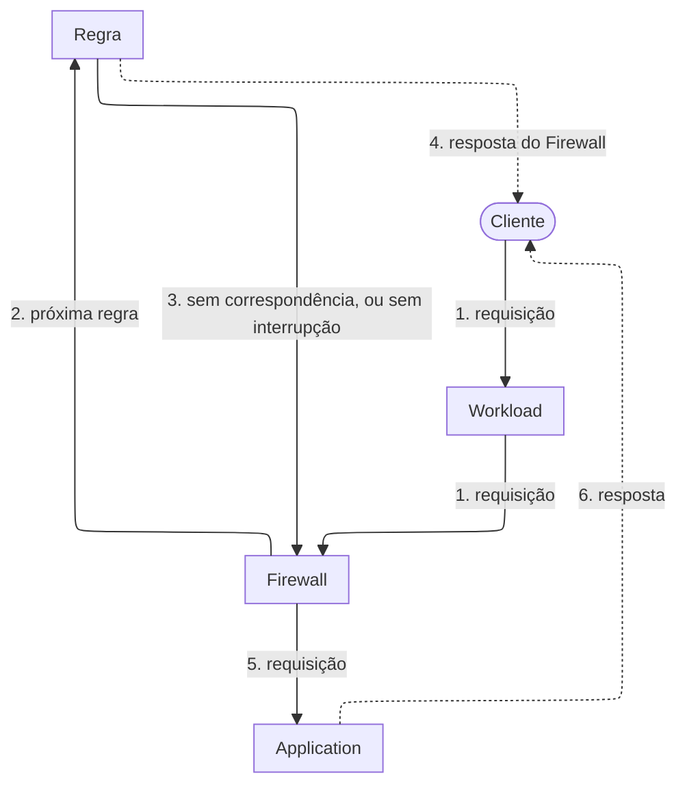

import FrameBox from '@aziontech/webkit/frame-box'
import ItemList from '@aziontech/webkit/item-list'
import DocItem from '@aziontech/webkit/doc-item'

Uma requisição a um site ou a uma API pode ser recusada antes que qualquer código da aplicação seja executado. Um ponto de controle na frente da aplicação lê o que a requisição carrega: o endereço de onde ela vem, o caminho que ela pede e os headers que ela envia. Ele os compara com condições que você escreveu, e uma requisição que atende a uma delas recebe a ação que você associou a essa condição. Uma requisição que não atende a nenhuma segue até a aplicação sem alteração.

Na Azion, esse ponto de controle é um Firewall. [Firewall](/pt-br/documentacao/plataforma/firewall/) é um recurso da plataforma que inspeciona as requisições aos seus Workloads antes que a sua Application as receba, na infraestrutura distribuída da Azion. O deployment de um [Workload](/pt-br/documentacao/plataforma/workloads/) define um Firewall e uma [Application](/pt-br/documentacao/plataforma/applications/), então toda requisição ao Workload atravessa primeiro o Firewall. As condições e as ações são as regras de [Rules Engine para Firewall](/pt-br/documentacao/plataforma/firewall/rules-engine/), e cada regra associa critérios a comportamentos.

Três recursos da plataforma aninhados ampliam o que uma regra pode decidir. Com [Web Application Firewall (WAF)](/pt-br/documentacao/plataforma/firewall/waf/), uma regra aplica um rule set que pontua uma requisição contra padrões de ataque conhecidos. [Network Shield](/pt-br/documentacao/plataforma/firewall/network-shield/) permite que uma regra compare o endereço do cliente com uma lista, e [Bot Manager](/pt-br/documentacao/plataforma/firewall/bot-manager/) avalia se o cliente por trás da requisição é um script ou uma pessoa.

Esta página cobre os mecanismos, e não os campos: cada critério, operador e comportamento está em Rules Engine para Firewall, e cada limite está em [Limites de Firewall](/pt-br/documentacao/plataforma/firewall/limites/). As seções seguem o caminho que uma requisição percorre, como as regras são executadas e o que o cliente recebe. Depois cobrem os recursos aninhados e os switches em um Firewall, as Functions em um Firewall, a propagação e a observabilidade. WAF, Network Shield e Bot Manager fecham a página, nessa ordem.

---

## O caminho que uma requisição percorre

Um Firewall não inspeciona nada até que o deployment de um Workload o defina. A relação fica no deployment, no campo `strategy.attributes.firewall` dele, e não no Firewall nem no registro do Workload. O mesmo deployment define a Application em `strategy.attributes.application`, então o Firewall e a Application sempre andam juntos.

Azion Console os agrupa, com uma Custom Page, como **Deployment Settings** que vários Workloads podem reutilizar. Para definir um Firewall em um Workload, consulte [Defina um Firewall em um Workload](/pt-br/documentacao/guias/seguranca-de-aplicacoes/firewall-e-waf/proteja-seu-dominio/).

Um Firewall não carrega domínio próprio. Ele inspeciona as requisições de todo Workload cujo deployment o define, e um Firewall que nenhum deployment define não inspeciona nenhuma requisição.

O diagrama acompanha uma requisição, do Workload que ela alcança até a resposta que ela recebe. As setas contínuas levam a requisição, e as setas pontilhadas levam a resposta. Cada rótulo começa com o número da sua etapa na lista que segue o diagrama.



1. Um cliente requisita um domínio de um Workload. O Firewall que o deployment do Workload define recebe a requisição antes da Application.
2. O Firewall executa as suas regras em ordem e, para cada regra, compara os critérios da regra com a requisição.
3. Uma regra cujos critérios não correspondem não aplica nada. Uma regra cujos critérios correspondem aplica os seus comportamentos, na ordem em que estão organizados. Quando nenhum comportamento interrompe a requisição, o Firewall passa para a próxima regra.
4. Um comportamento que interrompe a requisição, como uma negação, responde ao cliente, e nenhuma regra posterior é executada para essa requisição.
5. Uma requisição que nenhuma regra interrompe alcança a Application que o deployment define.
6. A Application processa a requisição, e a resposta dela chega ao cliente.

A recusa acontece no Firewall, então a Application nunca recebe uma requisição que uma regra interrompe. Por exemplo, uma regra que nega uma lista de endereços responde `403` a cada um deles, e a Application não vê nenhuma dessas requisições.

O preço é que a ordem decide. A primeira regra que interrompe uma requisição a resolve, então a posição de uma regra importa tanto quanto o que ela diz. Um Firewall pode servir aos deployments de vários Workloads, e uma mudança nas suas regras alcança, então, todos eles.

---

## Como as regras são executadas

Uma regra associa critérios, as condições que uma requisição precisa atender, a comportamentos, as ações tomadas quando ela as atende. Os critérios ficam em blocos. Dentro de um bloco, o primeiro critério começa com `if`, e cada um dos seguintes se junta a ele com `and` ou `or`.

Quando os critérios correspondem à requisição, a regra aplica os seus comportamentos na ordem em que estão organizados e, quando não correspondem, a regra não aplica nada. Para cada critério, operador e comportamento, consulte [Rules Engine para Firewall](/pt-br/documentacao/plataforma/firewall/rules-engine/#criterios).

### Ordem das regras

Um Firewall executa as suas regras em sequência até que uma delas bloqueie ou restrinja a requisição, ou até que todas tenham sido executadas. Cada regra carrega um `order`, que a API atribui na ordem de criação a partir de `0`. Azion Console, a API e a CLI podem reordenar as regras. Um comportamento como _Deny (403 Forbidden)_ encerra a execução das regras: nenhum comportamento posterior e nenhuma regra posterior são executados para essa requisição.

A ordem, portanto, muda resultados que as regras sozinhas não mostram. Por exemplo, uma regra que aplica um rate limit a um caminho de login nunca conta as requisições que uma regra anterior nega, porque essas requisições nunca chegam a ela.

A ordem das regras também define a ordem em que WAF, Network Shield, Bot Manager e Functions agem sobre uma requisição. Eles não têm uma ordem fixa própria, porque cada um age apenas por meio de uma regra. Network Shield age pelo critério _Network_ de uma regra, WAF por _Set WAF_, e Bot Manager e Functions por _Run Function_.

Esses recursos aninhados e Functions agem, portanto, na ordem das regras que os chamam, e nenhum deles age sobre uma requisição que uma regra anterior interrompeu. Dentro de uma regra, _Set WAF_ e _Run Function_ são executados na ordem em que a regra os organiza. [DDoS Protection](/pt-br/documentacao/plataforma/workloads/ddos-protection/ddos-mitigation/), uma feature da plataforma Azion, age em todo Workload antes do Firewall, antes que qualquer regra seja executada.

Uma regra pertence ao Firewall em que foi criada, e a API a mantém em `/v4/workspace/firewalls/<firewall-id>/request_rules` desse Firewall. Uma regra, portanto, não pode ser compartilhada com outro Firewall. Para começar um Firewall a partir das regras de outro, clone-o pelo Azion Console ou pela API. O clone leva as regras, na mesma ordem, e as Function Instances com os seus argumentos.

### Comportamentos que encerram a lista

A maioria dos comportamentos não pode ser seguida por outro na mesma regra. Apenas _Run Function_ e _Set WAF_ podem ser seguidos por outro comportamento, e cada um deles pode aparecer uma vez por regra. Escolher _Deny (403 Forbidden)_, _Drop (Close Without Response)_, _Set Rate Limit_ ou _Set Custom Response_ remove todo comportamento depois dele. Uma regra que executa uma Function Instance e depois nega a requisição é, portanto, válida, e uma regra que nega e depois executa uma Function Instance não é.

_Set Custom Response_ também resolve uma requisição. Quando os critérios de várias regras que o carregam são atendidos, a primeira dessas regras responde ao cliente.

### Rate limits

_Set Rate Limit_ conta requisições por segundo ou por minuto, conforme define o seu campo **Rate Limit Type**. O seu campo **Limit By** as conta por endereço IP do cliente ou entre todos os clientes. A contagem pertence à regra.

Uma regra cujos critérios correspondem a mais de uma URI por meio de `or` compartilha um único rate limit entre todas elas. Um limite separado para cada URI exige, portanto, uma regra para cada URI.

Uma requisição que excede a taxa não é recusada de imediato. O **Maximum Burst Size** define quantas requisições simultâneas entram em fila e são liberadas na taxa configurada, e ele se aplica apenas a uma taxa por segundo. Por exemplo, com uma taxa de uma requisição por segundo e um burst de um, requisições enviadas uma após a outra são retidas por cerca de um segundo cada e depois servidas. Apenas requisições que chegam ao mesmo tempo, além do burst, recebem `429`.

Uma requisição recusada carrega `retry-after: 1` com uma taxa por segundo, e nenhuma resposta carrega um header `x-ratelimit-`. Para os campos e os intervalos de valores deles, consulte [Set Rate Limit](/pt-br/documentacao/plataforma/firewall/rules-engine/#set-rate-limit).

---

## O que o cliente recebe

O comportamento que interrompe uma requisição decide o que o cliente recebe, e uma requisição que nenhuma regra interrompe recebe a resposta da Application. Esta tabela lista o que cada resultado retorna:

| Resultado | Valor na API | O que o cliente recebe |
| --- | --- | --- |
| _Deny (403 Forbidden)_ | `deny` | `403` e a página de erro padrão da Azion, com o título **Forbidden**. |
| _Drop (Close Without Response)_ | `drop` | Nenhuma resposta HTTP: nem linha de status nem corpo, de imediato. Em HTTP/2, o stream da requisição é reiniciado, e em HTTP/1.1 a conexão é fechada sem que nada seja enviado. |
| _Set Rate Limit_, além do burst | `set_rate_limit` | `429` e a página de erro padrão, com o título **Too Many Requests**, com `retry-after: 1` em uma taxa por segundo. |
| _Set Custom Response_ | `set_custom_response` | O status code, o content type e o corpo que o comportamento define. O status code vai de 200 a 499. |
| _Set WAF_ em _Blocking_, com um score que alcança o seu limite | `set_waf` | `400` e a página de erro padrão, com o título **Bad Request**. |
| _Run Function_ | `run_function` | O que a Function decidir. Uma instância do Bot Manager com `action` definido como `deny` responde `403`. |
| Nenhuma regra interrompe a requisição | — | A resposta da Application. |

Uma requisição descartada chega ao `curl` como um erro, e não como um status:

```text
$ curl -i https://<your-workload-domain>/
curl: (92) HTTP/2 stream 1 was not closed cleanly: PROTOCOL_ERROR (err 1)

$ curl --http1.1 -i https://<your-workload-domain>/
curl: (52) Empty reply from server
```

Um script que lê o status code com `curl` recebe `000`, e um navegador mostra um erro de conexão em vez de uma página da Azion. O Firewall fecha uma requisição descartada logo depois que o TLS termina, e não por timeout: as requisições observadas foram fechadas de 0,02 a 0,15 segundo depois dele. Um `000` em uma fração de segundo indica, portanto, um descarte, e não uma falha de rede.

Negar e descartar diferem no que o cliente fica sabendo. Uma negação diz ao cliente que ele foi recusado, e a página de erro dela mostra um request ID que uma pessoa bloqueada por engano pode reportar. Um descarte não diz nada ao cliente. Isso deixa um cliente automatizado sem status a que reagir, e deixa uma pessoa bloqueada por engano sem nada para reportar.

---

## Recursos aninhados e switches em um Firewall

Um Firewall decide com os critérios e os comportamentos que os seus switches disponibilizam. Ele carrega quatro switches, e a API os guarda no objeto `modules` do Firewall. Um Firewall criado apenas com um nome começa com estes valores:

| Switch | Campo da API | Em um Firewall novo |
| --- | --- | --- |
| DDoS Protection | `modules.ddos_protection.enabled` | Ativado, e somente leitura |
| Functions | `modules.functions.enabled` | Ativado |
| Network Shield | `modules.network_protection.enabled` | Ativado |
| WAF | `modules.waf.enabled` | Desativado |

[DDoS Protection](/pt-br/documentacao/plataforma/workloads/ddos-protection/ddos-mitigation/) mitiga ataques de negação de serviço em todo Workload, antes do Firewall. O switch dela em um Firewall carrega a tag **Automatically enabled in all accounts** e não pode ser desativado.

Cada um dos outros três controla o que uma regra pode usar. Uma opção controlada continua visível no formulário do Rules Engine enquanto o seu switch está desativado, desabilitada e com um rótulo que indica o recurso aninhado de que ela precisa:

| Switch no Firewall | O que acrescenta a uma regra | Rótulo enquanto o switch está desativado |
| --- | --- | --- |
| WAF | Os critérios _Header Accept_, _Header Accept Encoding_, _Header Accept Language_, _Header Cookie_, _Header Origin_, _Header Referer_, _Header User Agent_, _Request Args_ e _Request Method_, e o comportamento _Set WAF_ | _Set WAF - required WAF_, e o mesmo sufixo em cada critério |
| Network Shield | O critério _Network_, `${network}` na API | _Network - required Network Shield_ |
| Functions | O comportamento _Run Function_ | _Run Function - required Functions_ |

Os outros critérios e comportamentos não precisam de nenhum switch específico, mas um Firewall aceita regras apenas enquanto pelo menos um entre WAF, Network Shield e [Functions](/pt-br/documentacao/plataforma/functions/) está ativado. Com os três desativados, a API recusa toda regra com `25047`, mesmo uma regra _Deny (403 Forbidden)_ sobre _Host_. A API também aceita _Set WAF_ em um Firewall com WAF desativado e outro switch ativado, embora Azion Console o ofereça apenas com WAF ativado.

Bot Manager não tem switch próprio. Ele é executado como uma Function Instance no Firewall, então precisa de Functions ativado.

Esse controle impede que uma regra dependa de um recurso aninhado que o Firewall não executa. O custo é que regras e switches passam a depender uns dos outros nas duas direções. A API recusa uma regra que usa uma opção cujo switch está desativado, com `25047`, e recusa desativar Network Shield enquanto uma regra usa o critério _Network_, com `24005`. Para os dois erros, consulte [Rules Engine para Firewall](/pt-br/documentacao/plataforma/firewall/rules-engine/#erros).

---

## Functions em um Firewall

Uma Function em um Firewall é executada na fase de requisição, a única fase que um Firewall tem: todas as suas regras são regras de requisição. Três entidades ficam entre uma Function e uma requisição. A Function declara o ambiente de execução `firewall`, uma Function Instance no Firewall carrega os argumentos dela, e o comportamento _Run Function_ de uma regra executa essa instância pelo ID.

Quando os critérios da regra correspondem, o comportamento entrega a requisição ao Azion Runtime, que executa a Function e retorna um resultado. Rules Engine para Firewall então retoma a partir do ponto em que o comportamento foi executado, com base nesse resultado. A Function pode negar a requisição, descartá-la ou respondê-la ela mesma. Para os métodos que uma Function de Firewall chama sobre a requisição, consulte [Functions no Firewall](/pt-br/documentacao/plataforma/firewall/functions/#metodos-do-evento).

Uma Function carrega argumentos padrão, e a API os copia para uma instância criada sem argumentos. Os argumentos que uma instância define substituem os padrões por inteiro, então uma instância criada com `{}` armazena `{}`.

A API verifica apenas o formato e o tamanho dos argumentos: ela recusa um valor que não é um objeto ou array JSON, com `23001`, e um payload além do limite de tamanho, com `23000`. Ela não verifica nenhuma chave nem nenhum tipo de valor, então uma chave escrita errada é armazenada, e a Function nunca a lê. Para mais informações, consulte [Function Instances no Firewall](/pt-br/documentacao/plataforma/firewall/functions-instances/#argumentos).

Uma Function pode sustentar várias instâncias em um Firewall, cada uma com os seus argumentos e cada uma executada pela sua própria regra. É assim que uma Function instalada atende duas fatias de tráfego com duas configurações. Uma instância pertence ao Firewall em que foi criada, e uma Function escrita para o ambiente de execução `application` não pode ser instanciada em um Firewall. Para os limites do nome de uma instância e dos argumentos dela, consulte [Limites de Firewall](/pt-br/documentacao/plataforma/firewall/limites/#regras-e-function-instances).

---

## Propagação

Uma mudança salva não chega ao tráfego de imediato. Ela se propaga pela infraestrutura distribuída da Azion, e o tempo que isso leva depende do que mudou. Nenhuma duração é garantida:

| O que mudou | Tempo até as requisições mostrarem a mudança |
| --- | --- |
| Uma regra adicionada a um Firewall que já atende tráfego | Vários minutos. Observado: de 262 a 319 segundos na maioria dos testes, e mais de 528 segundos uma vez |
| Um Workload cujo deployment passa a definir um Firewall, até a primeira regra ser aplicada | Vários minutos. Observado: de 278 a 532 segundos, com respostas ainda alternando até cerca de 630 segundos |
| Os itens de uma Network List que regras já usam | Até alguns minutos. Observado: de 41 a 156 segundos |
| Os argumentos de uma Function Instance | Até alguns minutos. Observado: de 42 a 105 segundos |

Entre a primeira resposta alterada e a última, as requisições alternam entre o resultado anterior e o alterado. Uma única requisição logo depois de uma mudança, portanto, prova pouco. Por exemplo, depois que você remove o seu próprio endereço de uma blocklist, uma requisição pode passar e a seguinte ainda pode ser recusada.

Um Workload novo responde com o `404` provisório da Azion até que o seu deployment se propague, e o Firewall pode entrar no caminho depois da Application. Um domínio que responde, portanto, não significa que o Firewall já está no caminho. Verifique uma mudança repetindo a requisição até que ela responda como esperado e as respostas concordem, nunca com uma única requisição.

---

## Observabilidade

Uma decisão do Firewall deixa pouco na resposta. Nenhum header indica o Firewall, a regra ou a lista que decidiu. Toda resposta, interrompida ou não, carrega um header `x-azion-request-id`, e a página de erro padrão da Azion repete esse ID na linha Request ID. A linha Your IP mostra o endereço do cliente:

```text
$ curl -i https://<your-workload-domain>/
HTTP/2 403
server: nginx
date: Thu, 01 Jan 2026 12:00:00 GMT
content-type: text/html; charset=utf-8
content-security-policy: default-src 'none'; ...
x-content-type-options: nosniff
x-azion-request-id: <request-id>
x-azion-edge-location: <edge-location>
alt-svc: h3=":443"; ma=86400

<title>Azion - Default error page</title>
...
<h1 class="error-header__title">Forbidden</h1>
...
Your IP         <your-ip>
Request ID      <request-id>
Status Code     403
Edge Location   <edge-location>
```

O status distingue os resultados: `403` para uma negação, `429` para um rate limit, `400` para um bloqueio do WAF e nenhuma resposta para um descarte. Uma requisição descartada não carrega header, então o cliente dela não tem request ID para reportar.

Qual regra decidiu é respondido pelos logs, e apenas enquanto a configuração **Debug Rules** do Firewall, `debug` na API, está ativada. A configuração registra as regras que são executadas e vem desativada em um Firewall novo. Com ela ativada, [Real-Time Events](/pt-br/documentacao/plataforma/real-time-events/) e [Data Stream](/pt-br/documentacao/plataforma/data-stream/) mostram as regras que uma requisição executou no campo `$traceback`. A GraphQL API do Real-Time Events as mostra no campo `stacktrace`.

Manter a regra fora da resposta significa que um cliente não consegue saber qual regra o bloqueou, e a consulta passa para você. Um cliente pode reportar um status e um request ID, e a regra por trás deles vem dos logs. Para o procedimento, consulte [Depure regras criadas com Rules Engine](/pt-br/documentacao/guias/desenvolvimento-de-aplicacoes/primeiros-passos/debug-regras/).

---

## WAF

Uma requisição pode carregar um ataque na query string, em um header ou no corpo que ela envia. Um firewall de aplicações web lê essas partes antes da aplicação e pesa o que encontra contra padrões de ataque conhecidos. Quando as evidências se somam, ele recusa a requisição e, caso contrário, a requisição alcança a aplicação sem alteração.

Em um Firewall, WAF age por meio de uma regra: um comportamento _Set WAF_ aplica um rule set em um modo, e os critérios da regra decidem quais requisições o rule set pontua. O rule set guarda o que detectar e com que rigor.

Para saber onde WAF age sobre uma requisição, consulte a [visão geral do WAF](/pt-br/documentacao/plataforma/firewall/waf/#caminho-da-requisicao) e, para saber como ele pontua uma requisição, [Score e modos](/pt-br/documentacao/plataforma/firewall/waf/score-e-modos/).

---

## Network Shield

Parte do tráfego é indesejada por causa de onde vem, e não do que pede. A fonte pode ser um endereço que abusou de um formulário de login, uma rede inteira ou um país em que o seu serviço não opera. Bloquear pela origem compara o endereço do cliente de cada requisição com uma lista e recusa a requisição antes que a aplicação a veja. A lista pode mudar com a mesma frequência que as ameaças, enquanto a regra que a lê continua a mesma.

Em um Firewall, Network Shield age por meio de um critério de uma regra: o critério _Network_, `${network}` na API, compara o endereço do cliente com uma [Network List](/pt-br/documentacao/plataforma/firewall/network-shield/network-lists/). O comportamento da regra decide o que acontece com uma requisição que corresponde. Uma Network List não decide nada sozinha: ela só corresponde a tráfego depois que uma regra a usa, em um Firewall que o deployment de um Workload define.

Para saber onde Network Shield age sobre uma requisição, consulte a [visão geral do Network Shield](/pt-br/documentacao/plataforma/firewall/network-shield/#caminho-da-requisicao) e, para saber como uma lista corresponde ao endereço do cliente, quando os itens dela expiram e quais listas a Azion mantém, [Correspondência de listas](/pt-br/documentacao/plataforma/firewall/network-shield/correspondencia-de-listas/).

---

## Bot Manager

Um script e uma pessoa chegam a uma aplicação do mesmo jeito, por HTTP, e a requisição é tudo o que existe para diferenciá-los. O gerenciamento de bots pesa a evidência que uma requisição carrega: os headers que ela envia, o endereço de onde ela vem e a sessão que ela apresenta. Cada verificação que encontra algo soma pontos a um único score. Quando o score alcança um valor que você define, a requisição recebe uma ação e, com um score menor que esse valor, a aplicação recebe a requisição sem alteração.

Em um Firewall, Bot Manager age como uma Function Instance, e não como um switch. O comportamento _Run Function_ de uma regra executa a instância, cujos argumentos guardam o score a partir do qual Bot Manager age e a ação que ele toma, e os critérios da regra decidem quais requisições recebem um score. [Bot Manager Lite](/pt-br/documentacao/plataforma/firewall/bot-manager/bot-manager-lite/) é a edição self-service dele, instalada pelo Azion Marketplace.

Para saber onde Bot Manager age sobre uma requisição, consulte a [visão geral do Bot Manager](/pt-br/documentacao/plataforma/firewall/bot-manager/#caminho-da-requisicao) e, para saber como ele calcula um score e age sobre ele, [Score de bots](/pt-br/documentacao/plataforma/firewall/bot-manager/score-de-bots/).

---

## Recursos relacionados

<FrameBox>
<ItemList>
  <DocItem title="Rules Engine para Firewall" href="/pt-br/documentacao/plataforma/firewall/rules-engine/">Cada critério, operador e comportamento que uma regra combina, com os campos por trás da ordem de regras desta página.</DocItem>
  <DocItem title="Functions no Firewall" href="/pt-br/documentacao/plataforma/firewall/functions/">O evento de Firewall e os métodos que uma Function chama para negar, descartar ou responder a uma requisição.</DocItem>
  <DocItem title="Function Instances no Firewall" href="/pt-br/documentacao/plataforma/firewall/functions-instances/">Os campos e os argumentos de uma instância, e o comportamento Run Function que a executa.</DocItem>
  <DocItem title="Limites de Firewall" href="/pt-br/documentacao/plataforma/firewall/limites/">Os limites dentro dos quais esses mecanismos operam, para o Firewall e para WAF, Network Shield e Bot Manager.</DocItem>
</ItemList>
</FrameBox>
