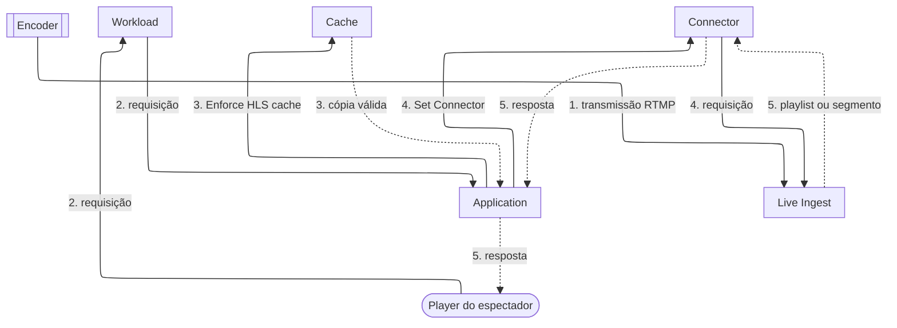

import DocButton from '~/components/webkit/DocButton.vue'
import DocCardGroup from '@aziontech/webkit/doc-card-group'
import DocCard from '@aziontech/webkit/doc-card'

**Live Ingest** é um recurso da plataforma que recebe e converte a transmissão do seu encoder para entrega aos espectadores, na infraestrutura distribuída da Azion. Um ponto de ingestão é um servidor que recebe a transmissão ao vivo de um encoder e a empacota em arquivos buscados por HTTP. Use Live Ingest para entregar eventos ao vivo, partidas de e-sports e transmissões educacionais ao seu público por meio de uma [Application](/pt-br/documentacao/plataforma/applications/).

<DocButton href="/pt-br/documentacao/plataforma/connectors/live-ingest/ingestao-e-entrega/" label="Ingestão e entrega" size="medium" />
<DocButton href="/pt-br/documentacao/plataforma/connectors/live-ingest/referencia/" label="Referência do Live Ingest" kind="secondary" size="medium" />

---

## Caminho da requisição

Espectadores nunca se conectam a Live Ingest: as requisições só chegam a ele por uma regra de Application que define um [Connector](/pt-br/documentacao/plataforma/connectors/) do tipo `live_ingest`. Esse Connector guarda uma configuração, a região para onde o seu encoder envia a transmissão.

O diagrama acompanha a transmissão desde o seu encoder e a requisição de um espectador por ela. As setas contínuas levam a transmissão ou uma requisição, e as setas pontilhadas levam uma resposta. Cada rótulo começa com o número da etapa correspondente na lista depois do diagrama.

1. O seu encoder envia a transmissão por Real-Time Messaging Protocol (RTMP) a Live Ingest, na região do Connector. Live Ingest a converte para HTTP Live Streaming (HLS): uma playlist, `.m3u8`, e os segmentos que ela lista, `.ts`.
2. O player de um espectador solicita a playlist ou um segmento a um domínio de um [Workload](/pt-br/documentacao/plataforma/workloads/). A Application que o deployment desse Workload define recebe a requisição.
3. A Azion adiciona o behavior _Enforce HLS cache_ à regra da Request Phase que define o Connector. O behavior aplica a política de cache HLS ao vivo no lugar das configurações de cache da Application. Quando o [Cache](/pt-br/documentacao/plataforma/applications/cache/) guarda uma cópia válida do arquivo, essa cópia responde ao player.
4. Caso contrário, a requisição vai para o Connector que a regra define com _Set Connector_, e o Connector a encaminha a Live Ingest.
5. Live Ingest responde com a playlist ou o segmento. O Cache guarda uma cópia sob a política de cache HLS ao vivo, e a resposta chega ao player.

Para o tempo de cache de cada tipo de arquivo, consulte [Rules Engine para Applications](/pt-br/documentacao/plataforma/applications/rules-engine/#enforce-hls-cache).

---

## Próximos passos

<DocCardGroup cols={2}>
  <DocCard title="Ingestão e entrega" href="/pt-br/documentacao/plataforma/connectors/live-ingest/ingestao-e-entrega/" label="Veja do que o encoder precisa, como a região funciona e como o cache atende um público grande." />
  <DocCard title="Entregue uma transmissão ao vivo a partir do Live Ingest" href="/pt-br/documentacao/guias/midia-e-streaming/streaming/entregar-uma-transmissao-ao-vivo-do-live-ingest/" label="Crie o Connector na região do seu encoder e envie a ele as requisições dos espectadores com uma regra." />
  <DocCard title="Configurações de Connector" href="/pt-br/documentacao/plataforma/connectors/configuracoes/#live-ingest" label="Consulte as regiões que um Connector de Live Ingest aceita e os erros que uma região errada retorna." />
  <DocCard title="Boas práticas" href="/pt-br/documentacao/plataforma/connectors/boas-praticas/#live-ingest" label="Prepare endpoints de backup, as configurações do encoder e um fallback do player antes do evento." />
  <DocCard title="Limites" href="/pt-br/documentacao/plataforma/connectors/limites/" label="Consulte os limites de um Connector e onde Live Ingest para." />
  <DocCard title="Solução de problemas" href="/pt-br/documentacao/plataforma/connectors/solucao-de-problemas/#live-ingest" label="Descubra por que a API recusa um Connector de Live Ingest." />
  <DocCard title="Preços" href="/pt-br/documentacao/fundamentos/precos/#live-ingest" label="Veja como Live Ingest é cobrado." />
  <DocCard title="Glossário" href="/pt-br/documentacao/plataforma/connectors/glossario/" label="Consulte uma palavra que as páginas do Live Ingest usam com um significado específico." />
</DocCardGroup>
