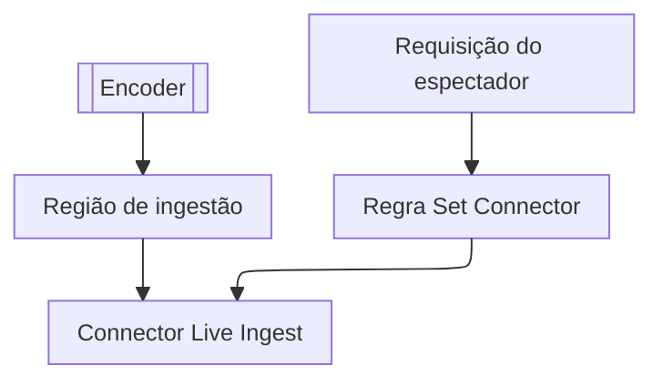

import DocButton from '~/components/webkit/DocButton.vue'
import DocCardGroup from '@aziontech/webkit/doc-card-group'
import DocCard from '@aziontech/webkit/doc-card'

Uma transmissão ao vivo é assistida enquanto é produzida. Um encoder captura o áudio e o vídeo e envia a transmissão a um ponto de ingestão à medida que a captura. O ponto de ingestão empacota a transmissão em arquivos que um player busca por HTTP. Os espectadores nunca se conectam ao encoder: servidores que receberam a transmissão entregam esses arquivos a cada espectador.

**Live Ingest** recebe a transmissão ao vivo que o seu encoder envia por Real-Time Messaging Protocol (RTMP), na região de um [connector](/pt-br/documentacao/plataforma/connectors/) do tipo `live_ingest`. Ele converte a transmissão para HTTP Live Streaming (HLS). Uma [aplicação](/pt-br/documentacao/plataforma/applications/) entrega a transmissão aos espectadores: uma regra cujo behavior _Set Connector_ nomeia esse connector envia as requisições deles à transmissão. Use Live Ingest para entregar eventos ao vivo, partidas de e-sports e transmissões educacionais ao seu público.

<DocButton href="/pt-br/documentacao/guias/midia-e-streaming/streaming/entregar-uma-transmissao-ao-vivo-do-live-ingest/" label="Entregue uma transmissão ao vivo" size="medium" />
<DocButton href="/pt-br/documentacao/plataforma/connectors/live-ingest/ingestao-e-entrega/" label="Referência do Live Ingest" kind="secondary" size="medium" />

---

## Estrutura do connector de Live Ingest

Live Ingest age por meio de um connector do tipo `live_ingest`, que carrega um atributo: a região onde Live Ingest recebe a sua transmissão. Este corpo cria um em `us-east-1`, enviado como corpo de `POST /v4/workspace/connectors`:

```json
{
  "name": "my-connector",
  "type": "live_ingest",
  "attributes": { "region": "us-east-1" }
}
```

- `type` definido como `live_ingest` deixa o connector sem endereços e sem opções de conexão, então ele não recebe [Load Balancer](/pt-br/documentacao/plataforma/connectors/load-balancer/) nem [Origin Shield](/pt-br/documentacao/plataforma/connectors/origin-shield/).
- `attributes.region` é obrigatório e aceita uma região como `us-east-1` ou `us-east-2`. Uma requisição sem ele é recusada com `10059`, e um valor que [Azion API](https://api.azion.com/) não aceita, com `10039`. Para o campo e os erros dele, consulte [Configurações de connector](/pt-br/documentacao/plataforma/connectors/configuracoes/#live-ingest).
- A API responde `202` com `"state": "pending"`, e o connector é lido de volta com `"attributes": {"region": "us-east-1"}`. Um `bucket` enviado com esse tipo é aceito e não é armazenado.
- [Azion Console](https://console.azion.com/) oferece o tipo como o card _Live Ingest_ de **Connector Type**, com **Region** como campo obrigatório.

---

## Caminho da requisição

Live Ingest age no connector que a requisição de um espectador alcança. Quando você seleciona uma fonte Live Ingest em uma regra, a Azion adiciona o behavior _Enforce HLS cache_ a essa regra da Request Phase. O behavior contorna as regras de cache da aplicação e aplica a política de cache que a Azion define para transmissões HLS ao vivo.

Este diagrama acompanha a transmissão, desde o encoder, e a requisição de um espectador até ela:



1. O encoder envia a transmissão ao vivo a Live Ingest, na região do connector.
2. Um espectador solicita a transmissão em um hostname do [workload](/pt-br/documentacao/plataforma/workloads/) cujo deployment nomeia a aplicação.
3. O behavior _Set Connector_ de uma regra nomeia o connector do tipo `live_ingest`, e o behavior _Enforce HLS cache_ aplica a política de cache HLS ao vivo.
4. O connector serve a transmissão, e o espectador a recebe.

Para saber como Live Ingest recebe uma transmissão e a entrega, consulte [Ingestão e entrega](/pt-br/documentacao/plataforma/connectors/live-ingest/ingestao-e-entrega/).

---

## Escopo e limites

- **Encoder**: Live Ingest recebe a transmissão por RTMP, então o encoder precisa suportar RTMP com autenticação por usuário e senha. A Azion fornece as credenciais e as URLs de ingestão de um endpoint primário e de um endpoint de backup. Ela também pode exigir encoders, configurações e endpoints suportados ou aprovados. O encoder não precisa de uma saída HLS própria.
- **Região**: um connector do tipo `live_ingest` aceita uma de cinco regiões. A região decide onde a transmissão entra na Azion, não onde os espectadores se conectam, então escolha a que tem o caminho mais curto a partir do encoder.
- **Cache**: _Enforce HLS cache_ mantém cada playlist, `.m3u8`, em cache por 5 segundos e cada segmento, `.ts`, por 60 segundos. Uma configuração de cache da aplicação não tem efeito sobre essas requisições. Enquanto uma cópia é válida, ela responde a todo espectador que a solicita, então um público grande não envia cada uma das suas requisições a Live Ingest.
- **Interfaces**: você cria o connector no Azion Console, pela API em `/v4/workspace/connectors` ou com `azion create connector --type live_ingest --file connector.json` da [Azion CLI](/pt-br/documentacao/devtools/cli/). Para criar o connector e a regra de entrega em cada uma delas, consulte [Entregue uma transmissão ao vivo a partir do Live Ingest](/pt-br/documentacao/guias/midia-e-streaming/streaming/entregar-uma-transmissao-ao-vivo-do-live-ingest/).
- **Observabilidade**: o dataset `connectedUsersMetrics` da GraphQL API de [Real-Time Metrics](/pt-br/documentacao/plataforma/real-time-metrics/) carrega dados agregados sobre os usuários conectados às suas transmissões ao vivo.
- **Limites**: os [limites de todo connector](/pt-br/documentacao/plataforma/connectors/limites/#connectors) se aplicam a um connector do tipo `live_ingest`, como um `name` de 1 a 255 caracteres. Para a forma de cobrança de Live Ingest, consulte [Limites de Connectors](/pt-br/documentacao/plataforma/connectors/limites/#live-ingest) e, para os valores, [Preços](/pt-br/documentacao/fundamentos/precos/#live-ingest).
- **HLS da sua origem**: para uma transmissão HLS da sua própria origem, dê às playlists e aos segmentos dela configurações de cache próprias, como descreve [Implemente cache HLS para streaming ao vivo](/pt-br/documentacao/guias/midia-e-streaming/streaming/implementar-cache-hls/).
- **Termos**: o [glossário de Connectors](/pt-br/documentacao/plataforma/connectors/glossario/) define as palavras às quais as páginas do Live Ingest dão um significado específico, como região de ingestão e tipo de connector.

---

## Próximos passos

<DocCardGroup cols={2}>
  <DocCard title="Entregue uma transmissão ao vivo a partir do Live Ingest" href="/pt-br/documentacao/guias/midia-e-streaming/streaming/entregar-uma-transmissao-ao-vivo-do-live-ingest/" label="Crie o connector na região do seu encoder e envie a ele as requisições dos espectadores." />
  <DocCard title="Ingestão e entrega" href="/pt-br/documentacao/plataforma/connectors/live-ingest/ingestao-e-entrega/" label="Acompanhe a transmissão do encoder até o player de um espectador e veja como funciona o cache dela." />
  <DocCard title="Guias e tutoriais" href="/pt-br/documentacao/plataforma/connectors/guias/" label="Conclua uma tarefa específica com um connector, como entregar uma transmissão ao vivo." />
  <DocCard title="Limites" href="/pt-br/documentacao/plataforma/connectors/limites/#live-ingest" label="Veja como Live Ingest é cobrado e os limites que todo connector aceita." />
  <DocCard title="Boas práticas" href="/pt-br/documentacao/plataforma/connectors/boas-praticas/#live-ingest" label="Planeje endpoints redundantes, configurações do encoder, fallback do player, alertas e um teste de carga." />
  <DocCard title="Solução de problemas" href="/pt-br/documentacao/plataforma/connectors/solucao-de-problemas/#live-ingest" label="Encontre a causa quando um connector de Live Ingest é recusado sem uma região." />
</DocCardGroup>
