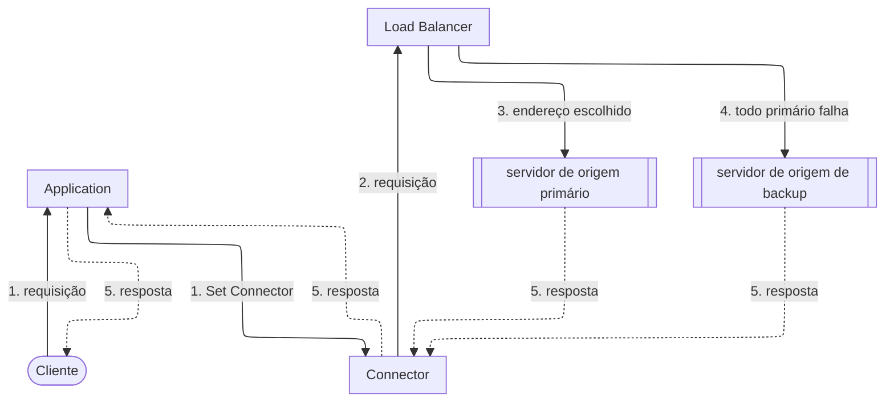

import DocButton from '~/components/webkit/DocButton.vue'
import DocCardGroup from '@aziontech/webkit/doc-card-group'
import DocCard from '@aziontech/webkit/doc-card'

**Load Balancer** é um recurso da plataforma que balanceia requisições entre os endereços de um [Connector](/pt-br/documentacao/plataforma/connectors/) do tipo `http`, na infraestrutura distribuída da Azion. Um [balanceador de carga](https://www.azion.com/pt-br/learning/performance/o-que-e-balanceamento-de-carga/) é um proxy à frente de servidores com o mesmo conteúdo, e o método de balanceamento escolhe o servidor por requisição. Use Load Balancer para tolerar falhas de origem, favorecer servidores maiores, manter uma origem de reserva ou fixar cada IP de cliente em um servidor.

<DocButton href="/pt-br/documentacao/plataforma/connectors/load-balancer/primeiros-passos/" label="Primeiros passos" size="medium" />
<DocButton href="/pt-br/documentacao/plataforma/connectors/load-balancer/referencia/" label="Referência do Load Balancer" kind="outlined" size="medium" />

---

## Caminho da requisição

Ativar Load Balancer não altera nenhuma regra: um Connector continua recebendo somente as requisições das regras de [Application](/pt-br/documentacao/plataforma/applications/) que o definem. Load Balancer então escolhe qual endereço desse Connector recebe cada uma.

O diagrama acompanha uma requisição que uma regra envia a um Connector do tipo `http` com Load Balancer ativado. As setas contínuas levam a requisição, e as setas pontilhadas levam a resposta. Cada rótulo começa com o número da etapa correspondente na lista depois do diagrama.

1. Uma Application recebe a requisição do cliente, que vai para o Connector que uma regra com _Set Connector_ define. Os critérios dessa regra, como o caminho, decidem quais requisições são balanceadas.
2. Load Balancer recebe a requisição e considera somente os endereços ativos do Connector. Um endereço inativo, com `active` igual a `false`, continua no Connector e sai da rotação.
3. O método de balanceamento, _Round Robin_, _Least Connections_ ou _IP Hash_, escolhe um endereço primário, e o peso de cada endereço molda essa escolha. O Connector envia a requisição a esse endereço com o mesmo header `Host`, o mesmo prefixo de caminho e o mesmo protocolo de todos os endereços.
4. Quando a conexão falha, o Connector tenta de novo quantas vezes `max_retries` permitir. Um endereço de backup recebe requisições somente quando todos os endereços primários falham.
5. O servidor de origem responde ao Connector, e a resposta volta pela Application até o cliente.

Para saber como cada método escolhe um endereço e como o peso e a função do servidor alteram o resultado, consulte [Métodos de balanceamento](/pt-br/documentacao/plataforma/connectors/load-balancer/metodos-de-balanceamento/).

---

## Próximos passos

<DocCardGroup cols={2}>
  <DocCard title="Primeiros passos" href="/pt-br/documentacao/plataforma/connectors/load-balancer/primeiros-passos/" label="Balanceie um Connector entre dois servidores e depois tire um servidor da rotação." />
  <DocCard title="Métodos de balanceamento" href="/pt-br/documentacao/plataforma/connectors/load-balancer/metodos-de-balanceamento/" label="Escolha um método e planeje o peso e a função do servidor de cada endereço." />
  <DocCard title="Configurações de Connector" href="/pt-br/documentacao/plataforma/connectors/configuracoes/#load-balancer" label="Consulte um campo do Load Balancer, o padrão dele em cada interface e os valores que ele aceita." />
  <DocCard title="Guias e tutoriais" href="/pt-br/documentacao/plataforma/connectors/guias/" label="Encontre o procedimento de uma tarefa, de uma origem de backup a uma mudança de tráfego por peso." />
  <DocCard title="Limites" href="/pt-br/documentacao/plataforma/connectors/limites/#load-balancer" label="Consulte o limite de endereços, peso, novas tentativas ou timeouts e o erro quando ele é ultrapassado." />
  <DocCard title="Boas práticas" href="/pt-br/documentacao/plataforma/connectors/boas-praticas/#load-balancer" label="Mantenha um endereço de backup pronto e tire um endereço da rotação antes de uma manutenção." />
  <DocCard title="Solução de problemas" href="/pt-br/documentacao/plataforma/connectors/solucao-de-problemas/#load-balancer" label="Encontre a causa quando um endereço é recusado ou quando um endereço inativo ainda recebe requisições." />
  <DocCard title="Glossário" href="/pt-br/documentacao/plataforma/connectors/glossario/" label="Consulte uma palavra que as páginas do Load Balancer usam com um significado específico, como função do servidor." />
</DocCardGroup>
