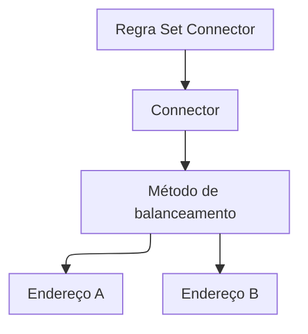

import DocButton from '~/components/webkit/DocButton.vue'
import DocCardGroup from '@aziontech/webkit/doc-card-group'
import DocCard from '@aziontech/webkit/doc-card'

Um balanceador de carga fica à frente de vários servidores que guardam o mesmo conteúdo. Para cada requisição, ele escolhe o servidor que a recebe, por uma política chamada método de balanceamento. Os servidores dividem a carga, então nenhum servidor sozinho carrega toda ela, e o site continua respondendo quando um deles falha.

**Load Balancer** distribui as requisições de um [connector](/pt-br/documentacao/plataforma/connectors/) do tipo `http` entre até 15 endereços em vez de um. Ele age dentro do connector, em cada requisição que uma regra de [aplicação](/pt-br/documentacao/plataforma/applications/) com o behavior _Set Connector_ envia a ele. Um método de balanceamento, _Round Robin_, _Least Connections_ ou _IP Hash_, escolhe o endereço, e o peso e a função do servidor de cada endereço moldam essa escolha. Use Load Balancer para continuar servindo quando um servidor falha, favorecer um servidor maior, manter uma origem de reserva ou manter cada IP de cliente em um só servidor.

<DocButton href="/pt-br/documentacao/plataforma/connectors/load-balancer/primeiros-passos/" label="Primeiros passos" size="medium" />
<DocButton href="/pt-br/documentacao/plataforma/connectors/load-balancer/metodos-de-balanceamento/" label="Referência do Load Balancer" kind="secondary" size="medium" />

---

## Estrutura da configuração do Load Balancer

Load Balancer age por meio da configuração de um connector: um switch e um método no connector, e uma função e um peso em cada endereço. Este corpo ativa Load Balancer com _Round Robin_ para dois endereços com pesos 2 e 1, enviado como corpo de `PATCH /v4/workspace/connectors/<connector-id>`:

```json
{
  "attributes": {
    "addresses": [
      {
        "address": "httpbin.org",
        "modules": { "load_balancer": { "server_role": "primary", "weight": 2 } }
      },
      {
        "address": "httpbingo.org",
        "modules": { "load_balancer": { "server_role": "primary", "weight": 1 } }
      }
    ],
    "connection_options": {
      "transport_policy": "force_http",
      "host": "${host}"
    },
    "modules": {
      "load_balancer": { "enabled": true, "config": { "method": "round_robin" } }
    }
  }
}
```

- `modules.load_balancer` dentro de `attributes` ativa Load Balancer, e o `config` dele nomeia o `method`: `round_robin`, o padrão, `least_conn` ou `ip_hash`. Com `enabled` definido como `true`, `config` precisa carregar pelo menos uma chave, ou [Azion API](https://api.azion.com/) recusa a requisição com `28014`.
- `modules.load_balancer` em cada endereço guarda o `server_role` dele, `primary` por padrão ou `backup`, e o `weight` dele, um número inteiro de 1 a 100 cujo padrão é `1`.
- `config` também aceita `max_retries`, `connection_timeout` e `read_write_timeout`. Cada chave que este corpo omite recebe o padrão da API: `0` novas tentativas, `60` segundos e `120` segundos. Para cada campo e o intervalo dele, consulte [Configurações de connector](/pt-br/documentacao/plataforma/connectors/configuracoes/#load-balancer).
- [Azion Console](https://console.azion.com/) grava os mesmos campos. Em um connector, o switch **Load Balancer** da seção **Modules** mostra **Method** e os campos de novas tentativas e de timeout. **Address Management** guarda **Server Role** e **Weight** de cada endereço.

O modelo se transfere de outros balanceadores de carga: um pool é um connector com Load Balancer ativado, e a steering policy dele é o método de balanceamento.

---

## Caminho da requisição

Load Balancer age dentro do connector, depois que uma regra o nomeia e antes que uma conexão com a origem se abra. Ele muda qual endereço recebe a requisição, não como a requisição é endereçada.

Este diagrama acompanha uma requisição, da regra até um de dois endereços:



1. O behavior _Set Connector_ de uma regra nomeia um connector que tem Load Balancer ativado.
2. O método de balanceamento do connector escolhe um dos seus endereços ativos, usando o peso e a função do servidor de cada endereço.
3. O connector abre a conexão com esse endereço, com o mesmo header `Host`, o mesmo prefixo de caminho e o mesmo protocolo de todos os outros endereços.
4. Quando a conexão falha, o connector tenta de novo quantas vezes **Max Retries** permitir.

Para saber como Round Robin, Least Connections e IP Hash escolhem um endereço, consulte [Métodos de balanceamento](/pt-br/documentacao/plataforma/connectors/load-balancer/metodos-de-balanceamento/).

---

## Escopo e limites

- **Tipo de connector**: Load Balancer funciona somente em um connector do tipo `http`, já que um connector do tipo `storage` ou `live_ingest` não tem endereços. Ele vem desativado em um connector novo, e [Origin Shield](/pt-br/documentacao/plataforma/connectors/origin-shield/) pode ficar ativado ao lado dele.
- **Requisições balanceadas**: as regras continuam decidindo quais requisições chegam ao connector, então qualquer critério de [Rules Engine para Applications](/pt-br/documentacao/plataforma/applications/rules-engine/), como o caminho, decide quais requisições são balanceadas.
- **Métodos**: os três métodos formam a lista completa, e nenhum deles direciona uma requisição pela localização do visitante ou por uma latência medida. A configuração do Load Balancer não tem health check: nem sonda, nem protocolo de sonda, nem intervalo. Um endereço de backup recebe requisições somente quando todos os endereços primários falham, e _IP Hash_ recusa um endereço de backup com `28005`.
- **Novas tentativas e timeouts**: eles existem somente enquanto Load Balancer está ativado, e um connector sem ele segue os padrões da plataforma em [Como Connectors funciona](/pt-br/documentacao/plataforma/connectors/como-funciona/#reutilizacao-de-conexoes-e-timeouts). Quando você ativa Load Balancer no Azion Console, o formulário preenche `3` novas tentativas e timeouts de `30` e `60` segundos. Pela API, `max_retries` tem o padrão `0`, então o connector não tenta de novo uma conexão que falhou até que você o aumente.
- **Manutenção**: desativar **Active** tira um endereço da rotação sem excluí-lo, e o endereço mantém as suas portas, a sua função e o seu peso. Para saber quando ele deixa de receber requisições, consulte [Endereços ativos](/pt-br/documentacao/plataforma/connectors/load-balancer/metodos-de-balanceamento/#enderecos-ativos).
- **Interfaces**: você ativa Load Balancer no formulário do connector no Azion Console ou pela API em `/v4/workspace/connectors`. [Azion CLI](/pt-br/documentacao/devtools/cli/) lê o connector inteiro de um arquivo, com `azion update connector --connector-id <connector-id> --type http --file connector.json`. No [azion.config.js](/pt-br/documentacao/devtools/cli/azion-config-js/#modules-do-connector), um connector o declara em `attributes.modules.loadBalancer`.
- **Observabilidade**: [Data Stream](/pt-br/documentacao/plataforma/data-stream/) registra em `$upstream_addr` o endereço e a porta de cada servidor para onde uma requisição foi enviada, no template predefinido *Applications + WAF Event Collector*. Quando Load Balancer escolhe outra origem para uma requisição, as variáveis `$upstream_*` guardam um valor por conexão, como mostra [Vários valores em um campo](/pt-br/documentacao/plataforma/data-stream/fontes-de-dados-e-variaveis/#varios-valores-em-um-campo).
- **Limites**: com Load Balancer ativado, um connector guarda até 15 endereços, e um 16º é recusado com `28011`. Para cada limite, o erro quando ele é ultrapassado e o que cada plano inclui, consulte [Limites de Connectors](/pt-br/documentacao/plataforma/connectors/limites/#load-balancer) e, para os valores, [Preços](/pt-br/documentacao/fundamentos/precos/#load-balancer).
- **Produtos vizinhos**: Load Balancer escolhe entre os endereços de um connector depois que a requisição chega à Azion. Registros DNS ponderados que dividem o tráfego entre endereços IP no momento da resolução pertencem ao [Edge DNS](/pt-br/documentacao/plataforma/edge-dns/).
- **Termos**: o [glossário de Connectors](/pt-br/documentacao/plataforma/connectors/glossario/) define as palavras às quais as páginas do Load Balancer dão um significado específico, como método de balanceamento, função do servidor e peso.

---

## Próximos passos

<DocCardGroup cols={2}>
  <DocCard title="Primeiros passos" href="/pt-br/documentacao/plataforma/connectors/load-balancer/primeiros-passos/" label="Distribua as requisições entre dois endereços e depois tire um deles da rotação." />
  <DocCard title="Métodos de balanceamento" href="/pt-br/documentacao/plataforma/connectors/load-balancer/metodos-de-balanceamento/" label="Compare os três métodos e veja como o peso, a função do servidor e as novas tentativas moldam a escolha." />
  <DocCard title="Guias e tutoriais" href="/pt-br/documentacao/plataforma/connectors/guias/" label="Conclua uma tarefa específica, da adição de uma origem de backup à mudança de tráfego por peso." />
  <DocCard title="Limites" href="/pt-br/documentacao/plataforma/connectors/limites/#load-balancer" label="Consulte um limite de endereços, peso, novas tentativas ou timeouts e o erro quando ele é ultrapassado." />
  <DocCard title="Boas práticas" href="/pt-br/documentacao/plataforma/connectors/boas-praticas/#load-balancer" label="Mantenha um endereço de backup pronto e tire um endereço da rotação antes de uma manutenção." />
  <DocCard title="Solução de problemas" href="/pt-br/documentacao/plataforma/connectors/solucao-de-problemas/#load-balancer" label="Encontre a causa quando um endereço é recusado ou quando um endereço inativo ainda recebe requisições." />
</DocCardGroup>
