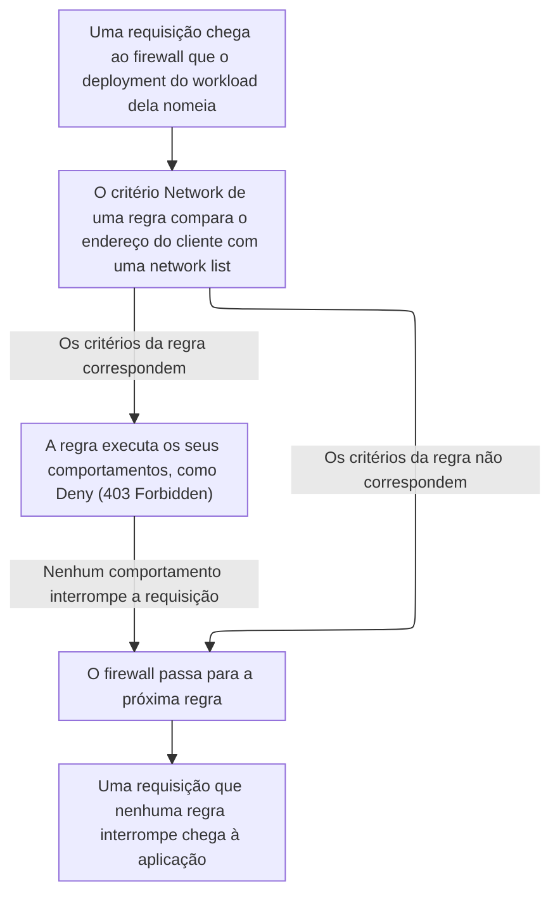

import DocButton from '~/components/webkit/DocButton.vue'
import DocCardGroup from '@aziontech/webkit/doc-card-group'
import DocCard from '@aziontech/webkit/doc-card'

Bloquear pela origem julga uma requisição pelo lugar de onde ela vem, não pelo que ela pede. A verificação compara o endereço do cliente de cada requisição com uma lista de endereços, redes ou países. Uma requisição de uma fonte listada é recusada antes que a aplicação a veja. A lista pode mudar com a mesma frequência que as ameaças, enquanto a regra que a lê continua a mesma.

**Network Shield** acrescenta essa comparação a um [firewall](/pt-br/documentacao/plataforma/firewall/) como um critério de regra, _Network_, `${network}` na [Azion API](https://api.azion.com/). O critério compara o endereço do cliente de uma requisição com uma [network list](/pt-br/documentacao/plataforma/firewall/network-shield/network-lists/) de endereços IP e intervalos CIDR, de Autonomous System Numbers (ASNs) ou de países. Use Network Shield para bloquear endereços sabidamente maliciosos, restringir o acesso por país, permitir somente as suas próprias redes, aplicar um rate limit a um conjunto de clientes ou bloquear exit nodes Tor.

<DocButton href="/pt-br/documentacao/plataforma/firewall/network-shield/primeiros-passos/" label="Primeiros passos" size="medium" />
<DocButton href="/pt-br/documentacao/plataforma/firewall/network-shield/network-lists/" label="Referência do Network Shield" kind="secondary" size="medium" />

---

## Estrutura da network list

Network Shield compara por meio de uma network list, que guarda itens de um único tipo, fixado quando a lista é criada. Esta lista guarda um endereço IPv4, um intervalo IPv4 e um intervalo IPv6, enviada como corpo de `POST /v4/workspace/network_lists`:

```json
{
  "name": "Blocked addresses",
  "type": "ip_cidr",
  "items": ["192.0.2.10", "198.51.100.0/24", "2001:db8::/32"]
}
```

- `type` define o formato de todos os itens e nunca muda depois da criação. `ip_cidr` aceita endereços e intervalos IPv4 e IPv6, `asn` aceita Autonomous System Numbers em dígitos e `countries` aceita códigos ISO 3166-1 alpha-2 de duas letras, como `DE`.
- `items` guarda as entradas que uma regra compara, e duplicatas exatas são removidas. Um item `ip_cidr` também pode carregar uma data de expiração, `--LT` e uma data e hora em UTC, e um comentário com `#`.
- Uma regra de firewall referencia a lista pelo ID com o critério _Network_, `{ "variable": "${network}", "conditional": "if", "operator": "is_in_list", "argument": <network-list-id> }`. O ID é um inteiro JSON, e o mesmo ID enviado como string é recusado com `25042`.
- [Azion Console](https://console.azion.com) mantém as listas na página **Network Lists**, Azion API as serve em `/v4/workspace/network_lists`, e [Azion CLI](/pt-br/documentacao/devtools/cli/) as gerencia com o substantivo `network-list`.

---

## Caminho da requisição

Criar uma network list não bloqueia nenhuma requisição. Uma lista não decide nada sozinha: ela só corresponde a tráfego depois que uma regra a referencia, em um firewall que o deployment de um [workload](/pt-br/documentacao/plataforma/workloads/) nomeia. O que acontece com uma requisição que corresponde é o comportamento da regra, que [Rules Engine para Firewall](/pt-br/documentacao/plataforma/firewall/rules-engine/) define e Network Shield não altera.

Este diagrama acompanha uma requisição, do firewall que a recebe até a decisão de uma regra com o critério _Network_:



1. O deployment de um workload nomeia um firewall, e cada requisição ao workload chega a esse firewall antes da aplicação.
2. O critério _Network_ de uma regra nomeia uma network list pelo ID e compara o endereço do cliente da requisição com os itens da lista. Uma lista `asn` ou `countries` corresponde quando o endereço pertence a uma rede ou a um país listado.
3. O critério é verdadeiro para um cliente na lista com _matches_ (`is_in_list`) e para um cliente fora da lista com _does not match_ (`is_not_in_list`).
4. Quando os critérios da regra correspondem, a regra executa os seus comportamentos. Um comportamento que interrompe a requisição, como _Deny (403 Forbidden)_, responde ao cliente com `403`, e nenhuma regra posterior é executada.
5. Quando os critérios não correspondem, ou nenhum comportamento interrompe a requisição, o firewall passa para a próxima regra. Uma requisição que nenhuma regra interrompe chega à aplicação.

Para saber como uma lista corresponde ao endereço do cliente, quando os itens expiram e quais listas a Azion mantém, consulte [Correspondência de listas](/pt-br/documentacao/plataforma/firewall/network-shield/correspondencia-de-listas/).

---

## Escopo e limites

- **Firewall**: Network Shield acrescenta uma coisa a um firewall, o critério _Network_, e um firewall novo começa com ele ativado. O interruptor do Console vem ativado por padrão, e a API retorna `modules.network_protection.enabled` como `true`. Enquanto Network Shield está desativado, a API recusa uma regra que usa `${network}` com `25047 Missing Required Modules`, e Azion Console mostra a opção desabilitada, como _Network - required Network Shield_. Depois que uma regra usa o critério, a desativação do Network Shield é recusada com `24005`, cujo detalhe lista os IDs das regras. O interruptor fica em **Main Settings** › **Modules**, e a opção _Network_ fica selecionável depois que você salva o firewall com ele ativado. Para saber por que mantê-lo ativado, consulte [Boas práticas de Firewall](/pt-br/documentacao/plataforma/firewall/boas-praticas/#network-shield).
- **Comportamentos**: todo comportamento que uma regra correspondente executa pertence ao Firewall, então _Deny (403 Forbidden)_, _Drop (Close Without Response)_ e _Set Rate Limit_ são aplicados com Network Shield desativado. Uma regra pode encadear o critério _Network_ com qualquer outro critério que o firewall oferece, como _Request Uri_, para limitar um bloqueio a um caminho.
- **Regras movidas**: uma regra _Network_ recriada em um firewall em que Network Shield está desativado é recusada até que Network Shield seja ativado ali. No firewall de onde a regra veio, Network Shield só é desativado depois que toda regra _Network_ dele for excluída ou alterada.
- **Listas**: uma lista pode sustentar muitas regras em muitos firewalls, então uma mudança nos itens dela altera o que todas elas comparam, sem alterar as regras. Essa mudança chega ao tráfego antes de uma regra nova. Toda conta também tem `Azion IP Tor Exit Nodes`, a lista `2`, que a Azion mantém atualizada, e qualquer gravação nela é recusada com `22004`. Para os tempos de propagação, consulte [Correspondência de listas](/pt-br/documentacao/plataforma/firewall/network-shield/correspondencia-de-listas/#uma-lista-por-tras-de-muitas-regras).
- **Países e ASNs**: a Azion resolve o país e o ASN de um endereço a partir de bancos de dados mantidos por fornecedores externos. O controle de acesso por país ou ASN é, portanto, aplicado em regime de melhor esforço. Para saber qual tipo de lista atende cada caso, consulte [Boas práticas de Firewall](/pt-br/documentacao/plataforma/firewall/boas-praticas/#escolha-o-tipo-de-lista-de-acordo-com-o-que-voce-bloqueia).
- **Limites**: uma regra que usa o critério _Network_ conta para as [regras que cada plano inclui](/pt-br/documentacao/plataforma/firewall/limites/#uso-incluido-por-plano) por firewall, como qualquer outra regra. Cada lista comporta até 20.000 itens por padrão, um teto que a Azion pode aumentar mediante solicitação, de acordo com o plano. Para cada limite, a resposta quando ele é ultrapassado e o que cada plano inclui, consulte [Limites de Firewall](/pt-br/documentacao/plataforma/firewall/limites/#network-shield) e, para os valores, [Preços](/pt-br/documentacao/fundamentos/precos/#network-shield).
- **Interfaces**: você cria e gerencia listas na página **Network Lists** do Azion Console e pela API em `/v4/workspace/network_lists`. Azion CLI as gerencia com comandos como `azion create network-list` e `azion update network-list --add-item`. O critério _Network_ pertence a uma regra de firewall, criada com `azion create firewall-rule` ou em `/v4/workspace/firewalls/<firewall-id>/request_rules`. `azion.config.js` declara uma lista na entrada `networkList` e ativa Network Shield com o `networkProtection` de um firewall, como documenta [azion.config.js](/pt-br/documentacao/devtools/cli/azion-config-js/#networklist). [Azion Terraform Provider](/pt-br/documentacao/devtools/terraform/security/) gerencia listas com o recurso `azion_network_list`. Uma função em um firewall verifica um endereço contra uma lista com `Azion.networkList.contains()`, documentado em [Network List API](/pt-br/documentacao/devtools/runtime/api-reference/network-list/).
- **Observabilidade**: uma requisição que _Deny (403 Forbidden)_ recusa recebe a página de erro padrão da Azion. A página mostra o endereço comparado e o ID da requisição que `x-azion-request-id` carrega, e não nomeia nem o firewall, nem a regra, nem a lista. Com a configuração **Debug Rules** do firewall ativada, [Real-Time Events](/pt-br/documentacao/plataforma/real-time-events/) e [Data Stream](/pt-br/documentacao/plataforma/data-stream/) mostram as regras que uma requisição executou, no campo `$traceback`. [Real-Time Metrics](/pt-br/documentacao/plataforma/real-time-metrics/) detalha as requisições por endereço, rede e país.
- **Produtos vizinhos**: Network Shield lê de onde uma requisição vem e nada sobre o que ela carrega. Para recusar um ataque que uma requisição carrega, use [WAF](/pt-br/documentacao/plataforma/firewall/waf/), e para distinguir scripts de pessoas, use [Bot Manager](/pt-br/documentacao/plataforma/firewall/bot-manager/).
- **Termos**: o [glossário de Firewall](/pt-br/documentacao/plataforma/firewall/glossario/) define as palavras às quais as páginas do Network Shield dão um significado específico, como network list, allowlist, blocklist e data de expiração.

---

## Próximos passos

<DocCardGroup cols={2}>
  <DocCard title="Primeiros passos" href="/pt-br/documentacao/plataforma/firewall/network-shield/primeiros-passos/" label="Negue o seu próprio endereço em um caminho de teste e leia a recusa." />
  <DocCard title="Correspondência de listas" href="/pt-br/documentacao/plataforma/firewall/network-shield/correspondencia-de-listas/" label="Veja como uma lista corresponde ao endereço do cliente e quando os itens dela expiram." />
  <DocCard title="Network Lists" href="/pt-br/documentacao/plataforma/firewall/network-shield/network-lists/" label="Consulte um campo, um tipo de lista, uma anotação de item ou um erro." />
  <DocCard title="Guias e tutoriais" href="/pt-br/documentacao/plataforma/firewall/guias/" label="Conclua uma tarefa específica, de um bloqueio por país a uma allowlist." />
  <DocCard title="Limites" href="/pt-br/documentacao/plataforma/firewall/limites/#network-shield" label="Consulte um limite de uma lista, a resposta quando ele é ultrapassado ou o que um plano inclui." />
  <DocCard title="Solução de problemas" href="/pt-br/documentacao/plataforma/firewall/solucao-de-problemas/#network-shield" label="Encontre a causa quando um cliente listado passa, ou uma lista ou uma regra é recusada." />
</DocCardGroup>
