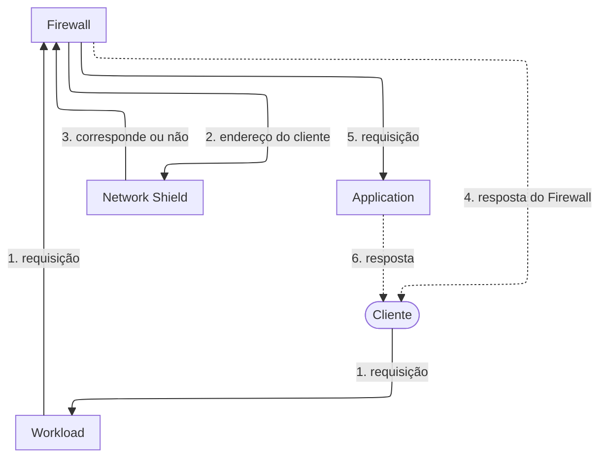

import DocButton from '~/components/webkit/DocButton.vue'
import DocCardGroup from '@aziontech/webkit/doc-card-group'
import DocCard from '@aziontech/webkit/doc-card'

**Network Shield** é um recurso da plataforma aninhado ao [Firewall](/pt-br/documentacao/plataforma/firewall/) que compara as requisições aos seus [Workloads](/pt-br/documentacao/plataforma/workloads/) pelo endereço do cliente, antes da [Application](/pt-br/documentacao/plataforma/applications/). Um filtro de camada de rede compara o endereço de cada cliente com listas de endereços, redes ou países e recusa quem uma política exclui. Use Network Shield para bloquear endereços e redes abusivos, recusar países que você não atende ou barrar todo cliente fora das suas próprias redes.

Network Shield compara o cliente com uma entidade própria:

- [Network Lists](/pt-br/documentacao/plataforma/firewall/network-shield/network-lists/) guardam os endereços IP e intervalos, os Autonomous System Numbers (ASNs) ou os países que uma regra compara com o cliente. Mantenha cada conjunto de clientes em uma lista, para que uma mudança nos itens dela alcance toda regra que a usa.

<DocButton href="/pt-br/documentacao/plataforma/firewall/network-shield/primeiros-passos/" label="Primeiros passos" size="medium" />
<DocButton href="/pt-br/documentacao/plataforma/firewall/network-shield/referencia/" label="Referência do Network Shield" kind="secondary" size="medium" />

---

## Caminho da requisição

Uma Network List não bloqueia nada sozinha. Uma regra do Firewall usa a lista por meio do critério _Network_, e os comportamentos dessa regra decidem o que acontece com um cliente a que a lista corresponde. Esse Firewall inspeciona apenas as requisições aos Workloads cujos deployments o definem.

O diagrama acompanha uma requisição por uma regra com o critério _Network_. As setas contínuas levam a requisição, as setas pontilhadas levam a resposta, e cada rótulo começa com o número da sua etapa.

1. A requisição de um cliente chega a um Workload, cujo deployment define o Firewall e a Application. O Firewall inspeciona a requisição antes da Application.
2. O Firewall executa as suas regras em ordem. Uma regra com o critério _Network_ faz Network Shield comparar o endereço do cliente com uma Network List.
3. Network Shield informa se o cliente está na lista. Com _matches_, o critério é verdadeiro para um cliente listado, e com _does not match_, é verdadeiro para um cliente fora da lista.
4. Quando os critérios da regra correspondem, a regra aplica os seus comportamentos. _Deny (403 Forbidden)_, por exemplo, responde ao cliente com uma recusa, e as regras depois dela nunca são executadas.
5. Quando os critérios não correspondem, ou nenhum comportamento encerra a requisição, o Firewall passa para a próxima regra. A Application recebe apenas as requisições que todas as regras deixaram passar.
6. A Application responde, e a resposta dela chega ao cliente.

Para ver como uma lista se torna uma blocklist ou uma allowlist, consulte [Correspondência de listas](/pt-br/documentacao/plataforma/firewall/network-shield/correspondencia-de-listas/#comparacao-do-endereco-do-cliente).

---

## Próximos passos

<DocCardGroup cols={2}>
  <DocCard title="Primeiros passos" href="/pt-br/documentacao/plataforma/firewall/network-shield/primeiros-passos/" label="Crie uma Network List, negue o seu próprio endereço em um caminho de teste e leia a recusa." />
  <DocCard title="Correspondência de listas" href="/pt-br/documentacao/plataforma/firewall/network-shield/correspondencia-de-listas/" label="Veja como uma lista compara o endereço de um cliente, quando os itens dela expiram e quais listas a Azion mantém." />
  <DocCard title="Guias e tutoriais" href="/pt-br/documentacao/plataforma/firewall/guias/" label="Faça uma tarefa específica, de um bloqueio por país a uma allowlist ou um bloqueio temporário." />
  <DocCard title="Boas práticas" href="/pt-br/documentacao/plataforma/firewall/boas-praticas/#network-shield" label="Escolha um tipo de lista para cada origem e decida quem é responsável por cada lista." />
  <DocCard title="Limites" href="/pt-br/documentacao/plataforma/firewall/limites/#network-shield" label="Consulte um limite de uma Network List e a resposta que uma chamada recebe além dele." />
  <DocCard title="Solução de problemas" href="/pt-br/documentacao/plataforma/firewall/solucao-de-problemas/#network-shield" label="Descubra por que um cliente listado passa, ou por que uma regra com uma Network List é recusada." />
  <DocCard title="Network List API" href="/pt-br/documentacao/devtools/runtime/api-reference/network-list/" label="Verifique um endereço contra uma lista a partir de uma Function em um Firewall." />
  <DocCard title="Glossário" href="/pt-br/documentacao/plataforma/firewall/glossario/" label="Consulte uma palavra como allowlist, blocklist ou data de expiração." />
</DocCardGroup>
