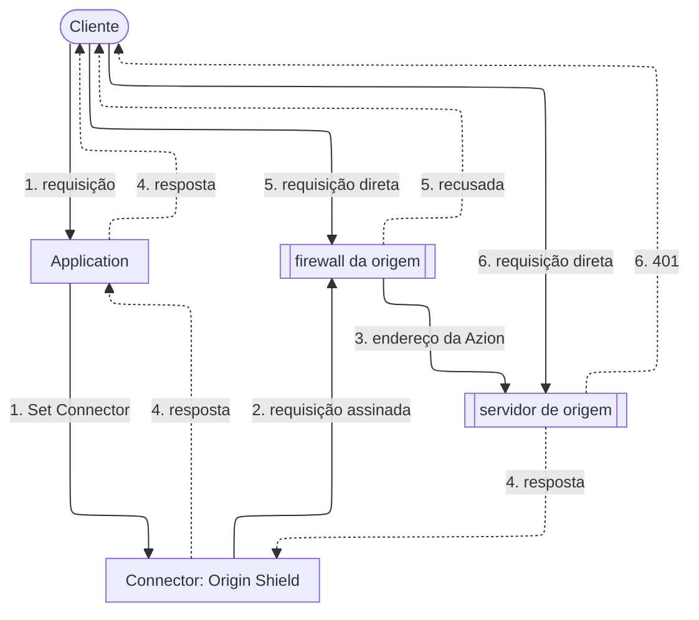

import DocButton from '~/components/webkit/DocButton.vue'
import DocCardGroup from '@aziontech/webkit/doc-card-group'
import DocCard from '@aziontech/webkit/doc-card'

**Origin Shield** é um recurso da plataforma que permite que a sua origem aceite somente as requisições que um [Connector](/pt-br/documentacao/plataforma/connectors/) envia a partir da Azion. Um origin shield é um conjunto de verificações na origem que aceitam só o tráfego de um proxy, por IP de saída, assinatura ou ambos. Use Origin Shield para impedir que clientes acessem a sua origem diretamente ou servir um bucket privado compatível com S3 por meio de uma [Application](/pt-br/documentacao/plataforma/applications/).

Origin Shield dá a um Connector do tipo `http` duas features, que você ativa separadamente:

- [HMAC](/pt-br/documentacao/plataforma/connectors/origin-shield/origin-ip-acl-e-hmac/#autenticacao-hmac), código de autenticação de mensagem baseado em hash, permite que um Connector assine cada requisição com as credenciais do seu provedor compatível com S3. Assim, um bucket privado a responde, mas a assinatura protege somente uma origem que a verifica, como faz o storage compatível com S3.
- [Origin IP ACL](/pt-br/documentacao/plataforma/connectors/origin-shield/origin-ip-acl-e-hmac/#origin-ip-acl) é indicado para um servidor atrás do seu firewall, cuja lista de controle de acesso (ACL) então aceita somente conexões dos endereços da Azion. O seu firewall aplica uma cópia da network list `Azion Origin Shield`, que você mantém atualizada à medida que a Azion a altera.

<DocButton href="/pt-br/documentacao/plataforma/connectors/origin-shield/origin-ip-acl-e-hmac/" label="Origin IP ACL e HMAC" size="medium" />
<DocButton href="/pt-br/documentacao/plataforma/connectors/origin-shield/referencia/" label="Referência do Origin Shield" kind="secondary" size="medium" />

---

## Caminho da requisição

Ativar Origin Shield não bloqueia nenhum cliente na Azion: a sua origem aplica cada verificação que você ativa. Com HMAC, o Connector assina cada requisição e, com Origin IP ACL, o firewall da sua origem aceita somente conexões de endereços da lista. Origin Shield atua somente sobre as requisições de um Connector que uma regra de Application define com o behavior _Set Connector_.

O diagrama acompanha uma requisição a uma origem protegida e duas requisições que tentam contornar a Azion. As setas contínuas levam a requisição, e as setas pontilhadas levam a resposta. Cada rótulo começa com o número da etapa correspondente.

1. A Application recebe a requisição de um cliente, e uma regra com o behavior _Set Connector_ define um Connector que tem Origin Shield ativado.
2. Com HMAC ativado, o Connector assina a requisição com as credenciais que guarda e então se conecta à sua origem a partir de um endereço da infraestrutura da Azion.
3. Com Origin IP ACL, o firewall da sua origem aceita a conexão, porque o endereço da fonte dela está na lista `Azion Origin Shield`.
4. A sua origem verifica a assinatura quando HMAC está ativado, depois responde, e a resposta volta pelo Connector e pela Application até o cliente.
5. Um cliente que se conecta diretamente ao endereço da sua origem vem de um endereço fora da lista, então o firewall recusa a conexão.
6. Sem Origin IP ACL, uma requisição direta chega à sua origem sem assinatura. Um bucket privado que espera a assinatura responde `401`, não `403`.

---

## Próximos passos

<DocCardGroup cols={2}>
  <DocCard title="Restrinja uma origem à Azion" href="/pt-br/documentacao/guias/seguranca-de-aplicacoes/bots-e-rede/restringir-uma-origem-a-azion-com-origin-ip-acl/" label="Ative Origin IP ACL e deixe o firewall da sua origem aceitar somente os prefixos da Azion." />
  <DocCard title="Assine requisições de origem com HMAC" href="/pt-br/documentacao/guias/desenvolvimento-de-aplicacoes/primeiros-passos/assine-requisicoes-de-origem-com-hmac/" label="Sirva um bucket privado compatível com S3 por meio de um Connector que assina cada requisição." />
  <DocCard title="Libere os IPs da Azion na sua origem" href="/pt-br/documentacao/suporte/obter-ranges-ip-azion/" label="Leia a lista Azion Origin Shield e automatize a atualização da cópia na sua origem." />
  <DocCard title="Configurações de Connector" href="/pt-br/documentacao/plataforma/connectors/configuracoes/#origin-shield" label="Consulte um campo do Origin Shield, o padrão dele ou o erro que o protege." />
  <DocCard title="Limites" href="/pt-br/documentacao/plataforma/connectors/limites/#origin-shield" label="Consulte os limites das credenciais HMAC e o que um Connector protegido cobre." />
  <DocCard title="Boas práticas" href="/pt-br/documentacao/plataforma/connectors/boas-praticas/#origin-shield" label="Mantenha a allowlist da sua origem atualizada e restrinja as credenciais HMAC a um bucket." />
  <DocCard title="Solução de problemas" href="/pt-br/documentacao/plataforma/connectors/solucao-de-problemas/#origin-shield" label="Encontre a causa quando a sua origem recusa a Azion ou quando as credenciais HMAC somem." />
  <DocCard title="Glossário" href="/pt-br/documentacao/plataforma/connectors/glossario/" label="Consulte uma palavra que as páginas do Origin Shield usam com um significado específico." />
</DocCardGroup>
