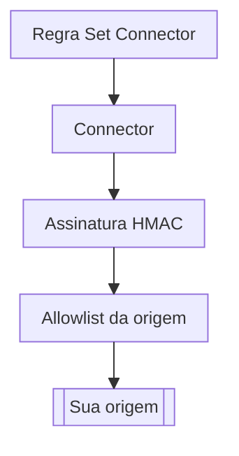

import DocButton from '~/components/webkit/DocButton.vue'
import DocCardGroup from '@aziontech/webkit/doc-card-group'
import DocCard from '@aziontech/webkit/doc-card'

Uma origem na internet pública responde a qualquer um que encontre o seu endereço, então um cliente pode contornar um proxy e todas as proteções à frente dele. Duas verificações fecham esse caminho. A origem aceita conexões apenas dos endereços do proxy e recusa toda requisição que não carrega uma assinatura feita com um segredo que só o proxy guarda. Com as duas em vigor, uma requisição chega à origem somente pelo proxy.

**Origin Shield** dá as duas verificações a um [connector](/pt-br/documentacao/plataforma/connectors/) do tipo `http`, para cada requisição que uma regra de [aplicação](/pt-br/documentacao/plataforma/applications/) com o behavior _Set Connector_ envia a ele. Um código de autenticação de mensagem baseado em hash (HMAC) assina cada requisição que o connector envia com credenciais AWS Signature Version 4. Assim, uma origem compatível com S3 a autentica. Origin IP ACL deixa o firewall da sua origem permitir somente os prefixos IPv4 e IPv6 da network list `Azion Origin Shield`, nas camadas 3 e 4. Use Origin Shield para impedir que os clientes alcancem a sua origem diretamente ou para servir um bucket privado por meio de uma aplicação.

<DocButton href="/pt-br/documentacao/guias/seguranca-de-aplicacoes/bots-e-rede/restringir-uma-origem-a-azion-com-origin-ip-acl/" label="Restrinja uma origem à Azion" size="medium" />
<DocButton href="/pt-br/documentacao/plataforma/connectors/origin-shield/origin-ip-acl-e-hmac/" label="Referência do Origin Shield" kind="secondary" size="medium" />

---

## Estrutura da configuração do Origin Shield

Origin Shield age por meio da configuração de um connector: um switch para Origin Shield, um switch por defesa e as credenciais HMAC. Este corpo cria um connector que lê um bucket privado pelo endpoint S3 do [Object Storage](/pt-br/documentacao/plataforma/object-storage/) e assina cada requisição, enviado como corpo de `POST /v4/workspace/connectors`:

```json
{
  "name": "my-bucket-connector",
  "type": "http",
  "attributes": {
    "addresses": [{ "address": "s3.us-east-005.azionstorage.net" }],
    "connection_options": {
      "transport_policy": "force_https",
      "host": "s3.us-east-005.azionstorage.net",
      "path_prefix": "/<bucket-name>"
    },
    "modules": {
      "origin_shield": {
        "enabled": true,
        "config": {
          "origin_ip_acl": { "enabled": false },
          "hmac": {
            "enabled": true,
            "config": {
              "type": "aws4_hmac_sha256",
              "attributes": {
                "region": "us-east-005",
                "service": "s3",
                "access_key": "<access-key>",
                "secret_key": "<secret-key>"
              }
            }
          }
        }
      }
    }
  }
}
```

- `modules.origin_shield.enabled` ativa Origin Shield, e o `config` dele guarda um switch por defesa, `origin_ip_acl.enabled` e `hmac.enabled`. Os três são `false` em um connector novo, e este corpo ativa somente HMAC.
- `hmac.config` carrega as credenciais. `type` é `aws4_hmac_sha256`, `region` é uma região que o provedor suporta e `service` tem o padrão `s3`. A access key e a secret key vêm do seu provedor de object storage.
- Com `enabled` definido como `true`, `config` precisa carregar pelo menos uma chave e, com `hmac.enabled` definido como `true`, `hmac.config` precisa estar presente, ou [Azion API](https://api.azion.com/) recusa a requisição com `28014`. Para cada campo e o erro que o protege, consulte [Configurações de connector](/pt-br/documentacao/plataforma/connectors/configuracoes/#origin-shield).
- [Azion Console](https://console.azion.com/) grava os mesmos campos. O switch **Origin Shield** do formulário do connector mostra o switch **Origin IP ACL** e a seção **HMAC**, em que **Type** é somente leitura.

Se você assina requisições ao S3 com AWS Signature Version 4, as credenciais se transferem: HMAC recebe a mesma região, serviço, access key e secret key.

---

## Caminho da requisição

Origin Shield age no trecho entre o connector e a origem. HMAC adiciona a assinatura quando o connector envia a requisição, e Origin IP ACL entra em vigor na sua origem, que verifica de onde vem a conexão.

Este diagrama acompanha uma requisição, da regra até uma origem protegida:



1. O behavior _Set Connector_ de uma regra nomeia um connector que tem Origin Shield ativado.
2. Com HMAC ativado, o connector assina a requisição com as credenciais que guarda.
3. A conexão alcança a sua origem a partir de um endereço da Azion. Com Origin IP ACL, o firewall da sua origem a aceita porque o endereço está na lista `Azion Origin Shield`.
4. A origem verifica a assinatura e responde à requisição.

Para saber como Origin IP ACL e HMAC protegem a origem, consulte [Origin IP ACL e HMAC](/pt-br/documentacao/plataforma/connectors/origin-shield/origin-ip-acl-e-hmac/).

---

## Escopo e limites

- **Tipo de connector**: Origin Shield se aplica somente a um connector do tipo `http`, e um connector do tipo `storage` ou `live_ingest` não recebe configurações de Origin Shield. Em um connector do tipo `http`, Origin Shield e [Load Balancer](/pt-br/documentacao/plataforma/connectors/load-balancer/) podem ficar ativados juntos.
- **Origin IP ACL**: o firewall da sua origem aplica a allowlist, não a Azion, e recusa um cliente que se conecta diretamente ao endereço da origem. A lista `Azion Origin Shield` aparece em [Network Lists](/pt-br/documentacao/plataforma/firewall/network-shield/network-lists/) assim que pelo menos um connector da conta tem Origin IP ACL ativado. Ela guarda prefixos IPv6 ao lado dos IPv4, e uma allowlist só com os prefixos IPv4 recusa as conexões que a Azion abre por IPv6.
- **Atualizações da lista**: a lista pode mudar com frequência, e a Azion envia um e-mail a toda conta com Origin Shield a cada mudança. Azion Console guarda um histórico dos prefixos que cada mudança adicionou e removeu. Os servidores por trás de um prefixo adicionado entram em produção 7 dias depois que a Azion publica a lista. Esse é o seu prazo para atualizar a cópia na sua origem. Para ler a lista e automatizar essa atualização, consulte [Libere os IPs da Azion na sua origem](/pt-br/documentacao/suporte/obter-ranges-ip-azion/).
- **HMAC**: um conjunto de credenciais assina as requisições para todos os endereços do connector, e desativar HMAC as remove. A assinatura protege somente uma origem que a verifica. Com HMAC desativado, um bucket privado no endpoint S3 do Object Storage responde `401`, não `403`. Para as etapas, consulte [Assine requisições de origem com HMAC](/pt-br/documentacao/guias/desenvolvimento-de-aplicacoes/primeiros-passos/assine-requisicoes-de-origem-com-hmac/).
- **O que cada defesa prova**: um endereço da lista prova que a conexão veio da infraestrutura da Azion, não do seu connector. Quando a assinatura é válida, ela prova que a requisição leva as suas credenciais. Ative as duas quando a origem precisar aceitar somente requisições que passam pela Azion e levam as suas credenciais, como explica [O que cada mecanismo prova](/pt-br/documentacao/plataforma/connectors/origin-shield/origin-ip-acl-e-hmac/#o-que-cada-mecanismo-prova).
- **Propagação**: uma mudança nesses switches chega ao tráfego em vários minutos, em um momento diferente em cada data center. Por exemplo, logo depois que você desativa HMAC, alguns data centers ainda assinam requisições enquanto outros já as enviam sem assinatura.
- **Interfaces**: você ativa Origin Shield no formulário do connector no Azion Console ou pela API em `/v4/workspace/connectors`. [Azion CLI](/pt-br/documentacao/devtools/cli/) cria o connector a partir de um arquivo JSON, com `azion create connector --type http --file connector.json`. No [azion.config.js](/pt-br/documentacao/devtools/cli/azion-config-js/#modules-do-connector), um connector o declara em `attributes.modules.originShield`.
- **Limites**: HMAC aceita um conjunto de credenciais por connector, e cada um dos atributos dele aceita de 1 a 255 caracteres. Para cada limite e o que cada plano inclui, consulte [Limites de Connectors](/pt-br/documentacao/plataforma/connectors/limites/#origin-shield) e, para os valores, [Preços](/pt-br/documentacao/fundamentos/precos/#origin-shield).
- **Produtos vizinhos**: Origin Shield protege a origem com uma allowlist e com a assinatura de requisições. Uma segunda camada de cache entre o cache da Azion e a sua origem, que reduz as requisições que chegam a ela, é [Tiered Cache](/pt-br/documentacao/plataforma/applications/cache/tiered-cache/).
- **Termos**: o [glossário de Connectors](/pt-br/documentacao/plataforma/connectors/glossario/) define as palavras às quais as páginas do Origin Shield dão um significado específico, como Origin IP ACL, HMAC e lista Azion Origin Shield.

---

## Próximos passos

<DocCardGroup cols={2}>
  <DocCard title="Restrinja uma origem à Azion" href="/pt-br/documentacao/guias/seguranca-de-aplicacoes/bots-e-rede/restringir-uma-origem-a-azion-com-origin-ip-acl/" label="Ative Origin IP ACL e deixe o firewall da sua origem aceitar só os prefixos da Azion." />
  <DocCard title="Origin IP ACL e HMAC" href="/pt-br/documentacao/plataforma/connectors/origin-shield/origin-ip-acl-e-hmac/" label="Veja o que cada defesa prova e como a lista de endereços é atualizada." />
  <DocCard title="Guias e tutoriais" href="/pt-br/documentacao/plataforma/connectors/guias/" label="Conclua uma tarefa específica, de uma allowlist na sua origem a um bucket assinado como origem." />
  <DocCard title="Limites" href="/pt-br/documentacao/plataforma/connectors/limites/#origin-shield" label="Consulte os limites das credenciais HMAC e o que um plano inclui." />
  <DocCard title="Boas práticas" href="/pt-br/documentacao/plataforma/connectors/boas-praticas/#origin-shield" label="Mantenha atualizada a allowlist da sua origem e limite as credenciais HMAC a um bucket." />
  <DocCard title="Solução de problemas" href="/pt-br/documentacao/plataforma/connectors/solucao-de-problemas/#origin-shield" label="Encontre a causa quando a sua origem recusa a Azion ou um bucket responde 401." />
</DocCardGroup>
