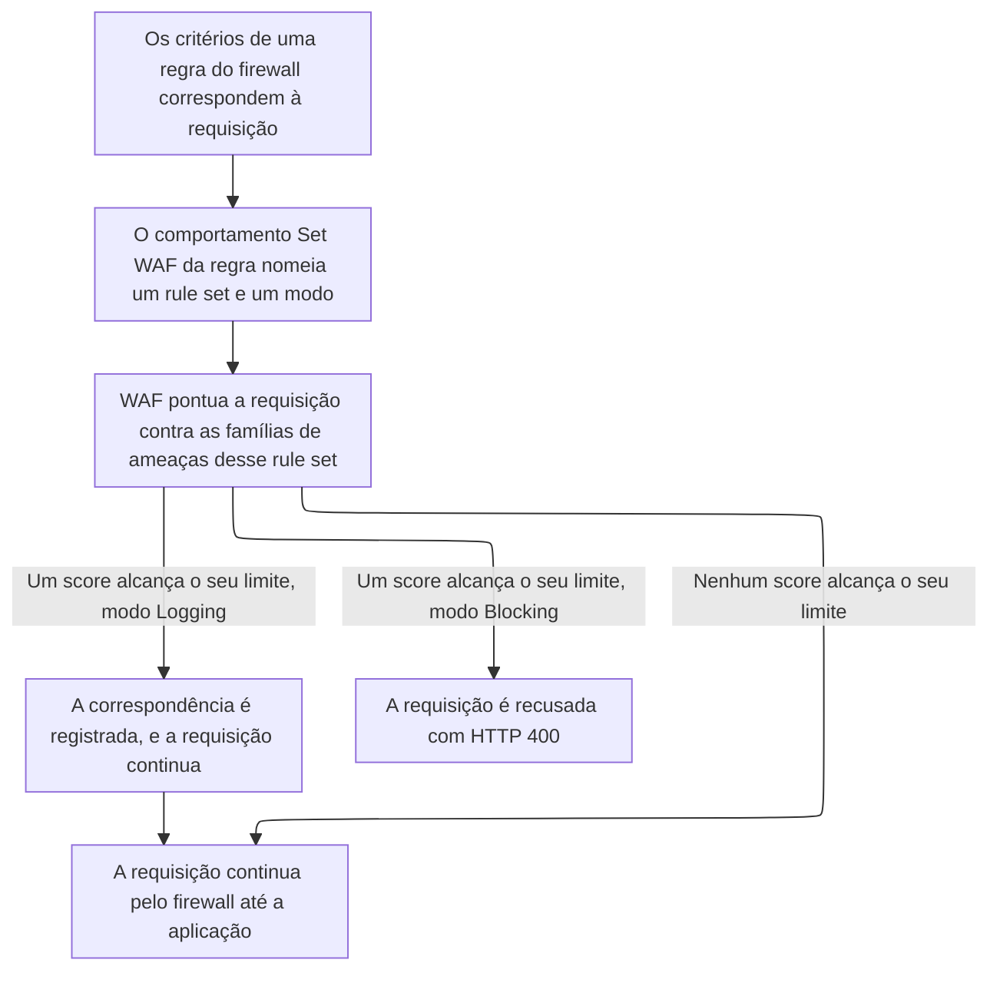

import DocButton from '~/components/webkit/DocButton.vue'
import DocCardGroup from '@aziontech/webkit/doc-card-group'
import DocCard from '@aziontech/webkit/doc-card'

Um [firewall de aplicação web](https://www.azion.com/pt-br/learning/websec/o-que-e-firewall-aplicacao-web/) lê uma requisição antes da aplicação. Ele pesa as partes que podem carregar um ataque, como o caminho, a query string, os headers, os cookies e o corpo, contra padrões de ataque conhecidos. Quando as evidências se somam, ele recusa a requisição, então a aplicação nunca a processa. Caso contrário, a requisição chega à aplicação sem alteração.

**Web Application Firewall (WAF)** pontua cada requisição que uma regra de um [firewall](/pt-br/documentacao/plataforma/firewall/) entrega a ele contra oito famílias de ameaças, na camada 7, a camada de aplicação. Ele recusa ou registra cada requisição cujo score alcança um limite. Em um firewall que tem WAF ativado, ele roda para as requisições cuja regra carrega um comportamento _Set WAF_. Use WAF para recusar requisições que carregam ameaças do [OWASP Top 10](https://www.azion.com/pt-br/learning/websec/o-que-e-a-lista-owasp-top-10-de-ataques-ciberneticos-em-aplicacoes-web/) e outras, como SQL injection, cross-site scripting e remote file inclusion.

<DocButton href="/pt-br/documentacao/plataforma/firewall/waf/primeiros-passos/" label="Primeiros passos" size="medium" />
<DocButton href="/pt-br/documentacao/plataforma/firewall/waf/rule-sets/" label="Referência do WAF" kind="secondary" size="medium" />

---

## Estrutura do rule set

WAF age por meio de um rule set, que guarda as famílias de ameaças a detectar e a sensibilidade escolhida para cada uma. Este rule set pontua as oito famílias na sensibilidade padrão, enviado como corpo de `POST /v4/workspace/wafs`:

```json
{
  "name": "storefront-waf",
  "active": true,
  "product_version": "1.0",
  "engine_settings": {
    "engine_version": "2021-Q3",
    "type": "score",
    "attributes": {
      "rulesets": [1],
      "thresholds": [
        { "threat": "cross_site_scripting", "sensitivity": "medium" },
        { "threat": "directory_traversal", "sensitivity": "medium" },
        { "threat": "evading_tricks", "sensitivity": "medium" },
        { "threat": "file_upload", "sensitivity": "medium" },
        { "threat": "identified_attack", "sensitivity": "medium" },
        { "threat": "remote_file_inclusion", "sensitivity": "medium" },
        { "threat": "sql_injection", "sensitivity": "medium" },
        { "threat": "unwanted_access", "sensitivity": "medium" }
      ]
    }
  }
}
```

- `thresholds` guarda uma entrada por família de ameaças. `sensitivity` aceita um de cinco níveis: `highest`, `high`, `medium`, `low` ou `lowest`. Uma sensibilidade maior bloqueia com um score menor: `highest` bloqueia em 4, `medium` em 16 e `lowest` em 40.
- `rulesets`, `engine_version` e `type` aceitam um valor cada, os mostrados. Uma criação que não envia `engine_settings` produz o mesmo rule set.
- Um rule set não pontua nada sozinho. Uma regra de firewall o aplica com um comportamento _Set WAF_, `{ "type": "set_waf", "attributes": { "waf_id": <rule-set-id>, "mode": "blocking" } }`, que nomeia o rule set e o modo.
- Azion Console lista os rule sets na página **WAF Rules**, e [Azion API](https://api.azion.com/) e [Azion CLI](/pt-br/documentacao/devtools/cli/) chamam o mesmo objeto de `waf`.

Se você configurou um rule set gerenciado em outro lugar, o modelo se transfere. Você escolhe categorias, que aqui são as famílias de ameaças, e um rigor para cada uma, que é a sensibilidade dela. As regras individuais ficam com a plataforma.

---

## Caminho da requisição

Criar um rule set não inspeciona nada. Um rule set é um objeto de configuração que não carrega domínio, caminho nem método, então ele pontua exatamente as requisições que os critérios de uma regra entregam a ele. Uma regra carrega no máximo um comportamento _Set WAF_, então uma regra decide um rule set e um modo para as requisições a que corresponde.

Este diagrama acompanha uma requisição, da regra que corresponde a ela até a decisão do WAF:



1. Uma regra no firewall corresponde à requisição, e o comportamento _Set WAF_ dela nomeia um rule set e um modo, `logging` ou `blocking`.
2. WAF pontua a requisição contra as famílias de ameaças configuradas nesse rule set.
3. Um score que alcança o limite da sua família torna a requisição uma correspondência.
4. Uma correspondência é recusada com `400` em _Blocking_ e registrada e servida em _Logging_.
5. Uma requisição que não alcança nenhum limite continua pelas regras do firewall até a aplicação.

Para saber como WAF pontua uma requisição, o que cada modo faz e como exceções e tuning restringem um rule set, consulte [Score e modos](/pt-br/documentacao/plataforma/firewall/waf/score-e-modos/).

---

## Escopo e limites

- **Firewall**: WAF vem desativado em um firewall novo, e é o único produto que começa desativado. `modules.waf.enabled` mostra `false` até que você o ative em **Main Settings** › **Modules** do firewall, e um rule set aplicado em um firewall sem WAF nunca roda. Para saber onde fica esse interruptor, consulte [Defina as configurações principais de um firewall](/pt-br/documentacao/guias/seguranca-de-aplicacoes/firewall-e-waf/firewall-definir-main-settings/).
- **Modos**: _Blocking_ responde a uma correspondência com `400` e a página de erro padrão da Azion, com o título **Bad Request**. Nada na resposta nomeia WAF, a regra ou o score. _Logging_ registra a correspondência e serve a requisição. [Real-Time Events](/pt-br/documentacao/plataforma/real-time-events/), [Data Stream](/pt-br/documentacao/plataforma/data-stream/) e `azion.config.js` chamam _Logging_ de learning, enquanto a API recusa `learning` como modo. Para saber por que a produção começa em _Logging_, consulte [Boas práticas de Firewall](/pt-br/documentacao/plataforma/firewall/boas-praticas/#waf).
- **Corpo da requisição**: em um `POST`, WAF faz o parsing de um corpo enviado como `application/x-www-form-urlencoded`, `multipart/form-data`, `application/json`, `application/vnd.api+json` ou `application/csp-report`. Ele inspeciona até 131.072 bytes, que são 128 KiB, e recusa um corpo maior com `400`.
- **Exceções**: uma exceção tira uma parte de uma requisição do score de uma regra interna, ou de todas as regras quando o ID da regra é `0`, o padrão. Azion Console a chama de allowed rule e a mantém na aba **Allowed Rules** do rule set. A aba **Tuning** transforma correspondências selecionadas dos últimos 3 dias em allowed rules. Para cada campo, consulte [Exceções](/pt-br/documentacao/plataforma/firewall/waf/custom-allowed-rules/).
- **Vários firewalls**: a Azion mantém uma configuração _Set WAF_ para cada conjunto de critérios de regra. Quando regras em dois firewalls carregam os mesmos critérios e nomeiam rule sets diferentes, só o comportamento mais recente roda. O outro rule set não roda, embora a regra dele continue ativa e o firewall dele não reporte erro. Para os detalhes, consulte [Como Set WAF é resolvido entre firewalls](/pt-br/documentacao/plataforma/firewall/como-funciona/#como-set-waf-e-resolvido-entre-firewalls).
- **Produtos vizinhos**: WAF pontua o que uma requisição carrega. Para bloquear uma requisição pela origem dela, use [Network Shield](/pt-br/documentacao/plataforma/firewall/network-shield/), e para distinguir scripts de pessoas, use [Bot Manager](/pt-br/documentacao/plataforma/firewall/bot-manager/).
- **Interfaces**: você cria rule sets na página **WAF Rules** do [Azion Console](https://console.azion.com), pela API em `/v4/workspace/wafs` e com comandos da Azion CLI como `azion create waf`. O comportamento _Set WAF_ pertence a uma regra de firewall, criada com `azion create firewall-rule` ou em `/v4/workspace/firewalls/<firewall-id>/request_rules`. `azion.config.js` declara um rule set e a regra que o aplica, como mostra [Vincule um rule set no azion.config.js](/pt-br/documentacao/guias/seguranca-de-aplicacoes/firewall-e-waf/binding-no-arquivo-de-config/). [Azion Terraform Provider](/pt-br/documentacao/devtools/terraform/security/) gerencia WAF com os recursos `azion_waf` e `azion_waf_rule_set`.
- **Observabilidade**: uma correspondência não deixa nada na resposta. [Real-Time Metrics](/pt-br/documentacao/plataforma/real-time-metrics/dashboards-secure/#waf) conta as requisições processadas e bloqueadas. Real-Time Events mostra as regras internas a que uma requisição correspondeu e o score que cada família alcançou, e Data Stream envia esses eventos para fora da Azion. Uma requisição bloqueada é encontrada pelo header `x-azion-request-id` dela.
- **Limites**: o `name` de um rule set aceita até 250 caracteres, e `thresholds` guarda de 1 a 8 entradas. Para cada limite, a resposta quando ele é ultrapassado e o que cada plano inclui, consulte [Limites de Firewall](/pt-br/documentacao/plataforma/firewall/limites/#waf) e, para os valores, [Preços](/pt-br/documentacao/fundamentos/precos/#web-application-firewall).
- **Termos**: o [glossário de Firewall](/pt-br/documentacao/plataforma/firewall/glossario/) define as palavras às quais as páginas do WAF dão um significado específico, como rule set, limite e nível de sensibilidade.

---

## Próximos passos

<DocCardGroup cols={2}>
  <DocCard title="Primeiros passos" href="/pt-br/documentacao/plataforma/firewall/waf/primeiros-passos/" label="Pontue a sua primeira requisição e recuse uma com formato de injeção." />
  <DocCard title="Score e modos" href="/pt-br/documentacao/plataforma/firewall/waf/score-e-modos/" label="Veja como um score alcança o seu limite e o que cada modo faz com uma correspondência." />
  <DocCard title="Rule sets" href="/pt-br/documentacao/plataforma/firewall/waf/rule-sets/" label="Consulte um campo, uma família de ameaças, um nível de sensibilidade ou uma regra interna." />
  <DocCard title="Guias e tutoriais" href="/pt-br/documentacao/plataforma/firewall/guias/" label="Conclua uma tarefa específica, do tuning de um rule set à isenção de um parâmetro." />
  <DocCard title="Limites" href="/pt-br/documentacao/plataforma/firewall/limites/#waf" label="Consulte um limite, a resposta quando ele é ultrapassado ou o que um plano inclui." />
  <DocCard title="Solução de problemas" href="/pt-br/documentacao/plataforma/firewall/solucao-de-problemas/#waf" label="Encontre a causa quando WAF recusa uma requisição que deveria deixar passar, ou uma regra é recusada." />
</DocCardGroup>
