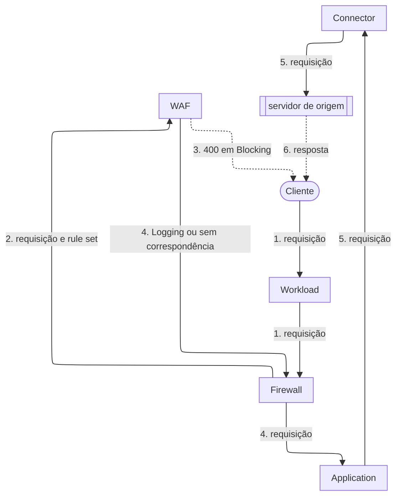

import DocButton from '~/components/webkit/DocButton.vue'
import DocCardGroup from '@aziontech/webkit/doc-card-group'
import DocCard from '@aziontech/webkit/doc-card'

**Web Application Firewall (WAF)** é um recurso da plataforma aninhado ao [Firewall](/pt-br/documentacao/plataforma/firewall/) que detecta ataques nas requisições aos seus [Workloads](/pt-br/documentacao/plataforma/workloads/) e as recusa ou registra. Um [firewall de aplicação web](https://www.azion.com/pt-br/learning/websec/o-que-e-firewall-aplicacao-web/) compara query string, headers, cookies e corpo de cada requisição com padrões de ataque conhecidos e interrompe as que correspondem. Use WAF para recusar SQL injection, cross-site scripting e command injection em query strings, cookies e corpos de requisição, ou registrá-los durante o ajuste.

WAF trabalha com duas entidades próprias:

- [Rule sets](/pt-br/documentacao/plataforma/firewall/waf/rule-sets/) definem as famílias de ameaças que WAF pontua e a sensibilidade de cada uma, que decide quanta evidência uma correspondência exige. Se você usou um rule set gerenciado em outro lugar, as categorias dele são as famílias, o rigor dele é a sensibilidade, e a Azion mantém as regras internas.
- [Exceções](/pt-br/documentacao/plataforma/firewall/waf/custom-allowed-rules/) isentam uma parte de uma requisição, como um cookie ou o valor de uma query string, de uma regra interna. Escreva uma para uma requisição legítima que uma regra confunde com um ataque, em vez de baixar a sensibilidade de uma família para todas as requisições.

<DocButton href="/pt-br/documentacao/plataforma/firewall/waf/primeiros-passos/" label="Primeiros passos" size="medium" />
<DocButton href="/pt-br/documentacao/plataforma/firewall/waf/referencia/" label="Referência do WAF" kind="secondary" size="medium" />

---

## Caminho da requisição

Ativar WAF e criar um rule set deixam toda requisição sem score. WAF pontua uma requisição apenas quando uma regra do Firewall que corresponde a ela carrega um comportamento _Set WAF_. Esse comportamento aplica um rule set em um modo, _Logging_ ou _Blocking_.

O diagrama acompanha uma requisição por uma regra com um comportamento _Set WAF_. As setas contínuas levam a requisição, e as setas pontilhadas levam a resposta. Cada rótulo começa com o número da sua etapa.

1. Um cliente requisita um domínio de um Workload, cujo deployment define o Firewall e a [Application](/pt-br/documentacao/plataforma/applications/). O Firewall inspeciona a requisição primeiro.
2. O Firewall executa as suas regras em ordem. Quando uma regra com um comportamento _Set WAF_ corresponde, WAF pontua a requisição contra cada família de ameaças do rule set, um score por família.
3. Em _Blocking_, uma requisição cujo score alcança o limite da sua família recebe `400` e a página de erro padrão da Azion, com o título **Bad Request**. Nada na resposta nomeia WAF, e a Application nunca recebe a requisição.
4. Em _Logging_, essa requisição continua, e o evento dela no [Real-Time Events](/pt-br/documentacao/plataforma/real-time-events/) registra a correspondência. Uma regra interna ainda recusou um corpo multipart malformado em _Logging_ nos testes, como mostra [Score e modos](/pt-br/documentacao/plataforma/firewall/waf/score-e-modos/#modos). Uma requisição que não alcança nenhum limite continua em qualquer modo, pelas regras seguintes, até a Application.
5. A Application envia a requisição para um [Connector](/pt-br/documentacao/plataforma/connectors/), cujo servidor de origem responde. Em testes, WAF não pontuou nenhuma requisição em uma Application sem Connector.
6. A resposta do servidor de origem chega ao cliente.

Para ver como um score alcança o seu limite e o que cada nível de sensibilidade troca, consulte [Score e modos](/pt-br/documentacao/plataforma/firewall/waf/score-e-modos/#score-e-sensibilidade).

---

## Próximos passos

<DocCardGroup cols={2}>
  <DocCard title="Primeiros passos" href="/pt-br/documentacao/plataforma/firewall/waf/primeiros-passos/" label="Crie um rule set, aplique-o com uma regra e veja WAF bloquear uma requisição." />
  <DocCard title="Score e modos" href="/pt-br/documentacao/plataforma/firewall/waf/score-e-modos/" label="Veja como WAF pontua uma requisição, o que cada modo faz com uma correspondência e qual Set WAF se aplica." />
  <DocCard title="Rules Engine para Firewall" href="/pt-br/documentacao/plataforma/firewall/rules-engine/#set-waf" label="Consulte os campos do comportamento Set WAF e os erros que uma regra recebe." />
  <DocCard title="Guias e tutoriais" href="/pt-br/documentacao/plataforma/firewall/guias/" label="Faça uma tarefa específica, da verificação do modo do WAF a uma exceção para o valor de uma query string." />
  <DocCard title="Boas práticas" href="/pt-br/documentacao/plataforma/firewall/boas-praticas/#waf" label="Mantenha um rule set por ambiente e trate cada exceção como temporária." />
  <DocCard title="Limites" href="/pt-br/documentacao/plataforma/firewall/limites/#waf" label="Consulte um limite de um rule set ou de uma exceção e a resposta que uma chamada recebe além dele." />
  <DocCard title="Solução de problemas" href="/pt-br/documentacao/plataforma/firewall/solucao-de-problemas/#waf" label="Descubra por que WAF recusa uma requisição legítima, ou por que nenhuma requisição é bloqueada." />
  <DocCard title="Glossário" href="/pt-br/documentacao/plataforma/firewall/glossario/" label="Consulte uma palavra como rule set, limite ou falso positivo." />
</DocCardGroup>
