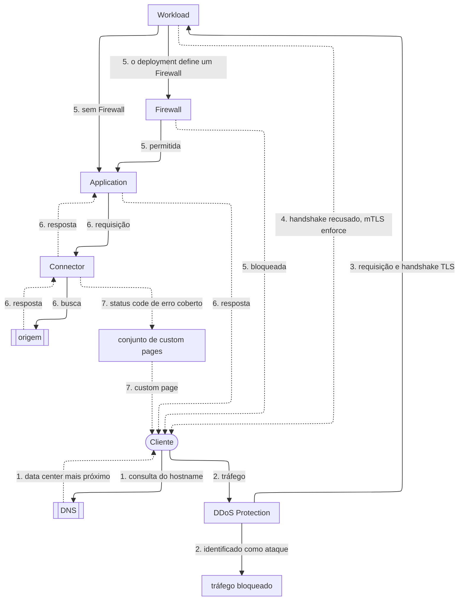
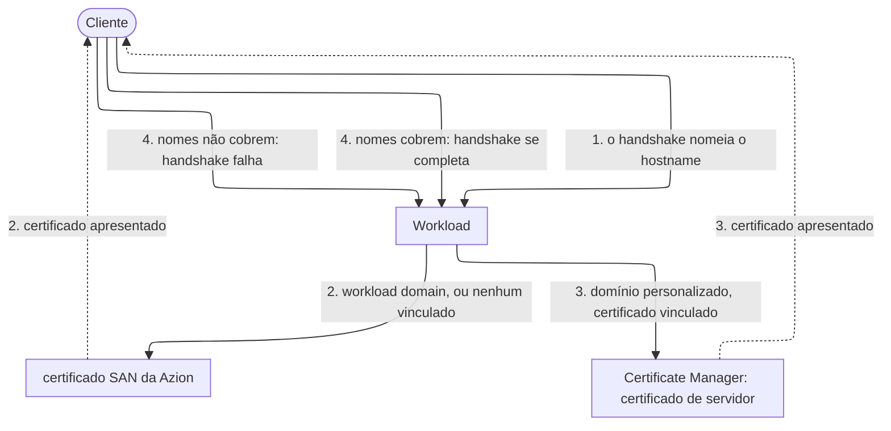
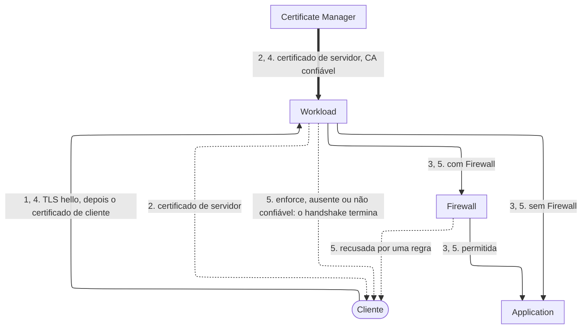
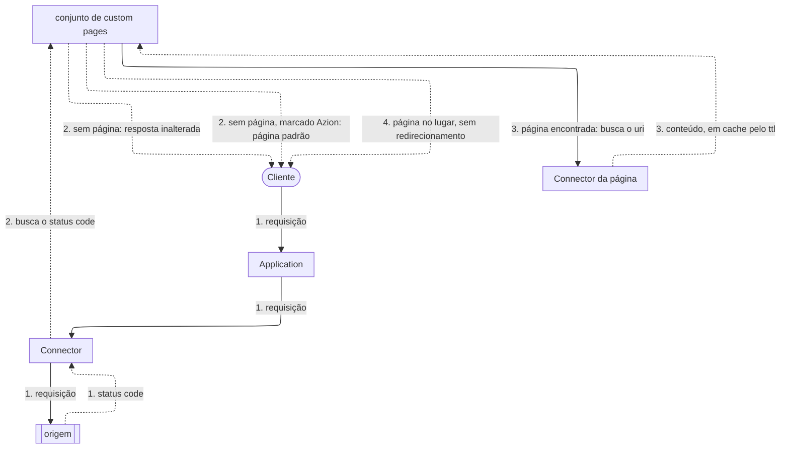
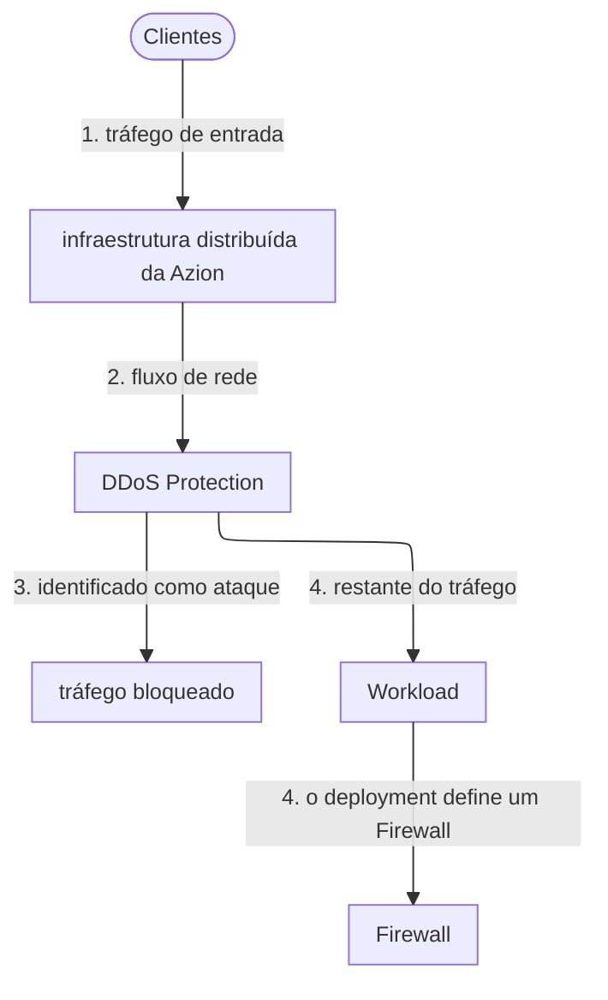

import FrameBox from '@aziontech/webkit/frame-box'
import ItemList from '@aziontech/webkit/item-list'
import DocItem from '@aziontech/webkit/doc-item'

Antes que um site responda a uma requisição, três coisas acontecem:

1. Uma consulta de Domain Name System (DNS) transforma o hostname em um endereço.
2. O cliente abre uma conexão segura, na qual o servidor prova que tem um certificado para esse nome.
3. O servidor escolhe a configuração que responde ao hostname. Essa configuração é o ponto de entrada do site.

Só depois disso algum código da aplicação é executado.

Na Azion, esse ponto de entrada é um Workload. [Workloads](/pt-br/documentacao/plataforma/workloads/) é um recurso da plataforma que recebe as requisições feitas aos seus domínios, na infraestrutura distribuída da Azion. Um Workload guarda os hostnames pelos quais uma requisição pode chegar, as configurações de TLS da conexão e as portas e versões HTTP que aceita. O deployment do Workload define a [Application](/pt-br/documentacao/plataforma/applications/) que responde e, opcionalmente, o [Firewall](/pt-br/documentacao/plataforma/firewall/) que inspeciona as requisições primeiro e o conjunto de custom pages que substitui as respostas de erro. Na API v3, um objeto Domains guardava os hostnames e o certificado, e as Main Settings de uma Application guardavam as configurações de protocolo e de TLS. Na API v4, o Workload e o deployment dele os substituem, e [Migração para API v4](/pt-br/documentacao/fundamentos/api-v4-migration/) mapeia os dois modelos.

Esta página cobre os mecanismos, não os campos: cada campo está em [Configurações de Workload](/pt-br/documentacao/plataforma/workloads/configuracoes/), e cada limite está em [Limites de Workloads](/pt-br/documentacao/plataforma/workloads/limites/). As seções cobrem, nesta ordem, o caminho que uma requisição percorre, o workload domain e os domínios personalizados, a infraestrutura, TLS e as versões HTTP, o deployment e a propagação. Certificate Manager, Custom Pages e DDoS Protection fecham a página, nessa ordem.

---

## O caminho que uma requisição percorre

Uma requisição chega a um Workload pelo hostname que o cliente pede. Esse hostname é o workload domain que a Azion gera ou um hostname dos domínios do Workload. Antes que a Application receba a requisição, o Workload completa o handshake TLS e, com o [TLS mútuo (mTLS)](/pt-br/documentacao/plataforma/workloads/mtls/) ativado, verifica o certificado do cliente. Quando o deployment desse Workload define um Firewall, as regras desse Firewall são executadas em seguida. A Application recebe apenas as requisições que passaram por cada uma dessas verificações.

Este diagrama acompanha uma requisição, da consulta DNS até a resposta. As setas contínuas levam a requisição, e as setas pontilhadas levam o que volta ao cliente. Cada rótulo começa com o número do passo a que pertence.



1. O cliente consulta o hostname. Para um domínio personalizado que aponta para o workload domain, o DNS retorna o endereço do data center da infraestrutura distribuída da Azion mais próximo ao cliente.
2. O cliente se conecta a esse data center. Ali, DDoS Protection inspeciona o tráfego antes que o Workload o veja, e a Azion mitiga o tráfego que identifica como ataque.
3. O Workload que lista o hostname recebe a requisição. Ele completa o handshake TLS com o certificado, a versão mínima de TLS e o conjunto de cifras dele.
4. Com o mTLS ativado, o Workload também verifica o certificado do cliente. No modo `enforce`, um cliente não consegue completar o handshake sem um certificado que a autoridade certificadora (CA) em que você confia assinou.
5. Quando o deployment define um Firewall, as regras desse Firewall avaliam a requisição antes da Application e podem bloqueá-la. Sem Firewall, a requisição segue direto para a Application.
6. A Application que o deployment define executa as regras dela sobre a requisição. Quando uma regra define um [Connector](/pt-br/documentacao/plataforma/connectors/), esse Connector encaminha a requisição à sua origem. A resposta volta pela Application até o cliente.
7. Quando o Connector responde com um status code de erro que o conjunto de custom pages do deployment cobre, o cliente recebe a custom page no lugar dessa resposta.

Manter o Workload separado da Application permite que os hostnames e as configurações de TLS mudem sem alterar o código da sua aplicação. O preço é que o caminho de uma requisição depende de duas entidades. Um Workload sem deployment [propagado](/pt-br/documentacao/plataforma/workloads/como-funciona/#propagacao) não tem Application para onde enviar a requisição, e uma Application não serve tráfego até que o deployment de um Workload defina essa Application.

---

## Workload domain e domínios personalizados

Um hostname é o nome que um cliente pede, e um Workload responde apenas aos hostnames que lista. Criar um Workload gera o seu _workload domain_: um hostname somente leitura na zona `azionedge.net`. A forma dele depende da [infraestrutura](/pt-br/documentacao/plataforma/workloads/como-funciona/#infraestrutura) do Workload: `<id>.map.azionedge.net` em produção e `<id>.preview.azionedge.net` em staging. O Workload serve tráfego nesse hostname assim que o seu deployment se propaga, antes que você tenha ou aponte qualquer domínio.

Mais dois tipos de hostname entram nos domínios do Workload: um hostname `azion.app` e um domínio personalizado.

### O hostname azion.app

O hostname gratuito em `azion.app`, como `my-site.azion.app`, é o que Azion Console chama de **Azion Custom Domain**. Um Workload guarda no máximo um, e um nome que outro Workload já guarda não está disponível. A Azion o serve por HTTPS com o certificado SAN da Azion. Esse certificado é da própria Azion e lista os hostnames que cobre como Subject Alternative Names (SANs). Então, o hostname `azion.app` não precisa de nenhum certificado seu.

### Domínios personalizados

Um domínio personalizado é um hostname de um domínio que você já tem, como `www.example.com`. Você lista cada um no Workload e, depois, o aponta para o workload domain com um registro CNAME no seu provedor de DNS. Quando [Edge DNS](/pt-br/documentacao/plataforma/edge-dns/) hospeda a zona do domínio, Edge DNS pode ligar o domínio à Azion. No Azion Console, você pode, então, selecionar o domínio dessa zona no campo **Domain** do Workload. A conta precisa ter permissão para todo domínio que o Workload lista, e a API recusa um domínio sem essa permissão. Para essa recusa, consulte [Solucione problemas de Workloads](/pt-br/documentacao/plataforma/workloads/solucao-de-problemas/#um-dominio-e-recusado-com-this-account-is-not-allowed-to-use-the-following-cnames).

:::caution[Atenção]
Um domínio personalizado só serve HTTPS com um certificado de servidor que o cubra. O certificado SAN da Azion cobre o workload domain, que fica em uma zona que a Azion compartilha com outros clientes, e o hostname `azion.app`. Ele não cobre nenhum domínio seu. Para o certificado, consulte [O certificado](/pt-br/documentacao/plataforma/workloads/como-funciona/#o-certificado).
:::

Por exemplo, um site que roda em `www.example.com` em outro provedor passa para a Azion com três mudanças. Você adiciona `www.example.com` aos domínios do Workload, vincula um certificado de servidor que o cobre e substitui o registro DNS dele por um CNAME para o workload domain. Os visitantes alcançam o Workload assim que os resolvers deles obtêm o novo registro. Para os registros DNS passo a passo, consulte [Aponte um domínio para um workload](/pt-br/documentacao/guias/plataforma/migracao/apontar-dominio-para-a-azion/).

### Acesso ao workload domain

O workload domain continua acessível ao lado dos seus próprios hostnames enquanto `workload_domain_allow_access` é `true`, que é o padrão. Azion Console chama essa configuração de **Workload Domain Allow Access**. Defina-a como `false` quando o Workload precisar responder apenas nos seus próprios hostnames: o workload domain passa a responder `404`, enquanto os seus domínios continuam servindo. Um Workload não pode fechar o seu workload domain sem outro hostname em que responder, então a API recusa essa mudança em um Workload cuja lista de domínios está vazia. Para as regras que a API aplica a cada hostname, consulte [Configurações de Workload](/pt-br/documentacao/plataforma/workloads/configuracoes/#dominios).

---

## Infraestrutura

A infraestrutura de um Workload é a rede que o serve. A rede de produção dá disponibilidade global em toda a infraestrutura distribuída da Azion, e a rede de staging serve para testes, com propagação limitada. Você escolhe a infraestrutura ao criar o Workload, no campo `infrastructure` da API. A escolha também define o sufixo do workload domain: `.map.azionedge.net` em produção e `.preview.azionedge.net` em staging. Para a mesma escolha no Azion Console, consulte [Configurações de Workload](/pt-br/documentacao/plataforma/workloads/configuracoes/#infraestrutura).

Um Workload de staging não aceita hostname `azion.app` nem domínio personalizado, então você o alcança apenas pelo workload domain dele. As mudanças que você faz nele não afetam um Workload de produção.

Porque um Workload de staging não aceita domínio personalizado, um teste no seu próprio hostname usa um Workload de produção que lista esse hostname. O teste acontece antes que os registros DNS do hostname mudem. O arquivo hosts do seu dispositivo mapeia o hostname para o endereço do workload domain, e todos os outros visitantes continuam alcançando o provedor atual. Para os passos, consulte [Teste uma aplicação pelo arquivo hosts](/pt-br/documentacao/guias/desenvolvimento-de-aplicacoes/primeiros-passos/testar-edge-application-atraves-do-arquivo-hosts/).

A infraestrutura é fixada na criação, e a API recusa uma atualização que a altere. Por exemplo, uma configuração que você testou em um Workload de staging chega à produção como um segundo Workload, criado com a infraestrutura de produção, não como uma edição do primeiro. O preço dessa divisão é que staging e produção são dois Workloads com dois deployments, que você mesmo mantém em sincronia.

---

## TLS e versões HTTP

Transport Layer Security (TLS) é o protocolo que criptografa a conexão entre o cliente e o Workload. No handshake desse protocolo, o Workload apresenta um certificado para o hostname, e o cliente e o Workload combinam uma versão de TLS e uma cifra. As configurações `tls` do Workload guardam esse certificado, a versão mínima de TLS que o Workload aceita e o conjunto de cifras que ele oferece. Essas configurações protegem o trecho do cliente até a Azion. A conexão da Azion até a sua origem é definida no [Connector](/pt-br/documentacao/plataforma/connectors/) que a Application usa.

### O certificado

O certificado que o Workload apresenta vem de um de dois lugares. Com [`tls.certificate`](/pt-br/documentacao/plataforma/workloads/#estrutura-do-workload) definido como `null`, o Workload apresenta o certificado SAN da Azion, que cobre o workload domain e o hostname `azion.app`. Para um domínio seu, você vincula um certificado de servidor do [Certificate Manager](/pt-br/documentacao/plataforma/workloads/#certificate-manager), e o Workload apresenta esse certificado para esse domínio. A API não compara os nomes do certificado com os domínios do Workload, então aceita um certificado que não os cobre. Verifique os nomes antes de vincular um certificado.

Este diagrama acompanha o certificado, do Workload até a verificação do cliente. As setas contínuas levam o handshake do cliente e a escolha do certificado, e as setas pontilhadas levam o certificado de volta. Cada rótulo começa com o número do passo a que pertence.



1. O cliente abre o handshake TLS e nomeia o hostname que quer.
2. Para o workload domain, ou com `tls.certificate` definido como `null`, o Workload apresenta o certificado SAN da Azion.
3. Para um domínio personalizado, com um certificado de servidor vinculado em `tls.certificate`, o Workload apresenta esse certificado.
4. O cliente verifica se os nomes do certificado cobrem o hostname que pediu. Uma divergência só aparece neste passo, como um handshake que falha.

### Versão mínima de TLS e conjunto de cifras

A versão mínima de TLS e o conjunto de cifras decidem quais clientes conseguem completar o handshake. A versão mínima é a mais baixa que o Workload aceita, então uma sessão ainda pode usar uma versão mais nova. O conjunto de cifras é uma lista nomeada de cifras, e o cliente e o Workload negociam uma cifra dela para cada sessão. Uma versão mínima mais alta recusa clientes que suportam apenas versões mais antigas, e uma mais baixa os admite, até o TLS 1.0. O TLS 1.0 e o TLS 1.1 estão descontinuados. Para as cifras que cada conjunto contém, consulte [Conjuntos de cifras](/pt-br/documentacao/plataforma/workloads/configuracoes/#conjuntos-de-cifras).

### Clientes sem SNI

Server Name Indication (SNI) é a extensão de TLS na qual um cliente nomeia o host que quer durante o handshake. Uma conexão sem SNI alcança a configuração padrão da Azion, que apresenta o certificado SAN da Azion, então um domínio servido com um certificado vinculado depende do SNI. Em um Workload com mTLS no modo `enforce`, a Azion fecha essa conexão antes que ela chegue à sua aplicação, e o cliente não recebe resposta. Para os demais requisitos do mTLS, consulte [mTLS](/pt-br/documentacao/plataforma/workloads/mtls/#requisitos).

### HTTP/3

O HTTP/3 roda sobre QUIC, e um cliente o alcança por meio de um upgrade. Na primeira requisição, o handshake e a resposta usam TCP com HTTP/1.1 ou HTTP/2. A resposta carrega um header `Alt-Svc` que anuncia o HTTP/3. Um navegador que suporta HTTP/3 envia, então, as requisições seguintes por QUIC, até que a resposta `Alt-Svc` em cache falte ou expire. A API aceita `http3` nas versões HTTP de um Workload apenas junto com `http1` e `http2`. No Azion Console, **HTTP/3 support** também exige que **HTTPS support** esteja ativado.

---

## O deployment

Um Workload guarda hostnames e configurações de TLS, mas nenhuma Application. Um deployment é a parte de um Workload que define a Application, que é obrigatória, e, opcionalmente, um Firewall e um conjunto de custom pages. No Azion Console, esses são os campos **Application**, **Firewall** e **Custom Page** de **Deployment Settings**.

Um Workload recebe o Firewall dele somente pelo deployment: o Firewall não tem domínio próprio, e os campos do Workload não definem nenhum Firewall. Até que o deployment de um Workload defina um Firewall, as regras desse Firewall não veem nenhuma requisição a esse Workload. O mesmo vale para um conjunto de custom pages: um Workload usa um conjunto de custom pages somente depois que o deployment desse Workload define esse conjunto.

Um Workload guarda no máximo um deployment, e a API recusa um segundo. Então, todo hostname do Workload alcança a mesma Application e, quando o deployment os define, o mesmo Firewall e o mesmo conjunto de custom pages. Mudar qualquer um deles significa editar esse único deployment, e a edição vale para todos os hostnames do Workload. Uma mudança no deployment se propaga como qualquer outra mudança do Workload, como descreve [Propagação](/pt-br/documentacao/plataforma/workloads/como-funciona/#propagacao).

Até que um deployment se propague, uma requisição ao workload domain recebe `404` com a página de erro HTML da Azion, e um header `x-azion-request-id` identifica a requisição:

```bash
curl -sI https://<your-workload-domain>/
```

Os headers da resposta são:

```text
HTTP/2 404 
server: nginx
date: <date>
content-type: text/html
x-azion-request-id: <request-id>
x-azion-edge-location: <edge-location>
```

Para os campos do deployment, consulte [Configurações de Workload](/pt-br/documentacao/plataforma/workloads/configuracoes/#deployment).

---

## Propagação

Uma mudança salva em um Workload ou no deployment dele só alcança o tráfego depois de se propagar. A propagação espalha a mudança pela infraestrutura distribuída da Azion, data center por data center, e leva vários minutos. A Azion não garante uma duração para a propagação.

Enquanto uma mudança se espalha, as requisições podem receber a configuração antiga ou a nova, dependendo do data center que responde. Cada data center serve uma configuração ou a outra, e a parcela de data centers na nova cresce até que todos concordem. Por exemplo, logo depois que o mTLS é ativado no modo `enforce`, um cliente sem certificado ainda pode receber `200` de um data center que não tem a mudança. Enquanto isso, um data center que a tem recusa o handshake do mesmo cliente.

Então, uma única requisição logo depois de uma mudança prova pouco. Verifique uma mudança repetindo a requisição até que ela responda como esperado e as respostas concordem. O preço de uma propagação sem duração garantida é que nenhuma mudança é atômica. Projete cada mudança para que a configuração antiga e a nova possam servir lado a lado. Por exemplo, mantenha o workload domain aberto até que os seus próprios hostnames respondam em todos os lugares e, depois, defina `workload_domain_allow_access` como `false`.

---

## Certificate Manager

[Certificate Manager](/pt-br/documentacao/plataforma/workloads/#certificate-manager) é um recurso da plataforma que armazena os certificados que um Workload usa para TLS. Um certificado de servidor é um certificado TLS para os seus próprios domínios, que o Workload apresenta para provar que detém um hostname. Você o envia com a chave privada dele, ou a Azion o solicita ao Let's Encrypt e o renova para você. Um certificado de CA confiável é o certificado de uma autoridade certificadora (CA) em que você confia para assinar certificados de cliente. Certificate Manager também armazena listas de revogação de certificados (CRLs) e cria solicitações de assinatura de certificado (CSRs).

Um Workload usa um certificado apenas depois que você o vincula. Um certificado de servidor vai em [`tls.certificate`](/pt-br/documentacao/plataforma/workloads/#estrutura-do-workload), um certificado de CA confiável vai em `mtls.config.certificate`, e as CRLs vão em `mtls.config.crl`. A API recusa um certificado enviado no campo destinado ao outro tipo. Um certificado enviado fica `inactive` até que você o vincule a um Workload, e `active` a partir de então, então o status mostra se algum Workload o usa.

### Onde Certificate Manager age sobre uma requisição

Certificate Manager age durante o handshake TLS, antes que um Firewall ou uma Application veja a requisição.

Este diagrama acompanha um handshake, do hello do cliente até a requisição que continua, com os certificados que Certificate Manager fornece. As setas contínuas levam o handshake e a requisição, e as setas pontilhadas levam o que volta ao cliente. A seta grossa leva os certificados que você vinculou antes da requisição. Cada rótulo começa com o número do passo a que pertence.



1. O cliente abre uma conexão TLS com um dos hostnames do Workload e nomeia esse hostname por SNI.
2. O Workload apresenta o certificado de servidor dele. Para o workload domain, ou com `tls.certificate` definido como `null`, esse é o certificado SAN da Azion. Para um domínio personalizado com um certificado de servidor vinculado, é esse certificado.
3. Com o mTLS desativado, o handshake se completa, e a requisição continua até a Application, pelo Firewall quando o deployment define um Firewall.
4. Com o mTLS ativado, o Workload solicita um certificado de cliente e o verifica contra o certificado de CA confiável em `mtls.config.certificate`.
5. No modo `enforce`, um cliente sem certificado, ou com um certificado que outra autoridade assinou, não consegue completar o handshake. No modo `permissive`, o handshake se completa. Quando o deployment define um Firewall, uma regra que testa a variável Client Certificate Validation pode recusar a requisição.

Armazenar os certificados separados do Workload permite substituir um deles sem editar as outras configurações do Workload. O preço é que o certificado e o Workload são verificados separadamente. A API aceita um certificado cujos nomes não cobrem os domínios do Workload, e vincular um certificado é uma mudança do Workload que se propaga ao longo de vários minutos. Para saber como `enforce` e `permissive` tratam cada cliente, consulte [mTLS](/pt-br/documentacao/plataforma/workloads/mtls/#modos-de-verificacao).

Para saber como a Azion solicita um certificado Let's Encrypt, conclui o desafio dele e o renova, consulte [Emissão e renovação](/pt-br/documentacao/plataforma/workloads/certificate-manager/emissao-e-renovacao/).

---

## Custom Pages

Quando uma origem não encontra um recurso, ou não responde a tempo, o cliente recebe uma resposta de erro, como `404` ou `504`. Uma custom page substitui essa resposta por um conteúdo que você escolhe, para um status code de cada vez.

[Custom Pages](/pt-br/documentacao/plataforma/workloads/#custom-pages) é um recurso da plataforma que substitui por uma página sua a resposta de erro retornada por um Connector, uma página por status code de erro. Um conjunto de custom pages é a lista nomeada que agrupa essas páginas. Uma página do tipo `page_connector` define um Connector e o caminho do conteúdo da página nesse Connector. Ela também define o tempo que o conteúdo fica em cache e um status code opcional para a resposta. Uma página só pode substituir um status code de uma lista fixa de status codes de erro de cliente (4xx) e de erro de servidor (5xx). Um Workload usa um conjunto de custom pages somente depois que o deployment desse Workload define esse conjunto.

### Onde Custom Pages age sobre uma requisição

Uma custom page age depois que a Application recebe uma resposta da origem. O status code dessa resposta diz se a requisição teve sucesso e decide se uma página se aplica.

Este diagrama acompanha uma resposta, do status code do Connector até o que o cliente recebe. As setas contínuas levam as requisições, e as setas pontilhadas levam as respostas. Cada rótulo começa com o número do passo a que pertence.



1. A Application envia a requisição à origem por um Connector, e o Connector responde com um status code.
2. A Azion procura uma página com esse status code no conjunto de custom pages que o deployment define. Quando o conjunto não tem página para o status code, o cliente recebe a resposta do Connector sem alteração. Para alguns status codes, o cliente recebe nesse caso a página padrão da Azion. Azion Console marca esses status codes como _Azion_.
3. Quando uma página corresponde, a Azion busca o conteúdo dela no Connector da página, no `uri` da página, e o mantém em cache pelo `ttl` da página.
4. O cliente recebe esse conteúdo no lugar da resposta, sem redirecionamento e sem header `Location`. O status é o `custom_status_code` da página, quando definido.

Por exemplo, a sua origem responde `404` para a página de um produto removido. Uma página para o status code `404` serve, então, o documento do `uri` dela, como `/myerrors/404.html`, ainda com o status `404`. O navegador permanece na URL que pediu e mostra a sua página. O preço do cache é que uma página editada só alcança os clientes depois que o `ttl` dela expira. Um `ttl` longo poupa a sua origem, e um curto incorpora as edições mais cedo.

Para os campos de um conjunto e das suas páginas, e para os status codes que uma página pode substituir, consulte [Configurações de custom page](/pt-br/documentacao/plataforma/workloads/custom-pages/configuracoes/).

---

## DDoS Protection

Um ataque de negação de serviço (DoS) inunda um serviço com tráfego até que as requisições legítimas não consigam passar. Ele pode vir de um único endereço IP. Um ataque distribuído de negação de serviço (DDoS) envia esse tráfego de uma botnet de muitas máquinas ao mesmo tempo. Mitigar um ataque significa distinguir o tráfego de ataque do tráfego real antes que qualquer um deles alcance o serviço, e descartar o primeiro.

[DDoS Protection](/pt-br/documentacao/plataforma/workloads/#ddos-protection) é uma feature da Azion Platform que mitiga esses ataques em todo Workload. Ela está sempre ativa e não precisa de ativação nem de configuração. A Azion realiza a mitigação sem afetar a performance das suas aplicações. Ela se aplica quer a sua origem rode on-premise, quer em uma nuvem, e quer a sua rede seja IPv4, IPv6 ou ambos.

### Onde DDoS Protection age sobre uma requisição

DDoS Protection age na infraestrutura distribuída da Azion, antes que o Workload receba o tráfego. Ela monitora continuamente o fluxo de rede do tráfego de entrada e avalia cada requisição em busca de um ataque DoS ou DDoS. Quando o deployment do Workload define um Firewall, as regras desse Firewall só são executadas depois dessa avaliação.

Este diagrama acompanha o tráfego de entrada, da sua chegada até o Workload. As setas contínuas levam o tráfego. Cada rótulo começa com o número do passo a que pertence.



1. O tráfego de qualquer Workload alcança a infraestrutura distribuída da Azion.
2. DDoS Protection inspeciona o fluxo de rede com algoritmos de detecção que encontram ataques pequenos de um único endereço IP e ataques em larga escala de botnets.
3. A Azion mitiga o tráfego que identifica como ataque.
4. O restante do tráfego continua até o Workload. Quando o deployment define um Firewall, esse Firewall executa as regras dele em seguida.

Porque a mitigação não precisa de configuração, um Workload fica protegido desde o momento em que existe, e você não tem nada para ajustar. O preço é que a defesa automática é a mesma para todo Workload. Para detecção e mitigação voltadas a um ataque específico, você escreve regras personalizadas no [Firewall](/pt-br/documentacao/plataforma/firewall/) que o deployment define. Para saber onde os registros de ataques aparecem, consulte [Visibilidade de ataques](/pt-br/documentacao/plataforma/workloads/ddos-protection/ddos-mitigation/#visibilidade-de-ataques).

Para os ataques que DDoS Protection mitiga e as técnicas que usa, consulte [Mitigação de ataques](/pt-br/documentacao/plataforma/workloads/ddos-protection/ddos-mitigation/).

---

## Recursos relacionados

<FrameBox>
<ItemList>
  <DocItem title="Configurações de Workload" href="/pt-br/documentacao/plataforma/workloads/configuracoes/">Cada campo de um Workload e do seu deployment, com o tipo, o padrão e os valores permitidos por trás dos mecanismos desta página.</DocItem>
  <DocItem title="Primeiros passos com Workloads" href="/pt-br/documentacao/plataforma/workloads/primeiros-passos/">Crie um Workload, defina uma Application no deployment dele e envie a sua primeira requisição pelo workload domain dele.</DocItem>
  <DocItem title="mTLS" href="/pt-br/documentacao/plataforma/workloads/mtls/">Como um Workload verifica certificados de cliente nos modos enforce e permissive, e o que cada cliente recebe.</DocItem>
  <DocItem title="Solucione problemas de Workloads" href="/pt-br/documentacao/plataforma/workloads/solucao-de-problemas/">Sintomas ao longo do caminho da requisição, de um domínio que responde 404 a um handshake que falha, com as suas causas e correções.</DocItem>
</ItemList>
</FrameBox>
