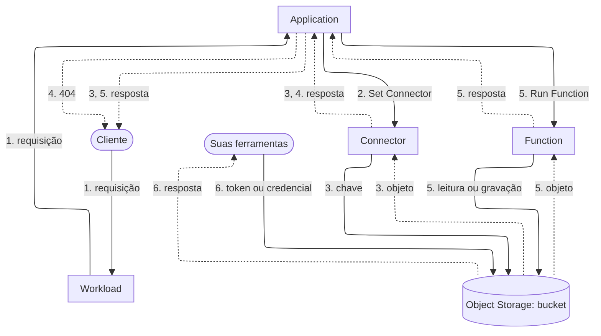

import FrameBox from '@aziontech/webkit/frame-box'
import ItemList from '@aziontech/webkit/item-list'
import DocItem from '@aziontech/webkit/doc-item'

Um object store é um serviço de armazenamento que guarda cada arquivo como um objeto, sob uma chave de sua escolha. Uma gravação sempre guarda um objeto inteiro, e uma leitura pode devolver o objeto todo ou um intervalo dos bytes dele. As chaves podem parecer caminhos, e o contêiner continua plano: uma pasta é só o começo comum de várias chaves.

Na Azion, [Object Storage](/pt-br/documentacao/plataforma/object-storage/) é o recurso da plataforma que armazena arquivos como objetos em buckets. Um objeto carrega sua chave, seu conteúdo e o content type com que é servido. Um bucket guarda objetos diretamente, e um bucket não fica aninhado dentro de outro. Azion Console, a API da Azion, a Azion CLI, a biblioteca `@aziontech/storage` e o protocolo S3 gerenciam os objetos, e as suas [Applications](/pt-br/documentacao/plataforma/applications/) os servem.

Esta página cobre os mecanismos, não os valores. Os campos e seus limites estão em [Buckets e objetos](/pt-br/documentacao/plataforma/object-storage/buckets-e-objetos/), e a superfície S3 está em [Compatibilidade com S3](/pt-br/documentacao/plataforma/object-storage/compatibilidade-s3/). As seções abaixo cobrem o objeto e sua chave, o caminho da requisição, os níveis de acesso, a entrega de objetos e a exclusão.

---

## O objeto e sua chave

Um upload nomeia o bucket e a chave e envia o conteúdo como corpo da requisição. Não existe uma sequência de criar e depois gravar: o objeto existe quando a requisição é bem-sucedida e não existe antes disso.

A chave é o endereço inteiro. Ela pode conter a barra. A API da Azion, Azion Console e o protocolo S3 leem um segmento inicial comum como prefixo, então `src/assets/logo.svg` aparece agrupado sob `src` e `src/assets`. Um prefixo existe só enquanto existe uma chave sob ele: aparece com a primeira chave e sai da listagem com a última.

O custo dessa ausência de hierarquia é que renomear ou mover um objeto o regrava. A API da Azion não tem uma operação de renomear, então você copia o objeto para a nova chave e exclui a antiga. Azion Console renomeia e move objetos com a mesma cópia e exclusão, então mover um prefixo regrava todos os objetos sob ele.

Gravar em uma chave que já está em uso substitui o objeto que a API da Azion devolve. Uma Application devolve o objeto novo quando não guarda mais uma cópia em cache do antigo. Nenhuma requisição atualiza parte de um objeto, e nenhuma configuração ativa o versionamento.

Pelo protocolo S3, `ListObjectVersions` ainda lista a versão anterior, e `GetObject` a lê pelo ID da versão, por um prazo que você não define. Então um objeto que precisa continuar recuperável depois de uma alteração é gravado sob uma nova chave, em geral uma que carrega uma versão.

O content type é fixado no upload a partir do header `Content-Type`. Quando um upload pela API da Azion não envia nenhum, a Azion detecta o tipo pela extensão da chave. Um objeto cuja chave não tem extensão recebe `application/octet-stream`. O tipo é armazenado junto com o objeto e retornado em toda leitura, então um objeto enviado com o content type errado continua sendo servido com o tipo errado até ser gravado de novo.

---

## O caminho da requisição

Dois caminhos levam aos mesmos objetos, e só o caminho de gerenciamento exige um token ou uma credencial.

O _caminho de gerenciamento_ é toda interface com que você gerencia objetos. Ele reúne Azion Console, a API da Azion, a Azion CLI, a biblioteca `@aziontech/storage` e o protocolo S3. A API da Azion, a CLI e a biblioteca enviam um personal token, e o protocolo S3 assina cada requisição com uma credencial S3. A API da Azion e o endpoint S3 recusam com `401` uma requisição que não traz nenhum dos dois.

Um token alcança todos os buckets da conta. Uma credencial S3 alcança os buckets que ela nomeia, ou todos os buckets quando não nomeia nenhum.

O _caminho de entrega_ passa por um Workload e por uma Application, e é por ele que os seus usuários alcançam um objeto. O diagrama segue uma requisição para `https://www.example.com/assets/logo.svg` no caminho de entrega, e uma requisição das suas próprias ferramentas no caminho de gerenciamento. As setas contínuas levam a requisição, e as setas pontilhadas levam a resposta. Cada rótulo começa com o número do passo correspondente abaixo.

1. O cliente envia a requisição ao [Workload](/pt-br/documentacao/plataforma/workloads/) que guarda `www.example.com`, e o Workload a passa para a Application que o deployment desse Workload define.
2. Uma regra da Application corresponde à requisição e define um [Connector](/pt-br/documentacao/plataforma/connectors/) do tipo `storage` com o behavior _Set Connector_.
3. O Connector pede ao bucket a chave formada pelo prefixo dele, quando ele tem um, seguido do caminho da requisição. A Application devolve o objeto com o content type guardado com ele.
4. Quando o bucket não guarda nenhum objeto com essa chave, o cliente recebe `404`.
5. No lugar de definir um Connector, uma regra pode executar uma [Function](/pt-br/documentacao/plataforma/functions/). A Function lê ou grava objetos pela [API do runtime](/pt-br/documentacao/devtools/runtime/api-reference/storage/) e devolve a própria resposta.
6. As suas ferramentas alcançam o mesmo bucket pelo caminho de gerenciamento, com um token ou uma credencial S3.

Criar um bucket não publica nenhum objeto: só o caminho de gerenciamento os alcança até que uma regra defina um Connector ou execute uma Function.

O prefixo de um Connector decide onde começa o caminho da Application, então um Connector com o prefixo `src/assets` serve o objeto `src/assets/logo.svg` em `/logo.svg`. 
:::caution[Atenção]
Sem prefixo, uma requisição para `/` que chega ao Connector devolve uma lista XML das chaves dos objetos do bucket, sem credenciais. Uma regra que redireciona `/` esconde essa lista, como explicam os [Limites do Object Storage](/pt-br/documentacao/plataforma/object-storage/limites/#escopo).
:::

Uma Function lê e grava objetos pela API do runtime durante uma requisição. É assim que uma Application serve um objeto sobre o qual precisa decidir antes, como um objeto atrás de uma verificação de autenticação.

---

## Níveis de acesso

O `workloads_access` de um bucket decide o que um Connector e uma Function das suas Applications podem fazer com os objetos dele. É uma propriedade do bucket, não de uma requisição.

| Valor | Um Connector | Uma Function |
| --- | --- | --- |
| `read_only` | Lê objetos e recusa toda gravação | Lê e lista objetos, e não grava |
| `read_write` | Lê objetos, exclui um no `DELETE` e recusa `PUT` e `POST` | Lê, grava, lista e exclui objetos |
| `restricted` | Responde `502` a toda requisição | Não alcança o bucket |

O nível governa apenas o caminho de entrega. Um personal token, ou uma credencial S3 com a capability `writeFiles`, grava em um bucket em qualquer nível, `restricted` incluído. Então um pipeline de deploy pode gravar em um bucket `read_only` que os seus usuários só podem ler.

O custo de `read_write` recai sobre o Connector, que exclui um objeto em qualquer requisição `DELETE` que chega a ele. Então um bucket em que uma Function grava não leva Connector, e um bucket que um Connector serve fica `read_only`. `restricted` remove o caminho de entrega por inteiro, e não é possível criar um Connector para um bucket `restricted`.

Uma troca de nível leva algum tempo para chegar ao Connector e à Function. Até lá, uma requisição pode receber o comportamento antigo ou o novo. Confira o nível novo com uma requisição antes de depender dele.

---

## Entrega de objetos

Os [Termos de Serviço](/pt-br/documentacao/contratos/tds/) dizem que os objetos devem chegar aos seus usuários finais por uma Application que usa Connectors. Eles também sujeitam o acesso direto aos objetos, fora de uma Application, a rate limits.

Uma URL pré-assinada carrega uma assinatura S3, então o endpoint S3 entrega o objeto a quem tiver a URL. Essa requisição não passa por nenhuma Application, então é um acesso direto.

Servir os mesmos objetos por uma Application coloca as regras dela na frente deles, como um redirecionamento de `/` que esconde a listagem do bucket. Com as configurações padrão de uma Application nova, um objeto substituído é servido de imediato, e a resposta não traz headers de cache. [Cache](/pt-br/documentacao/plataforma/applications/cache/) documenta as cache settings que uma Application pode aplicar.

O custo é a configuração: o endpoint S3 responde a uma URL pré-assinada logo após a assinatura, e uma Application precisa antes da regra dela. Essa configuração é o que o caminho de entrega compra.

---

## Exclusão e o período de carência

Excluir um objeto é assíncrono e acontece em etapas. A API da Azion aceita a requisição com `202`, a chave sai da listagem de imediato e uma leitura retorna `404`. Uma Application também retorna `404`, quando não guarda mais uma cópia em cache do objeto.

O objeto em si é retido por um período de carência de 24 horas antes de ser removido permanentemente. Pelo protocolo S3, `GetObject` ainda o lê pelo ID da versão.

O período de carência é a razão pela qual um bucket esvaziado não pode ser excluído de imediato. Um bucket é excluído apenas quando não guarda nenhum objeto e nenhum foi removido dele nas últimas 24 horas, e os dois casos retornam o mesmo erro. Um bucket que nunca guardou um objeto é excluído na hora.

Um bucket que um Connector referencia não pode ser excluído: a API da Azion responde `409` `17016` e nomeia esse Connector no erro.

---

## Recursos relacionados

<FrameBox>
<ItemList>
  <DocItem title="Buckets e objetos" href="/pt-br/documentacao/plataforma/object-storage/buckets-e-objetos/">Os campos por trás de cada mecanismo desta página, com as operações e os erros.</DocItem>
  <DocItem title="Boas práticas" href="/pt-br/documentacao/plataforma/object-storage/boas-praticas/">O que fazer sobre substituição, níveis de acesso e entrega, e o que cada escolha custa.</DocItem>
  <DocItem title="Usar um bucket como origem" href="/pt-br/documentacao/guias/desenvolvimento-de-aplicacoes/dados/bucket-como-connector/">O procedimento que constrói o caminho de entrega, do Connector até a regra.</DocItem>
  <DocItem title="Limites do Object Storage" href="/pt-br/documentacao/plataforma/object-storage/limites/">Os limites dentro dos quais esses mecanismos operam e o que acontece depois de cada um.</DocItem>
</ItemList>
</FrameBox>
